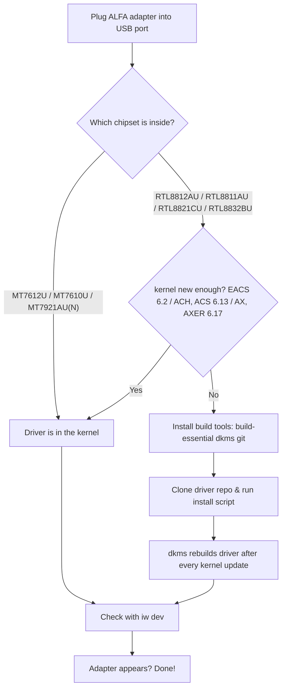

# ALFA 無線網路卡在 Ubuntu 上的完整設定指南

> **學習目標（Learning goal）**：完成本指南後，你的 ALFA 無線網路卡將能在 Ubuntu 中顯示（`iw dev`）、連上 Wi-Fi，並且——針對支援的晶片——可以切換到監聽模式（monitor mode）。
> **適用物件**：初學者–中階 ｜ **前置需求**：Ubuntu 24.04（GA kernel 6.8 內建 ACM、ACHM、AXM、AXML、EACS；HWE 6.14 再加上 ACH、ACS；AX 與 AXER 需 **kernel 6.17 以上**；ASUS GX10 + kernel 6.17.0-1014-nvidia 實測）；kernel 低於該卡內建版本時，Realtek 機型另需 DKMS（EACS < 6.2、ACH / ACS < 6.13、AX / AXER < 6.17）。需要網路連線（安裝套件需要它！），以及你的 ALFA 無線網路卡。

## 概念：兩種情況（依 kernel 版本）

在碰終端機之前，先了解*為什麼*不同環境的設定會不同。這裡有兩種情況：

1. **kernel ≥ 6.17：全部內建**（各卡最低版本：ACM / ACHM 4.19、AXM / AXML 5.18、EACS 6.2、ACH / ACS 6.13、AX / AXER 6.17）——九款無線網路卡的驅動程式都已編譯進核心，插上 → 即可使用，**不需要 DKMS**。MediaTek：**MT7612U**（AWUS036ACM，`mt76x2u`）、**MT7610U**（AWUS036ACHM，`mt76x0u`）、**MT7921AU / MT7921AUN**（AWUS036AXM / AXML，`mt7921u`，核心 5.18+ 即內建）；Realtek：**RTL8812AU**（ACH，`rtw88_8812au`）、**RTL8811AU**（ACS，`rtw88_8821au`）、**RTL8821CU**（EACS，`rtw88_8821cu`）、**RTL8832BU**（AX / AXER，`rtw89_8852bu`）。ASUS GX10 / Ubuntu 24.04 + kernel 6.17.0-1014-nvidia 實測。
2. **舊 kernel：只有內建版本高於你 kernel 的 Realtek 機型需要 DKMS**（EACS < 6.2、ACH / ACS < 6.13、AX / AXER < 6.17）——這些驅動程式不在你的核心內，所以你編譯一次社群驅動程式，之後 **DKMS** 會在每次核心更新後自動重新建置。MediaTek 機型不受影響。



## 前置需求

- [ ] Ubuntu 24.04（kernel 不低於你那張卡的內建版本，用 `lsb_release -a` 與 `uname -r` 確認；GA 6.8 涵蓋 ACM、ACHM、AXM、AXML、EACS，HWE 6.14 再加上 ACH、ACS，GX10 的 6.17.0-1014-nvidia 涵蓋全部九款）；kernel 較舊時 Realtek 機型另需 DKMS（步驟 3）
- [ ] 可用的網路（Wi-Fi 或乙太網路）以下載套件
- [ ] 你的 ALFA 無線網路卡與一條 USB-A 或 USB-C 傳輸線（AXML 使用 USB-C）
- [ ] `sudo` 權限

## 步驟 1：確認你的晶片

插上無線網路卡，然後問 Ubuntu 它看到了什麼：

```bash
lsusb
```

**預期輸出**（尋找 MediaTek / Realtek 那一行）：

```text
Bus 001 Device 004: ID 0e8d:7612 MediaTek Inc. MT7612U 802.11a/b/g/n/ac 2T2R Wireless Adapter
Bus 001 Device 005: ID 0bda:8812 Realtek Semiconductor Corp. RTL8812AU 802.11a/b/g/n/ac 2T2R Wireless Adapter
```

- `0e8d` = MediaTek（內建於核心）
- `0bda` = Realtek（kernel 夠新時內建：EACS ≥ 6.2、ACH / ACS ≥ 6.13、AX / AXER ≥ 6.17；較舊 kernel 才走 DKMS 路徑）
- 不確定？在[相容性矩陣](/alfa-network/linux-compatibility-matrix/)中交叉比對晶片表。

## 步驟 2：內建於核心的路徑（kernel 不低於該卡內建版本：隨插即用）

先確認 kernel：`uname -r`（GX10 實測為 `6.17.0-1014-nvidia`）。kernel 不低於該卡內建版本時（GX10 的 6.17 涵蓋全部九款）什麼都不用安裝；MediaTek 機型在較舊 kernel 也同樣內建。驗證：

```bash
lsusb | grep -iE 'mediatek|realtek'
sudo dmesg | grep -iE 'mt76|mt7921|rtw88|rtw89' | tail -5
```

接著：

```bash
iw dev
```

**預期輸出**：

```text
phy#0
	Interface wlan0
		ifindex 3
		addr 00:c0:ca:xx:xx:xx
		type managed
```

看到 `wlan0`（或 `wlx...` 介面）了嗎？恭喜——驅動程式已生效。透過桌面 Wi-Fi 選單或 NetworkManager 連線：

```bash
nmcli device wifi connect "MySSID" password "my-passphrase"
```

**預期輸出**：`Device 'wlan0' successfully activated with 'MySSID'.`

跳到[步驟 4：驗證一切](#step-4-verify-everything)。

## 步驟 3：DKMS 路徑（僅適用 kernel 低於該卡內建版本的 Realtek 機型）

> **僅適用 kernel 低於該卡內建版本時（ACH / ACS < 6.13、EACS < 6.2、AX / AXER < 6.17）。** kernel 夠新（例如 Ubuntu 24.04 + 6.17）請跳過本步驟，驅動程式已內建。

針對舊 kernel 上的 RTL8812AU（AWUS036ACH）、RTL8811AU（AWUS036ACS）、RTL8821CU（AWUS036EACS，社群 `brektrou/rtl8821CU`，詳見[驅動程式頁面](/alfa-network/drivers/rtl8821cu/)）與 RTL8832BU（AWUS036AX / AXER），建置一次驅動程式。遵循相同模式——安裝工具、複製 repo、執行安裝程式。

### 3.1 安裝建置工具

```bash
sudo apt update
sudo apt install -y build-essential dkms git
```

**預期輸出**：以 `Setting up dkms ...` 結尾且沒有錯誤。DKMS 就是在核心更新後負責重新編譯驅動程式的元件。

### 3.2 RTL8812AU（AWUS036ACH）— 僅 kernel < 6.13

最經得起考驗的 repo 由 aircrack-ng 專案維護：

```bash
cd /opt
sudo git clone https://github.com/aircrack-ng/rtl8812au.git
cd rtl8812au
sudo make dkms_install
```

**預期輸出**：

```text
DKMS: install completed.
```

模組現在是 `8812au`，DKMS 會在每次核心更新時重新建置它——你可以當它不存在。

### 3.3 RTL8811AU（AWUS036ACS）— 僅 kernel < 6.13

```bash
cd /opt
sudo git clone https://github.com/morrownr/8821au-20210708.git
cd 8821au-20210708
sudo sh install-driver.sh
```

**預期輸出**：腳本會使用 DKMS 建置並安裝驅動程式（請回答其提示，並在要求時重新啟動）——模組名稱 `8821au`。

### 3.4 RTL8832BU（AWUS036AX / AWUS036AXER）— 僅 kernel < 6.17

```bash
cd /opt
sudo git clone https://github.com/morrownr/rtl8852bu-20250826.git
cd rtl8852bu-20250826
sudo sh install-driver.sh
```

**預期輸出**：腳本會使用 DKMS 建置並安裝驅動程式（請回答其提示，並在要求時重新啟動）——模組名稱 `8852bu`。（kernel ≥ 6.17 的內建驅動程式 `rtw89_8852bu` 實測支援 monitor 與封包注入。）

拔下再重新插上無線網路卡（或執行 `sudo modprobe <module>`），然後驗證：

```bash
iw dev
```

**預期輸出**：出現一行 `Interface wlan1`（如果它是你唯一的無線網路卡則為 `wlan0`）。

> **你可能會想問**——*「哪個模組名稱對應我的無線網路卡？」* 對照你的晶片：`8812au` → AWUS036ACH、`8821au` → AWUS036ACS、`8852bu` → AWUS036AX / AXER。[驅動程式頁面](/alfa-network/drivers/rtl8812au/) 有更深入的各晶片細節。

## 步驟 4：驗證一切 {#step-4-verify-everything}

三指令健康檢查（內建驅動程式（kernel 夠新時）與 DKMS 驅動程式皆適用）：

```bash
ip link show | grep -E "^[0-9]+: wl"        # interface exists?
iw dev                                       # interface + phy info
iw reg get | head -20                        # regulatory domain (affects power/channels)
```

**預期輸出**：

```text
3: wlan1: <BROADCAST,MULTICAST,UP,LOWER_UP> mtu 1500 qdisc mq state UP
phy#1
	Interface wlan1
		ifindex 3
		addr 00:c0:ca:xx:xx:xx
		type managed
```

三個指令都有輸出 = 你的 ALFA 無線網路卡已完全正常運作。

## 進階：監聽模式（支援的晶片）

監聽模式（monitor mode）讓無線網路卡擷取某個頻道上的所有封包，而不只是自己的連線。在內建驅動程式的晶片上，這是兩個指令的工作：

```bash
sudo ip link set wlan1 down
sudo iw wlan1 set monitor none
sudo ip link set wlan1 up
iw dev
```

**預期輸出**：`type monitor` 取代 `type managed`。

實測結果（ASUS GX10 / Ubuntu 24.04）：九款在 2.4 / 5 GHz 皆可進入 monitor（AX / AXER 接收強，AXM / AXML 接收弱）；封包注入除 AXM / AXML 外其餘七款皆通過（ACHM 在 5 GHz 僅廣播封包），AXM / AXML 的注入在 stock kernel 6.17 未通過。**請勿執行 `airmon-ng check kill`**（會關閉 NetworkManager）；5 GHz 注入前先 `sudo iw reg set US`，測完還原；ARM64 的 aircrack-ng 需自原始碼編譯；hcxdumptool 8.x 除 EACS（2.4 GHz 可啟動、5 GHz 失敗）外，其餘卡都 `failed to arm`，請改用 airodump-ng + aireplay-ng。

> ⚠️ **重要**：`type managed`（預設值）表示驅動程式會過濾掉所有不是傳送給你的流量。`type monitor` 會停用該過濾器——突然之間會有大量流量變得可見。只能在你自己擁有或已明確授權測試的網路上執行。完整的封包注入工作流程請見 [Kali 指南](/alfa-network/linux-setup-kali/)。

## 常見錯誤（FAQ）

| 錯誤 / 症狀 | 原因 | 修復 |
|---|---|---|
| `lsusb` 顯示無線網路卡但沒有 `wlanX` 介面（舊 kernel 的 Realtek DKMS） | DKMS 模組未載入（僅適用舊 kernel） | `sudo modprobe 8812au`（對應你的晶片），然後檢查 `dmesg \| tail` |
| `lsusb` 有 `0bda:c820` / `0e8d:7961` 但沒有 `wlx` 介面（EACS / AXML 重插） | BT+WiFi 複合裝置重插競態，WiFi probe 卡死 | 換一個 USB 孔重插 |
| `make dkms_install` 失敗並顯示 "Kernel preparation unnecessary"（僅適用舊 kernel 的 DKMS） | 缺少核心標頭檔 | `sudo apt install linux-headers-$(uname -r)` 後重試 |
| `apt upgrade` 後無線網路卡消失（僅適用舊 kernel 的 DKMS） | 核心更新，DKMS 重建靜默失敗 | `sudo dkms autoinstall` 然後重新開機 |
| 重新開機後 `iw dev` 什麼都沒有（舊 kernel 的 Realtek DKMS） | 模組不在自動載入清單中 | `echo 8812au \| sudo tee /etc/modules-load.d/alfa.conf` |
| 反覆切換模式後掃不到東西（RX stall） | 驅動程式已知現象 | 拔插網路卡復原 |
| Wi-Fi 6E 無線網路卡（AXML）在 20.04 上偵測不到 | 核心對 `mt7921u` 來說太舊（< 5.18） | 升級到 Ubuntu 24.04（kernel 6.17 實測） |

## 參考資料

- [本指南的 Kali Linux 版本](/alfa-network/linux-setup-kali/)——監聽模式 + 封包注入
- [晶片驅動程式頁面](/alfa-network/drivers/mt7612u/)——各晶片的深入探討
- [疑難排解索引](/alfa-network/troubleshooting/)——其他任何出錯的情況
- [相容性矩陣](/alfa-network/linux-compatibility-matrix/)——完整的作業系統涵蓋表
- 舊 kernel 的社群驅動程式 repos：[rtl8812au](https://github.com/aircrack-ng/rtl8812au)、[8821au-20210708](https://github.com/morrownr/8821au-20210708) (RTL8811AU)、[rtl8852bu-20250826](https://github.com/morrownr/rtl8852bu-20250826) (RTL8832BU)