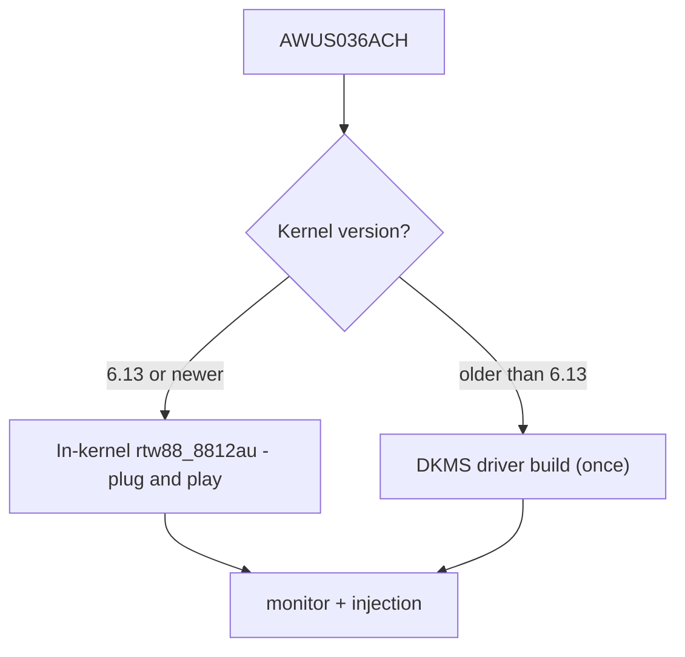

# ALFA AWUS036ACH——高功率 AC1200

> **一句話定位（Quick Summary）**：**AWUS036ACH** 是 ALFA 最有名的無線網路卡——一支**高功率 RTL8812AU AC1200 雙頻** USB 3.0 dongle，配兩支 5 dBi 外接天線。在 **kernel 6.13 或更新版本**由內建的 `rtw88_8812au` 驅動程式支援：插上即可用，不需 DKMS。已在 ASUS GX10 / Ubuntu 24.04 ARM64 實測：雙頻監聽與注入（100%）、端到端 handshake 擷取、WPA3 AP（2.4 GHz）。只有較舊的 kernel（< 6.13）才需要社群 DKMS 驅動程式。僅限在自有或已授權的網路使用。

## 規格總覽 (Spec overview)

| 項目 | 規格 |
|---|---|
| 晶片 | Realtek RTL8812AU |
| Wi-Fi 等級 | AC1200（300 + 867 Mbps） |
| 介面 | USB 3.0 |
| 頻段 | 2.4 + 5 GHz |
| 天線 | 2 × 外接 5 dBi，RP-SMA |
| TX 功率 | 高功率（500 mW 等級） |
| Linux 驅動程式 | `rtw88_8812au`——**kernel ≥ 6.13 內建**；較舊的 kernel（< 6.13）：社群 `rtl8812au` DKMS |
| 監聽模式 | ✅ 2.4 + 5 GHz（GX10 實測） |
| 封包注入 | ✅ 2.4 與 5 GHz 皆 100%（GX10 實測） |

## 實測：ASUS GX10 / Ubuntu 24.04 ARM64

**測試環境**：ASUS Ascent GX10（NVIDIA GB10）、Ubuntu 24.04 LTS ARM64、kernel `6.17.0-1014-nvidia`，測試日期 2026-11-16 至 2026-11-19，測試裝置為 iPhone 7 Plus（WPA3 另用 iPhone 15 Pro）。

| 項目 | 結果 |
|---|---|
| 晶片 | Realtek RTL8812AU |
| USB ID | `0bda:8812` |
| 核心驅動程式 | `rtw88_8812au`（內建於核心） |
| 韌體 | `rtw88/rtw8812a_fw.bin`（linux-firmware） |
| 是否需要 DKMS | 否（kernel ≥ 6.13 不需要） |

| 功能 | 2.4 GHz | 5 GHz |
|---|---|---|
| Monitor | ✅ | ✅ |
| Injection | ✅ 100% | ✅ 100% |
| AP 熱點 | ✅ | ✅ |
| WPA3-SAE（AP 端，`sae_pwe=0`） | ✅ | 未測試 |

| 進階功能 | 結果 |
|---|---|
| WPA handshake 擷取 | ✅ 端到端（已轉出 `.22000`） |
| VIF | ✅ STA + monitor |
| Active monitor | ❌ `Operation not supported (-95)` |
| IBSS（Ad-hoc） | 🟡 僅單機驗證 |
| Mesh（802.11s） | ❌ `-95` |
| Wi-Fi Direct（P2P） | ❌ `-95` |

在你自己的機器上驗證：

```bash
lsusb | grep 0bda:8812
lsusb -t | grep rtw88_8812au
sudo dmesg | grep -iE 'rtw88_8812au|8812' | tail -5
iw phy $(cat /sys/class/net/$(ls /sys/class/net | grep '^wlx' | head -1)/phy80211/name) info | sed -n '/Supported interface modes/,/Band 1/p'
iw dev
```

完整測試報告：[AWUS036ACH 於 ASUS GX10 / Ubuntu 的實測報告](https://yupitek.com/zh-tw/blog/awus036ach-asus-gx10-ubuntu-test-report/)。

**備註**：
- 請直接插在 USB 3.0 連接埠（`lsusb -t` 顯示 `5000M`），不要接 USB 2.0 hub。
- 反覆切換模式或法規網域後，5 GHz RX 可能卡死（收到 0 個封包，只有重新插拔才能恢復）。請在剛插上卡之後立刻做 5 GHz 測試。
- 5 GHz 注入前請先執行 `sudo iw reg set US`，測完再還原你原本的區域設定。
- AP：停用 802.11n（純 g / 純 a）後，iPhone 7 Plus 第一次就連上。WPA3 需要 `sae_pwe=0` 才能讓 iPhone 7 Plus 連上。
- 6 GHz：不適用。Kali 與 NetHunter：未實機測試。

## 總覽

AWUS036ACH 是替 ALFA 打下「駭客無線網路卡」名聲的那一支。它把老牌的 **RTL8812AU** 無線電搭配真正的**高功率（500 mW）前端**與兩支可更換的 5 dBi 天線，裝在你一眼就認得的黃黑色 ALFA 外殼裡。背後是 aircrack-ng 社群多年的打磨，而在 kernel 6.13 以後，這些成果已進入主線的 `rtw88_8812au` 驅動程式。

在較舊的 kernel 上，RTL8812AU **不在 Linux 核心裡**，因此需要做一次性的 DKMS 建置——這就是這張卡在舊作業系統上，與隨插即用的 [AWUS036ACM](/alfa-network/products/awus036acm/) 之間的差別。

## 安裝與驅動程式

**Kernel 6.13 或更新版本（例如 Ubuntu 24.04 + HWE 6.14 / GX10 的 6.17）**：不需要安裝任何東西。內建的 `rtw88_8812au` 會自動綁定——請用上方實測區塊的指令驗證，或參考 [RTL8812AU 驅動程式頁面](/alfa-network/drivers/rtl8812au/)。

### 較舊的 kernel（僅限 < 6.13）：DKMS

以下建置**只適用於 6.13 以前的 kernel**。完整步驟請見 [RTL8812AU 驅動程式頁面](/alfa-network/drivers/rtl8812au/)：

```bash
sudo apt install -y build-essential dkms git
cd /opt && sudo git clone https://github.com/aircrack-ng/rtl8812au.git
cd rtl8812au && sudo make dkms_install
sudo modprobe 8812au
```

**預期輸出**：`DKMS: install completed.`，然後 `iw dev` 中出現介面。（這條舊 kernel 路徑未在 GX10 上執行過。）



## 進階使用

### 監聽模式 + 注入

在 GX10／桌機上不要執行 `airmon-ng check kill`（會關閉 NetworkManager），請改用 `iw`：

```bash
IF=$(ls /sys/class/net | grep '^wlx' | head -1)
sudo nmcli dev set $IF managed no
sudo ip link set dev $IF down
sudo iw dev $IF set type monitor
sudo ip link set dev $IF up
sudo iw dev $IF set channel 6
sudo aireplay-ng --test --ignore-negative-one $IF
```

**預期輸出**：`Injection is working!` 與 `30/30: 100%`。（`--ignore-negative-one` 用來避開 station 介面開著時，頻道被回報為 `-1` 的現象；5 GHz 請先執行 `sudo iw reg set US`。）

### 更換天線以增加距離

RP-SMA 連接埠可接任何 [ALFA 天線](/alfa-network/products/apa-m25/)——換成面板天線或更高增益的偶極天線，可擴大這顆 500 mW 無線電的涵蓋距離。

## 相容性

| 平臺 | 支援 | 注意事項 |
|---|---|---|
| Ubuntu 24.04 ARM64（GX10，kernel 6.17） | ✅ 已實測 | 內建 `rtw88_8812au`，不需 DKMS |
| Linux kernel ≥ 6.13 | ✅ | 內建於核心 |
| Linux kernel < 6.13（較舊的 Ubuntu/Kali） | 🔧 | 需要社群 DKMS 驅動程式 |
| Kali Linux | ✅（我們未實機測試） | kernel ≥ 6.13 時內建於核心 |
| NetHunter / Android | 🔧 | 未測試；取決於手機的 kernel |
| Windows | 我們未測試 | ALFA 官方驅動程式 |
| macOS | 我們未測試 | 需要驅動程式；Apple Silicon 支援有限 |

## 疑難排解

| 症狀 | 原因 | 修復 |
|---|---|---|
| （僅 kernel < 6.13）DKMS 建置失敗 | 新 kernel 與過期的原始碼庫不相容 | `cd /opt/rtl8812au && sudo git pull && sudo make dkms_install` |
| （僅 kernel < 6.13）卡只能在 managed 模式 | 核心的替代驅動程式先佔用了它 | 將衝突的模組列入黑名單（見[驅動程式頁面](/alfa-network/drivers/rtl8812au/)） |
| 5 GHz 擷取收到 0 個封包 | 多次切換模式／法規網域後 RX 卡死 | 拔下再插回 |
| 注入 0/30 | 空頻道 | `sudo iw $IF set channel 6`；在 AP 附近測試 |
| 5 GHz 注入被擋 | 法規網域 | `sudo iw reg set US`，之後還原 |
| （僅 kernel < 6.13）重開機後消失 | 模組未自動載入 | 將 `8812au` 加到 `/etc/modules-load.d/alfa.conf` |

## 相關資源

- [RTL8812AU 驅動程式頁面](/alfa-network/drivers/rtl8812au/)——設定與深入疑難排解
- [Kali 設定指南](/alfa-network/linux-setup-kali/)
- [AWUS036ACM](/alfa-network/products/awus036acm/)——MediaTek 內建驅動的替代款
- [無線網路卡比較](/alfa-network/wifi-adapter-comparison/)
- [相容性矩陣](/alfa-network/linux-compatibility-matrix/)
