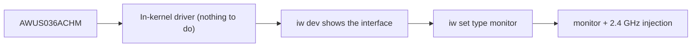

# ALFA AWUS036ACHM——平價雙頻 AC600

> **一句話定位（Quick Summary）**：**AWUS036ACHM** 是平價雙頻 ALFA——一支 **MT7610U AC600** 無線網路卡，配一支可拆卸的 5 dBi 雙頻天線，而且關鍵的是**內建於核心的驅動程式**（自 Linux 4.19 起的 `mt76x0u`）。已在 ASUS GX10 / Ubuntu 24.04 ARM64（kernel 6.17）實測：2.4/5 GHz 監聽、2.4 GHz 注入（96–100%）、AP 模式、WPA3 熱點（僅 AP 端；WPA3 用戶端未測試），以及在自有網路上的端到端 WPA handshake 擷取皆可用。僅限在自有或已授權的網路使用。

## 規格總覽 (Spec overview)

| 項目 | 規格 |
|---|---|
| 晶片 | MediaTek MT7610U |
| Wi-Fi 等級 | AC600（150 + 433 Mbps） |
| 介面 | USB 2.0 |
| 頻段 | 2.4 + 5 GHz |
| 天線 | 1 × 可拆卸 5 dBi 雙頻偶極天線，RP-SMA |
| Linux 驅動程式 | `mt76x0u`——**自 4.19 起內建於核心** |
| 監聽模式 | ✅ 2.4 + 5 GHz（GX10 實測） |
| 封包注入 | ✅ 2.4 GHz 96–100%；5 GHz 僅廣播（GX10 實測） |

## 實測：ASUS GX10 / Ubuntu 24.04 ARM64

**測試環境**：ASUS Ascent GX10（NVIDIA GB10）、Ubuntu 24.04 LTS ARM64、kernel `6.17.0-1014-nvidia`，測試日期 2026-11-16 至 2026-11-19，測試裝置為 iPhone 7 Plus（WPA3 另用 iPhone 15 Pro）。

| 項目 | 結果 |
|---|---|
| 晶片 | MediaTek MT7610U |
| USB ID | `0e8d:7610` |
| 核心驅動程式 | `mt76x0u`（內建於核心） |
| 韌體 | `mt7610u.bin`（linux-firmware） |
| 是否需要 DKMS | 否（kernel ≥ 4.19 內建，不需要） |

| 功能 | 2.4 GHz | 5 GHz |
|---|---|---|
| Monitor | ✅ | ✅ |
| Injection | ✅ 96–100% | ⚠️ 僅廣播 |
| AP 熱點 | ✅（純 802.11g） | ✅（純 802.11a，20 MHz） |
| WPA3-SAE（AP 端） | ✅（`sae_pwe=0`） | 未測試 |

| 進階功能 | 結果 |
|---|---|
| WPA handshake 擷取 | ✅ 於自有網路端到端實測（在 5 GHz ch36 擷取：deauth 自有 iPhone 7 Plus、擷取完整 4-way M1–M4、轉出 hashcat `.22000`） |
| VIF | ✅ |
| Active monitor | 🟡 可設定，ACK 未驗證 |
| IBSS（Ad-hoc） | 🟡 僅單機驗證 |
| Mesh（802.11s） | 🟡 僅單機驗證 |
| Wi-Fi Direct（P2P） | 未測試（需第二台設備） |

在你自己的機器上驗證：

```bash
lsusb | grep 0e8d:7610
sudo dmesg | grep mt76x0u | tail -3
iw phy $(cat /sys/class/net/$(ls /sys/class/net | grep '^wlx' | head -1)/phy80211/name) info | sed -n '/Supported interface modes/,/Band 1/p'
iw dev
```

完整測試報告：[AWUS036ACHM 於 ASUS GX10 / Ubuntu 的實測報告](https://yupitek.com/zh-tw/blog/awus036achm-asus-gx10-ubuntu-test-report/)。

**備註**：
- 單天線 1×1 無線網路卡（AC600 等級）。我們未將它與 ACM 做吞吐量對比；STA+AP VIF 測試在 5 GHz 連線下的下載速度為 198 Mbit/s。
- 開 AP 時要停用 802.11n：2.4 GHz 用純 `hw_mode=g`，5 GHz 用純 `hw_mode=a`。若保留 `ieee80211n=1`，iPhone 會關聯失敗並顯示「密碼錯誤」。
- WPA3 需要 `sae_pwe=0`；使用 `sae_pwe=2` 時 iPhone 7 Plus 連不上。
- 5 GHz 逐台注入回應率未取得（廣播注入可用）。
- 6 GHz：不適用。Kali 與 NetHunter：未實機測試。

## 總覽

ACHM 是 [AWUS036ACM](/alfa-network/products/awus036acm/) 的「小弟」。它使用 **1×1 MT7610U** 無線電，所以 AC600 的速度上限大約只有 ACM 的 AC1200 的一半——但在大學生真正需要它做的兩件事上，它的表現毫不遜色：

1. **它在核心裡。** 沒有 DKMS、不需編譯、不會「升級後壞掉」。在 Ubuntu 或 Kali 上插上，介面就存在。
2. **監聽模式 + 注入可用**，走的是標準 `mac80211` 路徑，要感謝 MediaTek 的主線驅動程式。

如果你的課程作業是「擷取並分析 Wi-Fi 管理訊框」或「示範封包注入」，ACHM 能以 ALFA 產品線中最低的價格完成。若你想要 2×2 無線電，以及有實測數據的逐台 5 GHz 注入回應率（ACM 為 76%；ACHM 未取得），再改買 [ACM](/alfa-network/products/awus036acm/)。

## 安裝與驅動程式

因為驅動程式在核心裡，**不需要安裝任何東西**——請見 [MT7610U 驅動程式頁面](/alfa-network/drivers/mt7610u/)。驗證：

```bash
lsusb | grep -i mediatek
iw dev
```

**預期輸出**：

```text
Bus 003 Device 005: ID 0e8d:7610 MediaTek Inc. WiFi
phy#0
	Interface wlx00c0cababcd2
		ifindex 3
		type managed
```



## 進階使用

### 監聽模式（不需安裝）

在桌機／GX10 上不要執行 `airmon-ng check kill`（會關閉 NetworkManager），請改用 `iw`：

```bash
IF=$(ls /sys/class/net | grep '^wlx' | head -1)
sudo nmcli dev set $IF managed no
sudo ip link set dev $IF down
sudo iw dev $IF set type monitor
sudo ip link set dev $IF up
sudo iw dev $IF set channel 6
sudo aireplay-ng --test $IF
```

**預期輸出**：`Injection is working!`（實測 2.4 GHz 為 96–100%）。

### 天線升級

如果原廠偶極天線不夠用，RP-SMA 連接埠可以接 [ALFA 天線](/alfa-network/products/apa-m25/)——但要注意 1×1 無線電無法用兩支天線做 MIMO，所以為了距離請只接一支高增益天線。

## 相容性

| 平臺 | 支援 | 注意事項 |
|---|---|---|
| Ubuntu 24.04 ARM64（GX10，kernel 6.17） | ✅ 已實測 | 內建 `mt76x0u` |
| Kali Linux | ✅ 內建於核心（我們未實機測試） | |
| Ubuntu（其他版本） | ✅ | 自 4.19 起內建於核心 |
| NetHunter / Android | ✅ 內建於核心（我們未實機測試） | |
| Windows | 我們未測試 | ALFA 官方驅動程式 |
| Raspberry Pi / Jetson | 我們未測試 | 內建於核心驅動；僅在 GX10 上實測 |

## 疑難排解

| 症狀 | 原因 | 修復 |
|---|---|---|
| 不在 `lsusb` 中 | 電源 / 傳輸線 | 換連接埠 / 使用有供電的 hub——[疑難排解](/alfa-network/troubleshooting/) |
| 沒有介面 | 驅動程式未載入（罕見） | `sudo modprobe mt76x0u` |
| 吞吐量低於 2×2 的卡 | 1×1 硬體（AC600 等級） | 不是故障；我們未做吞吐量對比 |
| 注入失敗 | 空頻道 | `sudo iw $IF set channel 6` |
| iPhone 無法加入你的 AP（顯示「密碼錯誤」） | 啟用了 802.11n | 使用純 `hw_mode=g` / `hw_mode=a` |
| iPhone 7 Plus 無法加入 WPA3 AP | `sae_pwe=2` | 改設 `sae_pwe=0` |

## 相關資源

- [MT7610U 驅動程式頁面](/alfa-network/drivers/mt7610u/)
- [Ubuntu 設定指南](/alfa-network/linux-setup-ubuntu/)與 [Kali 設定指南](/alfa-network/linux-setup-kali/)
- [AWUS036ACM](/alfa-network/products/awus036acm/)——速度更快的兄弟款
- [無線網路卡比較](/alfa-network/wifi-adapter-comparison/)
