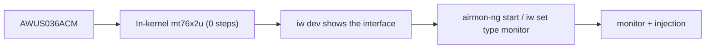

# ALFA AWUS036ACM——經典全能款（MT7612U）

> **一句話定位（Quick Summary）**：**AWUS036ACM** 是社群的預設推薦：一支**高功率 MT7612U AC1200** 雙頻無線網路卡，驅動程式（`mt76x2u`）**內建於 Linux 核心**。沒有 DKMS、不需編譯——在 Kali 或 Ubuntu 上插上，監聽模式（monitor mode）就能用。已在 ASUS GX10 / Ubuntu 24.04 ARM64（kernel 6.17）實測：2.4 與 5 GHz 的監聽與封包注入、AP 模式、WPA3-SAE 熱點（僅 AP 端；WPA3 用戶端未測試）以及端到端 WPA handshake 擷取皆通過。僅限在自有或已授權的網路使用。

## 規格總覽 (Spec overview)

| 項目 | 規格 |
|---|---|
| 晶片 | MediaTek MT7612U |
| Wi-Fi 等級 | AC1200（300 + 867 Mbps） |
| 介面 | USB 3.0 |
| 頻段 | 2.4 + 5 GHz |
| 天線 | 2 × 外接 5 dBi，RP-SMA |
| TX 功率 | 依模式而異為 19–23 dBm（約 100–200 mW），依 ALFA 規格表 |
| Linux 驅動程式 | `mt76x2u`——**自 4.19 起內建於核心** |
| 監聽模式 | ✅ 2.4 + 5 GHz（GX10 實測） |
| 封包注入 | ✅ 2.4 GHz 63–83%、5 GHz 76%（GX10 實測） |

## 實測：ASUS GX10 / Ubuntu 24.04 ARM64

**測試環境**：ASUS Ascent GX10（NVIDIA GB10）、Ubuntu 24.04 LTS ARM64、kernel `6.17.0-1014-nvidia`，測試日期 2026-11-16 至 2026-11-19，測試裝置為 iPhone 7 Plus（WPA3 另用 iPhone 15 Pro）。

| 項目 | 結果 |
|---|---|
| 晶片 | MediaTek MT7612U |
| USB ID | `0e8d:7612` |
| 核心驅動程式 | `mt76x2u`（內建於核心） |
| 韌體 | `mt7662.bin` + `mt7662_rom_patch.bin`（linux-firmware） |
| 是否需要 DKMS | 否（kernel ≥ 4.19 內建，不需要） |

| 功能 | 2.4 GHz | 5 GHz |
|---|---|---|
| Monitor | ✅ | ✅ |
| Injection | ✅ 63–83% | ✅ 76% |
| AP 熱點 | ✅ | ✅（80 MHz） |
| WPA3-SAE（AP 端） | ✅ | 未測試 |

| 進階功能 | 結果 |
|---|---|
| WPA handshake 擷取 | ✅ 於自有網路端到端實測（deauth 自有 iPhone 7 Plus、擷取完整 4-way M1–M4、轉出 hashcat `.22000`） |
| VIF | ✅ STA+AP / AP+monitor |
| Active monitor | 🟡 可設定，ACK 未驗證 |
| IBSS（Ad-hoc） | 🟡 僅單機驗證 |
| Mesh（802.11s） | 🟡 僅單機驗證 |
| Wi-Fi Direct（P2P） | 未測試（需第二台設備） |

在你自己的機器上驗證：

```bash
lsusb | grep 0e8d:7612
sudo dmesg | grep mt76x2u | tail -3
iw phy $(cat /sys/class/net/$(ls /sys/class/net | grep '^wlx' | head -1)/phy80211/name) info | sed -n '/Supported interface modes/,/Band 1/p'
iw dev
```

完整測試報告：[AWUS036ACM 於 ASUS GX10 / Ubuntu 的實測報告](https://yupitek.com/zh-tw/blog/awus036acm-asus-gx10-ubuntu-test-report/)。

**備註**：
- 已知問題：若先用這張卡連過 Wi-Fi 再切到監聽模式，只收得到上次連線的那個頻道。切換到監聽模式前請先拔下再插回。
- 2.4 GHz 開 AP 時以 20 MHz 運作正常；實測 HT40 無法連線。
- 在 GX10 上，`hcxdumptool` 8.x 無法啟動（arm 失敗，需要 active monitor）——請改用 `airodump-ng` + `aireplay-ng`。
- 6 GHz：不適用（本卡為 2.4/5 GHz 雙頻）。Kali 與 NetHunter：未實機測試。

## 總覽

AWUS036ACM 把 [AWUS036ACH](/alfa-network/products/awus036ach/) 出名的一切——2×2 AC1200、高功率、雙頻、兩支外接天線——拿來，並移除學生在舊版核心上最討厭的一件事：**DKMS 驅動程式建置**。ACM 的 MT7612U 是 Linux 核心的正式成員，所以：

- 插上 → 出現 `wlx…`（或 `wlan0`）介面。零指令。
- 沒有 DKMS → 核心更新時不會有東西壞掉。
- 監聽模式 + 注入 → 透過原廠 `mac80211` 工具運作。

這個組合就是為什麼它是「我是學生、我想要一支無線網路卡上資安課、我不想跟作業系統搏鬥」的答案——也是為什麼這本 wiki 在 [Ubuntu](/alfa-network/linux-setup-ubuntu/) 與 [Kali](/alfa-network/linux-setup-kali/) 指南中把它當成參考無線網路卡。

## 安裝與驅動程式

不需要安裝任何東西——完整細節請見 [MT7612U 驅動程式頁面](/alfa-network/drivers/mt7612u/)。快速驗證：

```bash
lsusb | grep -i mediatek
iw dev
```

**預期輸出**：

```text
Bus 003 Device 003: ID 0e8d:7612 MediaTek Inc. MT7612U 802.11a/b/g/n/ac Wireless Adapter
phy#0
	Interface wlx00c0cabf874c
		ifindex 3
		addr 00:c0:ca:xx:xx:xx
		type managed
```

（`00:c0:ca` 字首是 ALFA 的 MAC OUI——一個方便的實驗室識別技巧。在 GX10 上介面名稱為 `wlx` + MAC，例如 `wlx00c0cabf874c`。）



## 進階使用

### 監聽模式 + 注入

在 GX10 上，**不要**執行 `airmon-ng check kill`（會關閉 NetworkManager），請改用 `iw`：

```bash
IF=$(ls /sys/class/net | grep '^wlx' | head -1)
sudo nmcli dev set $IF managed no
sudo ip link set dev $IF down
sudo iw dev $IF set type monitor
sudo ip link set dev $IF up
sudo iw dev $IF set channel 6
sudo aireplay-ng --test $IF
```

**預期輸出**：`Injection is working!`（實測 2.4 GHz 為 63–83%、5 GHz 為 76%）。

### 天線升級

兩個 RP-SMA 連接埠代表你可以用[面板天線](/alfa-network/products/apa-m25/)做聚焦的長距離連結，或用雙高增益偶極天線做全向涵蓋——而且 2×2 無線電真的會用到兩個串流。

### Wireshark 擷取裝置

搭配 [Raspberry Pi 指南](/alfa-network/hardware/raspberry-pi/) 建立無頭、常開的擷取站。

## 相容性

| 平臺 | 支援 | 注意事項 |
|---|---|---|
| Ubuntu 24.04 ARM64（GX10，kernel 6.17） | ✅ 已實測 | 內建於核心，隨插即用 |
| Kali Linux | ✅ 內建於核心（我們未實機測試） | 預期免設定 |
| Ubuntu（其他版本） | ✅ | 自 mt76x2u 4.19 起內建於核心 |
| NetHunter / Android | ✅ 內建於核心（我們未實機測試） | 標準的 NetHunter 無線網路卡 |
| Windows | 我們未測試 | ALFA 官方驅動程式 |
| Raspberry Pi / Jetson | 我們未測試 | 內建於核心驅動；僅在 GX10 上實測 |

## 疑難排解

| 症狀 | 原因 | 修復 |
|---|---|---|
| 不在 `lsusb` 中 | 電源 / 傳輸線 | 換連接埠 / 使用有供電的 hub——[疑難排解](/alfa-network/troubleshooting/) |
| 沒有介面 | 驅動程式未載入（罕見） | `sudo modprobe mt76x2u`；檢查 `dmesg \| grep mt76` |
| 監聽模式只收得到一個頻道 | 切到監聽模式前，這張卡曾連過 Wi-Fi | 拔下再插回，然後再切換到監聽模式 |
| 注入 0/30 | 空頻道 / 無 RF 區域 | `sudo iw $IF set channel 6`；在 AP 附近測試；5 GHz 注入前先 `sudo iw reg set US`，測完還原為 `sudo iw reg set TW` |
| 反覆切換模式後，掃描/監聽收不到封包 | RX stall | 拔下再插回 |
| 暫停/恢復時 WLAN 失效 | 已知的筆電 USB 問題 | 恢復後拔下再插回 |

## 相關資源

- [MT7612U 驅動程式頁面](/alfa-network/drivers/mt7612u/)
- [Kali 設定指南](/alfa-network/linux-setup-kali/)
- [Ubuntu 設定指南](/alfa-network/linux-setup-ubuntu/)
- [NetHunter 設定指南](/alfa-network/linux-setup-nethunter/)
- [AWUS036AXM](/alfa-network/products/awus036axm/)——Wi-Fi 6 升級款（實測核心下無法注入；藍牙未測試）
- [無線網路卡比較](/alfa-network/wifi-adapter-comparison/)
