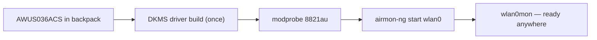

# ALFA AWUS036ACS——口袋尺寸雙頻 AC433

> **一句話摘要**：**AWUS036ACS** 是 55 mm 的口袋型 ALFA——一款 **RTL8811AU AC433** 雙頻網卡，配備一支可摺疊的 2 dBi 天線，並以 DKMS 驅動支援監聽模式。你會隨身攜帶它，因為「你永遠不知道什麼時候會想看看某個 Wi-Fi。」

## 規格總覽 (Spec overview)

| 項目 | 規格 |
|---|---|
| 晶片 | Realtek RTL8811AU |
| Wi-Fi 等級 | AC433（150 + 433 Mbps） |
| 介面 | USB 2.0 |
| 頻段 | 2.4 + 5 GHz |
| 天線 | 1 × 外接 2 dBi 雙頻偶極天線，RP-SMA |
| 機身 | 約 55 mm——口袋尺寸 |
| Linux 驅動程式 | `8821au`（DKMS，非核心內建） |
| 監聽模式 | ✅ 良好 |
| 封包注入 | ✅ 良好 |

## 總覽

ACS 是在不失去關鍵要素的前提下，將經典 ALFA 配方縮小的成果。它保留了雙頻、外接天線與可用的監聽模式，卻裝進能消失在筆電包裡的 **55 mm 機身**。其 1×1 RTL8811AU 無線電屬於 AC433 等級——足以進行管理框架擷取、注入示範與輕量分析，並坦白呈現其傳輸量的限制。

取捨與其他 Realtek 系列 ALFA 相同：驅動程式**不在核心內**，因此需要進行一次性的 DKMS 建置（之後核心更新時由它自動處理）。如果你希望完全不用處理驅動程式，可以多花一點錢選擇核心內建驅動的 [AWUS036ACM](/alfa-network/products/awus036acm/)。

## 安裝與驅動程式

完整細節請見 [RTL8811AU 驅動程式頁面](/alfa-network/drivers/rtl8811au/)。簡短版本：

```bash
cd /opt && sudo git clone https://github.com/morrownr/8821au-20210708.git
cd 8821au-20210708 && sudo sh install-driver.sh
sudo modprobe 8821au
```

**預期輸出**：`DKMS: install completed.`，之後 `iw dev` 中會出現一個介面。



## 進階用法

### 外出時的監聽模式

```bash
sudo airmon-ng check kill
sudo airmon-ng start wlan0
sudo aireplay-ng --test wlan0mon
```

**預期輸出**：`wlan0mon` + `30/30: 100%`。

### 旅行裝備

將可摺疊天線（運送途中保持接上）搭配 [Jetson](/alfa-network/hardware/jetson/) 或筆電，即可組成可攜式擷取/分析工作站。摺起天線、放進口袋，就完成了。

## 相容性

| 平台 | 支援 | 備註 |
|---|---|---|
| Kali Linux | ✅ | DKMS；aircrack-ng repo |
| Ubuntu | ✅ | DKMS |
| NetHunter / Android | 🔧 | Realtek，因此不保證可用 |
| Windows | ✅ | 官方驅動程式 |
| Raspberry Pi / Jetson | ✅ | ARM64 上建置 DKMS |

## 疑難排解

| 症狀 | 原因 | 修復 |
|---|---|---|
| DKMS 建置失敗 | 缺少標頭檔 / 新核心 | `sudo apt install linux-headers-$(uname -r)`；`git pull && make dkms_install` |
| 僅有 managed 模式 | 核心 stub 衝突 | 將 `rtl8811au` 加入黑名單（請參閱[驅動程式頁面](/alfa-network/drivers/rtl8811au/)） |
| 注入 0/30 | 空頻道 | `sudo iw wlan0mon set channel 6` |
| 傳輸量偏低 | 1×1 AC433 硬體 | 並非 bug |
| 重新開機後偵測不到 | 模組未自動載入 | 將 `8821au` 加入 `/etc/modules-load.d/alfa.conf` |

## 相關資源

- [RTL8811AU 驅動程式頁面](/alfa-network/drivers/rtl8811au/)
- [Kali 設定指南](/alfa-network/linux-setup-kali/)
- [AWUS036ACH](/alfa-network/products/awus036ach/)——全尺寸高功率兄弟機種
- [AWUS036ACM](/alfa-network/products/awus036acm/)——核心內建驅動的替代方案
- [網卡比較](/alfa-network/wifi-adapter-comparison/)
