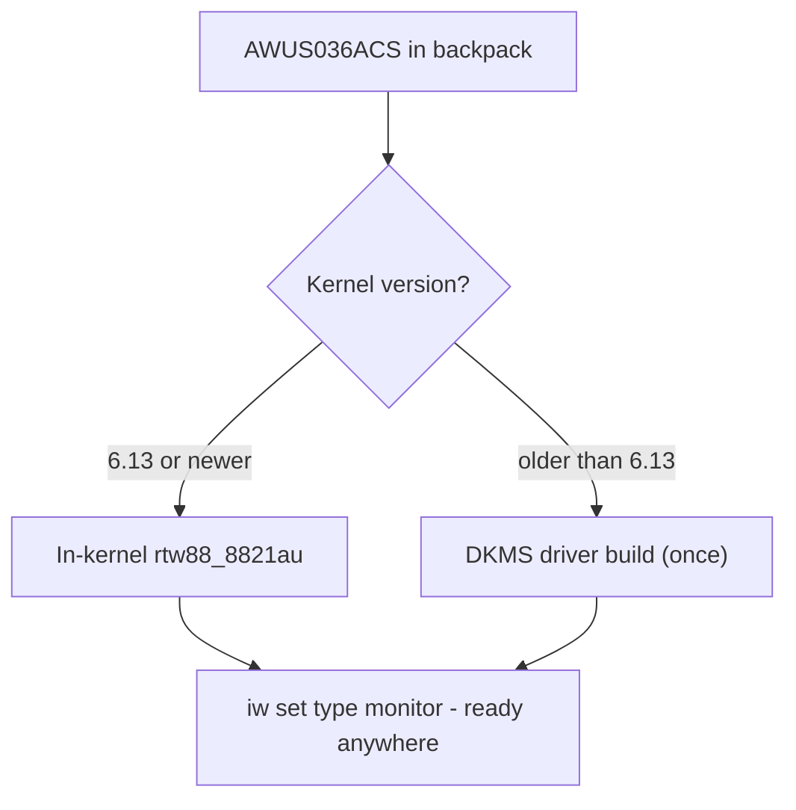

# ALFA AWUS036ACS——口袋尺寸雙頻 AC600

> **一句話定位（Quick Summary）**：**AWUS036ACS** 是 55 mm 的口袋型 ALFA——一款 **RTL8811AU AC600** 雙頻無線網路卡，配備一支可摺疊的 2 dBi 天線。在 **kernel 6.13 或更新版本**使用內建的 `rtw88_8821au` 驅動程式（不需 DKMS）；已在 ASUS GX10 / Ubuntu 24.04 ARM64 實測：監聽、注入（2.4 GHz 100%、5 GHz 96%）、AP、WPA3 AP（5 GHz，僅 AP 端）與端到端 handshake 擷取。只有較舊的 kernel（< 6.13）才需要 DKMS 建置。僅限在自有或已授權的網路使用。

## 規格總覽 (Spec overview)

| 項目 | 規格 |
|---|---|
| 晶片 | Realtek RTL8811AU |
| Wi-Fi 等級 | AC600（150 + 433 Mbps） |
| 介面 | USB 2.0 |
| 頻段 | 2.4 + 5 GHz |
| 天線 | 1 × 外接 2 dBi 雙頻偶極天線，RP-SMA |
| 機身 | 約 55 mm——口袋尺寸 |
| Linux 驅動程式 | `rtw88_8821au`——**kernel ≥ 6.13 內建**；較舊的 kernel（< 6.13）：社群 `8821au` DKMS |
| 監聽模式 | ✅ 2.4 + 5 GHz（GX10 實測） |
| 封包注入 | ✅ 2.4 GHz 100%、5 GHz 96%（GX10 實測） |

## 實測：ASUS GX10 / Ubuntu 24.04 ARM64

**測試環境**：ASUS Ascent GX10（NVIDIA GB10）、Ubuntu 24.04 LTS ARM64、kernel `6.17.0-1014-nvidia`，測試日期 2026-11-16 至 2026-11-19，測試裝置為 iPhone 7 Plus（WPA3 另用 iPhone 15 Pro）。

| 項目 | 結果 |
|---|---|
| 晶片 | Realtek RTL8811AU |
| USB ID | `0bda:0811` |
| 核心驅動程式 | `rtw88_8821au`（內建於核心） |
| 韌體 | 42.4.0（H2C version 0，取自 `dmesg`） |
| 是否需要 DKMS | 否（kernel ≥ 6.13 不需要） |

| 功能 | 2.4 GHz | 5 GHz |
|---|---|---|
| Monitor | ✅ | ✅ |
| Injection | ✅ 100% | ✅ 96% |
| AP 熱點 | ✅ | ✅（頻寬未確認） |
| WPA3-SAE（AP 端） | 未測試 | ✅ |

| 進階功能 | 結果 |
|---|---|
| WPA handshake 擷取 | ✅ 端到端（已轉出 `.22000`） |
| VIF | ✅ |
| Active monitor | ❌ `Operation not supported (-95)` |
| IBSS（Ad-hoc） | ❌ `iw` 有列出但加入失敗 |
| Mesh（802.11s） | ❌ `-95` |
| Wi-Fi Direct（P2P） | ❌ `-95` |

在你自己的機器上驗證：

```bash
lsusb | grep -i 0bda:0811
sudo dmesg | grep -i 8821au
iw phy $(cat /sys/class/net/$(ls /sys/class/net | grep '^wlx' | head -1)/phy80211/name) info | sed -n '/Supported interface modes/,/Band 1/p'
iw dev
```

完整測試報告：[AWUS036ACS 於 ASUS GX10 / Ubuntu 的實測報告](https://yupitek.com/zh-tw/blog/awus036acs-asus-gx10-ubuntu-test-report/)。

**備註**：
- 單串流（1×1）：HT 最大 RX 150 Mbps，VHT 理論上約 433 Mbps。
- 5 GHz 注入前請先執行 `sudo iw reg set US`，測完再還原你原本的區域設定。
- 請勿執行 `airmon-ng check kill`（會關閉 NetworkManager）；`hcxdumptool` 8.x 無法啟動（arm 失敗）——請改用 `airodump-ng` + `aireplay-ng`。
- 2.4 GHz AP：較早的一輪測試曾在手機斷線後中止（`key not allowed / Failed to set beacon parameters`）；重測時正常收尾，無法重現該問題。
- 多次切換監聽／AP 模式後，掃描可能掃到 0 個目標（RX 狀態變差）；拔下再插回即可恢復。
- 6 GHz：不適用。Kali 與 NetHunter：未實機測試。

## 總覽

ACS 是把經典 ALFA 公式縮小、卻不犧牲要點的產物。它保留了雙頻、外接天線與可用的監聽模式，卻包在一個丟進筆電包就消失的 **55 mm 機身**裡。它的 1×1 RTL8811AU 無線電屬於 AC600 等級——足夠做管理訊框擷取、注入示範與輕量分析，並且老實面對它的吞吐量上限。

在 kernel 6.13 以後，驅動程式已在核心裡，沒有東西需要編譯。在較舊的 kernel（< 6.13）上，驅動程式不在核心裡，所以需要做一次性的 DKMS 建置（之後核心更新時會自動處理）。如果你用的是舊 kernel，又希望完全不用處理驅動程式，請選擇內建驅動的 [AWUS036ACM](/alfa-network/products/awus036acm/)。

## 安裝與驅動程式

**Kernel 6.13 或更新版本**：不需要安裝任何東西；內建的 `rtw88_8821au` 會自動綁定。請見 [RTL8811AU 驅動程式頁面](/alfa-network/drivers/rtl8811au/)。

### 較舊的 kernel（僅限 < 6.13）：DKMS

僅適用於 6.13 以前的 kernel：

```bash
cd /opt && sudo git clone https://github.com/morrownr/8821au-20210708.git
cd 8821au-20210708 && sudo sh install-driver.sh
sudo modprobe 8821au
```

**預期輸出**：`DKMS: install completed.`，然後 `iw dev` 中出現介面。（這條舊 kernel 路徑未在 GX10 上執行過。）



## 進階使用

### 在外面使用監聽模式

```bash
IF=$(ls /sys/class/net | grep '^wlx' | head -1)
sudo nmcli dev set $IF managed no
sudo ip link set dev $IF down
sudo iw dev $IF set type monitor
sudo ip link set dev $IF up
sudo iw dev $IF set channel 6
sudo aireplay-ng --test --ignore-negative-one $IF
```

**預期輸出**：`Injection is working!`（對我們自己的 AP 實測 2.4 GHz 為 100%、5 GHz 為 96%；5 GHz 請先執行 `sudo iw reg set US`）。

### 旅行裝備

將可摺疊天線（運送時保持裝著）搭配 [Jetson](/alfa-network/hardware/jetson/) 或筆電，組成可攜式擷取／分析站（我們僅在 GX10 上實測）。把天線摺好、放進口袋，就完成了。

## 相容性

| 平臺 | 支援 | 注意事項 |
|---|---|---|
| Ubuntu 24.04 ARM64（GX10，kernel 6.17） | ✅ 已實測 | 內建於核心，不需 DKMS |
| Linux kernel ≥ 6.13 | ✅ | 內建 `rtw88_8821au` |
| Linux kernel < 6.13 | 🔧 | 需要社群 DKMS 驅動程式 |
| Kali Linux | ✅（我們未實機測試） | kernel ≥ 6.13 時內建於核心 |
| NetHunter / Android | 🔧 | 未測試；屬 Realtek 晶片，不保證可用 |
| Windows | 我們未測試 | ALFA 官方驅動程式 |
| Raspberry Pi / Jetson | 我們未測試 | kernel ≥ 6.13 時內建於核心；僅在 GX10 上實測 |

## 疑難排解

| 症狀 | 原因 | 修復 |
|---|---|---|
| （僅 kernel < 6.13）DKMS 建置失敗 | 缺少 headers／新 kernel | `sudo apt install linux-headers-$(uname -r)`；`git pull && make dkms_install` |
| （僅 kernel < 6.13）只能在 managed 模式 | 核心的替代驅動程式衝突 | 將衝突的模組列入黑名單（見[驅動程式頁面](/alfa-network/drivers/rtl8811au/)） |
| 注入 0/30 | 空頻道 | `sudo iw $IF set channel 6` |
| 5 GHz 注入被擋 | 法規網域 | `sudo iw reg set US`，之後還原 |
| 手機斷線後 2.4 GHz AP 中止（`key not allowed / Failed to set beacon parameters`） | 偶發的 beacon re-key 失敗，重測無法重現 | 改用 5 GHz AP；長時間或頻繁重連的情境請留意 |
| 多次切換模式後掃描掃到 0 個目標 | RX 狀態變差 | 拔下再插回 |
| 吞吐量偏低 | 1×1 AC600 硬體 | 不是故障 |
| （僅 kernel < 6.13）重開機後偵測不到 | 模組未自動載入 | 將 `8821au` 加到 `/etc/modules-load.d/alfa.conf` |

## 相關資源

- [RTL8811AU 驅動程式頁面](/alfa-network/drivers/rtl8811au/)
- [Kali 設定指南](/alfa-network/linux-setup-kali/)
- [AWUS036ACH](/alfa-network/products/awus036ach/)——全尺寸高功率兄弟款
- [AWUS036ACM](/alfa-network/products/awus036acm/)——MediaTek 內建驅動的替代款
- [無線網路卡比較](/alfa-network/wifi-adapter-comparison/)
