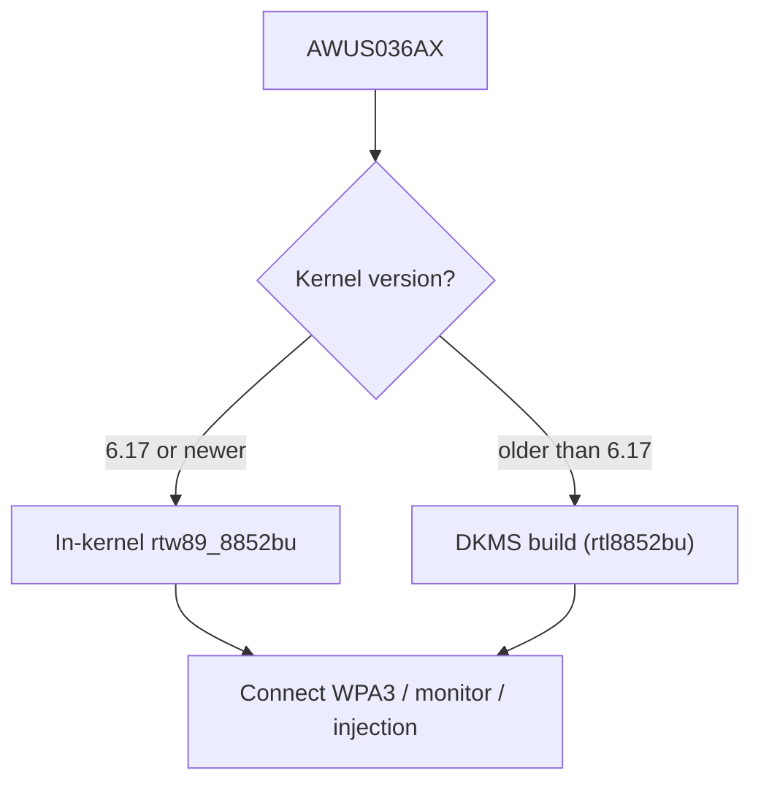

# ALFA AWUS036AX——Wi-Fi 6 雙頻 AX1800

> **一句話定位（Quick Summary）**：**AWUS036AX** 是 ALFA 的 Wi-Fi 6 入門款——一款 **RTL8832BU AX1800** 雙頻無線網路卡，支援 **WPA3**、**2×2 MIMO**，並配備兩支外接天線。在 **kernel 6.17 或更新版本**使用內建的 `rtw89_8852bu` 驅動程式（不需 DKMS）。已在 ASUS GX10 / Ubuntu 24.04 ARM64 實測：2.4 與 5 GHz 監聽接收強、注入（2.4 GHz 為 96%，5 GHz 可用）、AP、WPA3 AP（僅 AP 端；WPA3 用戶端未測試）與端到端 handshake 擷取。僅限在自有或已授權的網路使用。

## 規格總覽 (Spec overview)

| 項目 | 規格 |
|---|---|
| 晶片 | Realtek RTL8832BU |
| Wi-Fi 等級 | AX1800（574 + 1201 Mbps） |
| 介面 | USB 3.2 |
| 頻段 | 2.4 + 5 GHz |
| 天線 | 2 × 外接雙頻，RP-SMA |
| 安全性 | WPA3（同時支援 WPA2/WPA） |
| MIMO | 2×2 |
| Linux 驅動程式 | `rtw89_8852bu`——**kernel ≥ 6.17 內建**；較舊的 kernel（< 6.17）：社群 `rtl8852bu` DKMS |
| 監聽模式 | ✅ 2.4 + 5 GHz（GX10 實測） |
| 封包注入 | ✅ 2.4 GHz 96%、5 GHz 可用（GX10 實測） |

## 實測：ASUS GX10 / Ubuntu 24.04 ARM64

**測試環境**：ASUS Ascent GX10（NVIDIA GB10）、Ubuntu 24.04 LTS ARM64、kernel `6.17.0-1014-nvidia`，測試日期 2026-11-16 至 2026-11-19，測試裝置為 iPhone 7 Plus（WPA3 另用 iPhone 15 Pro）。

| 項目 | 結果 |
|---|---|
| 晶片 | Realtek RTL8832BU |
| USB ID | `0bda:b832` |
| 核心驅動程式 | `rtw89_8852bu`（內建於核心） |
| 韌體 | `rtw89/rtw8852b_fw-1.bin`（版本 0.29.29.5） |
| 是否需要 DKMS | 否（kernel ≥ 6.17 不需要） |

| 功能 | 2.4 GHz | 5 GHz |
|---|---|---|
| Monitor | ✅ 強 | ✅ 強 |
| Injection | ✅ 96% | ✅ 可用（指定 AP 逐台測試） |
| AP 熱點 | ✅（含 802.11n） | ✅（80 MHz） |

| 進階功能 | 結果 |
|---|---|
| WPA3-SAE（AP 端） | ✅ iPhone 15 Pro 連入，`MFP: yes`，`sae_pwe=0`，於 2.4 GHz 實測（5 GHz 未測試）；WPA3 用戶端未測試 |
| WPA handshake 擷取 | ✅ 端到端（已轉出 `.22000`） |
| VIF | ✅ STA + AP |
| Active monitor | N/A（驅動程式未提供） |
| IBSS（Ad-hoc） | N/A |
| Mesh（802.11s） | N/A |
| Wi-Fi Direct（P2P） | 未測試（需第二台設備） |

在你自己的機器上驗證：

```bash
lsusb | grep -iE '0bda:b832|0bda:1a2b'
sudo dmesg | grep rtw89_8852bu | tail -3
iw phy $(cat /sys/class/net/$(ls /sys/class/net | grep '^wlx' | head -1)/phy80211/name) info | sed -n '/Supported interface modes/,/Band 1/p'
iw dev
```

若 `lsusb` 顯示 `0bda:1a2b`（光碟模式），請執行 `sudo usb_modeswitch -v 0bda -p 1a2b -K`。在我們的測試中，這張卡是直接以 WLAN 裝置列舉的。

完整測試報告：[AWUS036AX 於 ASUS GX10 / Ubuntu 的實測報告](https://yupitek.com/zh-tw/blog/awus036ax-asus-gx10-ubuntu-test-report/)。

**備註**：
- 我們這一張卡上沒有出現藍牙介面。
- 5 GHz 注入前請先執行 `sudo iw reg set US`，測完再還原你原本的區域設定。
- 請勿執行 `airmon-ng check kill`；`hcxdumptool` 8.x 無法啟動（arm 失敗）——請改用 `airodump-ng` + `aireplay-ng`。
- 6 GHz：不適用。Kali 與 NetHunter：未實機測試。

## 總覽

AWUS036AX 是 ALFA 著名的 AC 世代與 Wi-Fi 6 世界之間的橋梁。底層是新一代的 **RTL8832BU** 2×2 ax 無線電（AX1800），帶來兩項學生真正會注意到的升級：

1. **WPA3 支援**——這張卡通過了我們以 iPhone 15 Pro 進行的 WPA3-SAE AP 測試（僅 AP 端；我們未將它當作 WPA3 用戶端測試）。
2. **Wi-Fi 6 功能**——2×2 ax 無線電（OFDMA 等 Wi-Fi 6 功能來自標準本身；我們未做效能測試）。

它保留了經典的 ALFA 血統——兩支外接天線與高功率前端——而且與舊的說法不同，它在 Linux 上**並非**只能當用戶端：使用內建驅動程式時，監聽模式與封包注入都能運作。

## 安裝與驅動程式

### Kernel 6.17 或更新版本

不需要安裝任何東西——`rtw89_8852bu` 在核心裡，會自動綁定。請見 [RTL8832BU 驅動程式頁面](/alfa-network/drivers/rtl8832bu/)。

### 較舊的 kernel（僅限 < 6.17）：DKMS

僅適用於 6.17 以前的 kernel：

```bash
cd /opt && sudo git clone https://github.com/morrownr/rtl8852bu-20250826.git
cd rtl8852bu-20250826 && sudo sh install-driver.sh
sudo modprobe 8852bu
```

**預期輸出**：安裝程式完成（若提示請重開機），然後 `iw dev` 中出現介面。注意：社群 DKMS 驅動程式的監聽模式行為，我們未在此測試。



## 進階使用

### 連線到僅支援 WPA3 的網路（用戶端我們未測試）

```bash
nmcli device wifi connect "MySSID" password "my-passphrase"
iw dev $(ls /sys/class/net | grep '^wlx' | head -1) link
```

**預期輸出**：`Connected`，以及 `iw ... link` 輸出中的連線速率。我們未將這張卡當作 WPA3 用戶端測試，也未量測連線速率；原廠標示 5 GHz 最高 1201 Mbps。

### 監聽模式與注入

```bash
IF=$(ls /sys/class/net | grep '^wlx' | head -1)
sudo nmcli dev set $IF managed no
sudo ip link set dev $IF down
sudo iw dev $IF set type monitor
sudo ip link set dev $IF up
sudo iw dev $IF set channel 6
sudo aireplay-ng --test $IF
```

**預期輸出**：`Injection is working!`（2.4 GHz 實測為 96%）。在 5 GHz（例如 channel 36）上，廣播測試可能顯示 `Found 0 APs`，因為現代 AP 不回應廣播 probe；請改用 `sudo aireplay-ng --test -a <AP-BSSID> $IF` 對指定 AP 測試，實測會顯示 `Injection is working!`。

## 相容性

| 平臺 | 支援 | 注意事項 |
|---|---|---|
| Ubuntu 24.04 ARM64（GX10，kernel 6.17） | ✅ 已實測 | 內建於核心，不需 DKMS |
| Linux kernel ≥ 6.17 | ✅ | 內建 `rtw89_8852bu` |
| Linux kernel < 6.17 | 🔧 | 社群 DKMS 驅動程式 |
| Kali Linux | ✅（我們未實機測試） | kernel ≥ 6.17 時內建於核心 |
| NetHunter / Android | ⚠️ | 未測試；屬 Realtek 晶片，在手機 kernel 上可能無法編譯 |
| Windows | 我們未測試 | ALFA 官方驅動程式 |
| Raspberry Pi / Jetson | 我們未測試 | kernel ≥ 6.17 時內建於核心；僅在 GX10 上實測 |

## 疑難排解

| 症狀 | 原因 | 修復 |
|---|---|---|
| 看不到 WPA3 網路 | 驅動程式／wpa_supplicant 太舊 | 更新作業系統／kernel |
| `lsusb` 顯示 `0bda:1a2b` | 卡處於光碟模式 | `sudo usb_modeswitch -v 0bda -p 1a2b -K` |
| （僅 kernel < 6.17）DKMS 建置失敗 | 新 kernel 與原始碼庫不相容 | `cd /opt/rtl8852bu-20250826 && git pull && sudo sh install-driver.sh` |
| 連線速率很高但傳輸很慢 | USB 2.0 連接埠 | 改用 USB 3.x 連接埠（本卡為 USB 3.2） |
| 注入 0/30 | 空頻道 | `sudo iw $IF set channel 6` |

## 相關資源

- [RTL8832BU 驅動程式頁面](/alfa-network/drivers/rtl8832bu/)
- [AWUS036AXER](/alfa-network/products/awus036axer/)——nano Wi-Fi 6 款（相同晶片）
- [AWUS036AXM](/alfa-network/products/awus036axm/)——MediaTek AX3000 + 藍牙款（實測核心下無法注入；藍牙未測試）
- [Ubuntu 設定指南](/alfa-network/linux-setup-ubuntu/) / [Kali 設定指南](/alfa-network/linux-setup-kali/)
- [無線網路卡比較](/alfa-network/wifi-adapter-comparison/)
