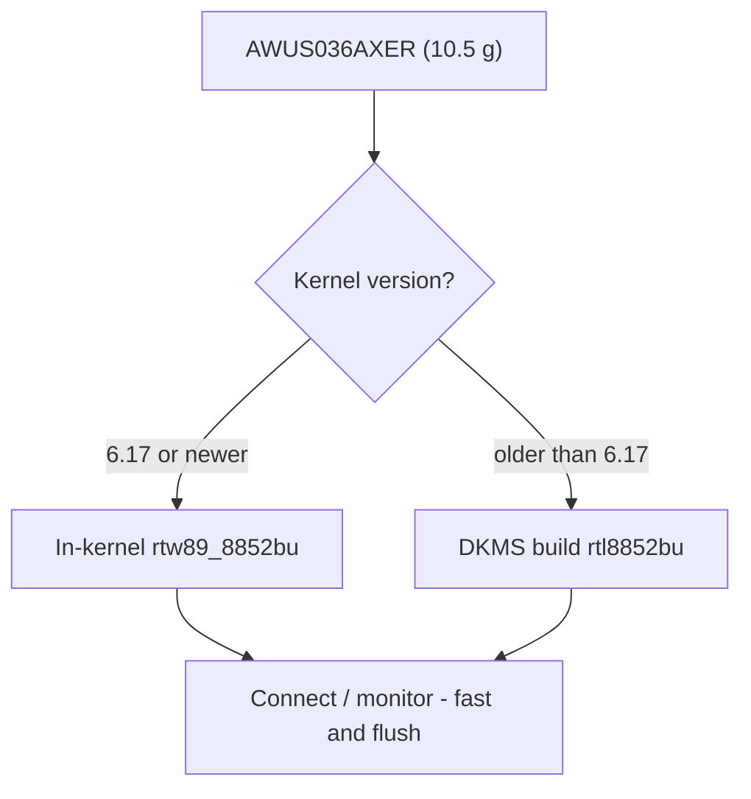

# ALFA AWUS036AXER——Wi-Fi 6 Nano（內建天線）

> **一句話定位（Quick Summary）**：**AWUS036AXER** 是 ALFA 的 **10.5 g nano** 機種——與大型 AWUS036AX 採用相同的 **RTL8832BU AX1800** Wi-Fi 6 引擎，但配備**內建天線**與 USB 3.2，插入後幾乎與連接埠齊平、毫不顯眼。在 **kernel 6.17 或更新版本**使用內建的 `rtw89_8852bu` 驅動程式（不需 DKMS）。已在 ASUS GX10 / Ubuntu 24.04 ARM64 實測：監聽接收極強（60 秒跳頻掃描找到 63 個 AP + 12 個用戶端）、2.4 GHz 注入 73%、5 GHz 注入可用、AP、WPA3 AP（僅 AP 端；WPA3 用戶端未測試）與端到端 handshake 擷取。僅限在自有或已授權的網路使用。

## 規格總覽 (Spec overview)

| 項目 | 規格 |
|---|---|
| 晶片 | Realtek RTL8832BU |
| Wi-Fi 等級 | AX1800（574 + 1201 Mbps） |
| 介面 | USB 3.2 |
| 頻段 | 2.4 + 5 GHz |
| 天線 | **內建**（無外接 RP-SMA） |
| 重量 | 10.5 g |
| 安全性 | WPA3 |
| MIMO | 2×2 |
| Linux 驅動程式 | `rtw89_8852bu`——**kernel ≥ 6.17 內建**；較舊的 kernel（< 6.17）：社群 `rtl8852bu` DKMS |
| 監聽模式 | ✅ 2.4 + 5 GHz（GX10 實測） |
| 封包注入 | ✅ 2.4 GHz 73%、5 GHz 可用（GX10 實測） |

## 實測：ASUS GX10 / Ubuntu 24.04 ARM64

**測試環境**：ASUS Ascent GX10（NVIDIA GB10）、Ubuntu 24.04 LTS ARM64、kernel `6.17.0-1014-nvidia`，測試日期 2026-11-16 至 2026-11-19，測試裝置為 iPhone 7 Plus（WPA3 另用 iPhone 15 Pro）。

| 項目 | 結果 |
|---|---|
| 晶片 | Realtek RTL8832BU（與 AWUS036AX 相同） |
| USB ID | `0bda:b832` |
| 核心驅動程式 | `rtw89_8852bu`（內建於核心） |
| 韌體 | `rtw89/rtw8852b_fw-1.bin`（版本 0.29.29.5） |
| 是否需要 DKMS | 否（kernel ≥ 6.17 不需要） |

| 功能 | 2.4 GHz | 5 GHz |
|---|---|---|
| Monitor | ✅ 強 | ✅ 強 |
| Injection | ✅ 73% | ✅ 可用（指定 AP 逐台測試） |
| AP 熱點 | ✅（含 802.11n） | ✅（80 MHz） |

| 進階功能 | 結果 |
|---|---|
| WPA3-SAE（AP 端） | ✅ iPhone 15 Pro 連入，`sae_pwe=0`，於 2.4 GHz 實測（5 GHz 未測試）；WPA3 用戶端未測試 |
| WPA handshake 擷取 | ✅ 端到端（已轉出 `.22000`） |
| VIF | ✅ STA + AP |
| Active monitor | N/A（驅動程式未提供） |
| IBSS（Ad-hoc） | N/A |
| Mesh（802.11s） | N/A |
| Wi-Fi Direct（P2P） | 未測試（需第二台設備） |

在你自己的機器上驗證：

```bash
lsusb | grep -iE '0bda:b832|0bda:1a2b'
sudo dmesg | grep rtw89_8852bu | tail -3
iw phy $(cat /sys/class/net/$(ls /sys/class/net | grep '^wlx' | head -1)/phy80211/name) info | sed -n '/Supported interface modes/,/Band 1/p'
iw dev
```

若 `lsusb` 顯示 `0bda:1a2b`（光碟模式），請執行 `sudo usb_modeswitch -v 0bda -p 1a2b -K`。

完整測試報告：[AWUS036AXER 於 ASUS GX10 / Ubuntu 的實測報告](https://yupitek.com/zh-tw/blog/awus036axer-asus-gx10-ubuntu-test-report/)。

**備註**：
- 我們這一張卡上沒有出現藍牙介面。
- 儘管是內建天線，60 秒跳頻掃描仍找到 63 個 AP 與 12 個用戶端，是這次測試中接收表現最好的結果之一。
- 請勿執行 `airmon-ng check kill`；`hcxdumptool` 8.x 無法啟動（arm 失敗）——請改用 `airodump-ng` + `aireplay-ng`。
- 6 GHz：不適用。Kali 與 NetHunter：未實機測試。

## 總覽

AXER 沿用 AWUS036AX 的無線電，並去掉了體積。它不使用兩支外接天線，而是把**內建天線**收進 **10.5 g 的機身**——插進筆電連接埠後幾乎不凸出。你保有 Wi-Fi 6 速度、WPA3 與 2×2 MIMO；代價是失去用外接天線延伸距離的途徑，以及升級天線的選項。

對於坐在階梯教室裡的學生，它是一支很適合日常隨身攜帶的 Wi-Fi 6 無線網路卡；在我們的測試中，它在 kernel 6.17+ 上也能做監聽模式與注入（注入成功率低於 AWUS036AX：2.4 GHz 為 73% 對 96%）。

## 安裝與驅動程式

驅動程式的狀況與 [AWUS036AX](/alfa-network/products/awus036ax/) 相同——請見 [RTL8832BU 驅動程式頁面](/alfa-network/drivers/rtl8832bu/)。

**Kernel 6.17 或更新版本**：不需要安裝任何東西。

### 較舊的 kernel（僅限 < 6.17）：DKMS

```bash
cd /opt && sudo git clone https://github.com/morrownr/rtl8852bu-20250826.git
cd rtl8852bu-20250826 && sudo sh install-driver.sh
sudo modprobe 8852bu
```

**預期輸出**：安裝程式完成（若提示請重開機），然後 `iw dev` 中出現介面。



## 進階使用

### 用戶端模式（我們未測試）

```bash
nmcli device wifi connect "MySSID" password "my-passphrase"
iw dev $(ls /sys/class/net | grep '^wlx' | head -1) link
```

**預期輸出**：已連線，並在 `iw ... link` 輸出中顯示連線速率。我們未將這張卡當作用戶端測試，也未量測連線速率；原廠標示 5 GHz 最高 1201 Mbps。

### 監聽模式與注入

```bash
IF=$(ls /sys/class/net | grep '^wlx' | head -1)
sudo nmcli dev set $IF managed no
sudo ip link set dev $IF down
sudo iw dev $IF set type monitor
sudo ip link set dev $IF up
sudo iw dev $IF set channel 6
sudo aireplay-ng --test $IF
```

**預期輸出**：`Injection is working!`（2.4 GHz 實測為 73%）。在 5 GHz 請用 `sudo aireplay-ng --test -a <AP-BSSID> $IF` 對指定 AP 測試，實測會顯示 `Injection is working!`。

## 相容性

| 平臺 | 支援 | 注意事項 |
|---|---|---|
| Ubuntu 24.04 ARM64（GX10，kernel 6.17） | ✅ 已實測 | 內建於核心，不需 DKMS |
| Linux kernel ≥ 6.17 | ✅ | 內建 `rtw89_8852bu` |
| Linux kernel < 6.17 | 🔧 | 社群 DKMS 驅動程式 |
| Kali Linux | ✅（我們未實機測試） | kernel ≥ 6.17 時內建於核心 |
| NetHunter / Android | ⚠️ | 未測試；屬 Realtek 晶片、內建天線，優先度低 |
| Windows | 我們未測試 | ALFA 官方驅動程式 |
| Raspberry Pi / Jetson | 我們未測試 | kernel ≥ 6.17 時內建於核心；僅在 GX10 上實測 |

## 疑難排解

| 症狀 | 原因 | 修復 |
|---|---|---|
| 距離比外接天線的 ALFA 短 | 設計上就是內建天線 | 屬預期——長距離連線請改用外接天線的卡 |
| 看不到 WPA3 網路 | 作業系統太舊 | 更新作業系統／kernel |
| （僅 kernel < 6.17）DKMS 建置失敗 | 新 kernel | `git pull && sudo sh install-driver.sh` |
| `lsusb` 顯示 `0bda:1a2b` | 光碟模式 | `sudo usb_modeswitch -v 0bda -p 1a2b -K` |
| 在 USB 2.0 連接埠上很慢 | 頻寬上限 | 改用 USB 3.x 連接埠 |

## 相關資源

- [RTL8832BU 驅動程式頁面](/alfa-network/drivers/rtl8832bu/)
- [AWUS036AX](/alfa-network/products/awus036ax/)——相同引擎、外接天線、注入成功率更高
- [AWUS036AXM](/alfa-network/products/awus036axm/)——採用 MediaTek 晶片的 Wi-Fi 6 款（實測核心下無法注入；藍牙未測試）
- [無線網路卡比較](/alfa-network/wifi-adapter-comparison/)
