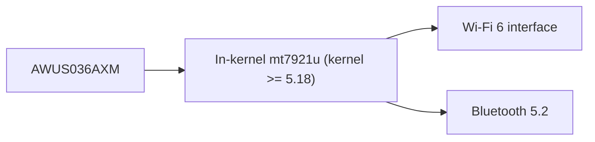

# ALFA AWUS036AXM——Wi-Fi 6 AX3000 + 藍牙 5.2

> **一句話定位（Quick Summary）**：**AWUS036AXM** 是 ALFA 的旗艦 Wi-Fi 6 dongle——一支 **MT7921AU AX3000** 雙頻無線網路卡（與 AXML 使用相同的 `mt7921u` 驅動程式），含 **藍牙 5.2**、USB 3.2、兩支天線，而且關鍵的是**內建於核心的驅動程式**（自 Linux 5.18 起的 `mt7921u`）。已在 ASUS GX10 / Ubuntu 24.04 ARM64 實測：AP（2.4/5 GHz）、WPA3 AP（AP 端，2.4 GHz）與 VIF 可用，監聽模式可接收（但接收較弱）。**封包注入在 stock 6.17 kernel 上未通過**，因此在該環境下不適合做 deauth 或 handshake 擷取。藍牙與 6 GHz 在這個型號上未測試。僅限在自有或已授權的網路使用。

## 規格總覽 (Spec overview)

| 項目 | 規格 |
|---|---|
| 晶片 | MediaTek MT7921AUN（與 AXML 的 MT7921AUN 屬同一個 `mt7921u` 驅動程式家族） |
| Wi-Fi 等級 | AX3000 等級——最高 600 / 1200 / 1200 Mbps（2.4 / 5 / 6 GHz），依 ALFA 規格表 |
| 介面 | USB 3.2 |
| 頻段 | 2.4 + 5 GHz 已測試；6 GHz 由同晶片推測，AXM 上未測試 |
| 天線 | 2 × 外接 5 dBi，RP-SMA |
| 藍牙 | **BT 5.2**（同一支 dongle；AXM 上未單獨測試） |
| MIMO | 2×2 |
| Linux 驅動程式 | `mt7921u`——**自 5.18 起內建於核心** |
| 監聽模式 | ✅ 2.4 + 5 GHz，接收較弱（GX10 實測） |
| 封包注入 | ❌ 在 stock kernel 6.17 未通過（kernel 6.16 起的 mac80211 chanctx 回歸；並非晶片先天限制） |

## 實測：ASUS GX10 / Ubuntu 24.04 ARM64

**測試環境**：ASUS Ascent GX10（NVIDIA GB10）、Ubuntu 24.04 LTS ARM64、kernel `6.17.0-1014-nvidia`，測試日期 2026-11-16 至 2026-11-19，測試裝置為 iPhone 7 Plus（WPA3 另用 iPhone 15 Pro）。

| 項目 | 結果 |
|---|---|
| 晶片 | MediaTek MT7921AU |
| USB ID | `0e8d:7961` |
| 核心驅動程式 | `mt7921u`（內建於核心） |
| 韌體 | `WIFI_RAM_CODE_MT7961`（linux-firmware） |
| 是否需要 DKMS | 否（kernel ≥ 5.18 不需要） |

| 功能 | 2.4 GHz | 5 GHz |
|---|---|---|
| Monitor | ✅ 弱 | ✅ 弱 |
| Injection | ❌ 失敗（stock kernel 6.17） | ❌ 失敗（stock kernel 6.17） |
| AP 熱點 | ✅ | ✅（80 MHz） |

| 進階功能 | 結果 |
|---|---|
| WPA3-SAE（AP 端） | ✅ iPhone 7 Plus 在 2.4 GHz 連入，`MFP: yes`，`sae_pwe=0`；5 GHz 與 WPA3 用戶端未測試 |
| 藍牙 | 未測試 |
| 6 GHz | 未測試 |
| WPA handshake 擷取 | ❌ 無法進行，注入失敗 |
| VIF | ✅ |
| Active monitor | 🟡 `iw` 接受設定，ACK 未驗證 |
| IBSS（Ad-hoc） | N/A |
| Mesh（802.11s） | N/A |
| Wi-Fi Direct（P2P） | 未測試（需第二台設備） |

在你自己的機器上驗證：

```bash
lsusb | grep 0e8d:7961
sudo dmesg | grep mt7921u | tail -3
iw phy $(cat /sys/class/net/$(ls /sys/class/net | grep '^wlx' | head -1)/phy80211/name) info | sed -n '/Supported interface modes/,/Band 1/p'
iw dev
```

完整測試報告：[AWUS036AXM 於 ASUS GX10 / Ubuntu 的實測報告](https://yupitek.com/zh-tw/blog/awus036axm-asus-gx10-ubuntu-test-report/)。

**備註**：
- 注入：在 stock kernel 6.17 上，`aireplay-ng --test` 找到 0 個 AP（`No Answer`），因此無法 deauth，也無法擷取 handshake。這並非晶片先天限制：主因是 kernel 6.16 起的 mac80211 chanctx 回歸（見[驅動程式頁面](/alfa-network/drivers/mt7921aun/)）。社群以 git／patched 驅動程式可讓 active monitor 與注入運作，但韌體仍鎖定速率（1/6 Mbps，無法注入 HT/VHT）。
- 監聽模式接收較弱；請鎖定單一頻道，不要跳頻。
- `iw` 在監聽模式下回報 TX 功率為 3 dBm；這是回報上的假象（硬體實際 TX 量測約 20 dBm）。
- 6 GHz：由與 AXML 相同的晶片推測（AXML 已實測驗證），但**AXM 本身未測試**。Kali 與 NetHunter：未實機測試。
- 若你需要注入或 handshake 擷取，請選擇其他卡（見[比較頁](/alfa-network/wifi-adapter-comparison/)）。

## 總覽

就速度與功能而言，AXM 是備受喜愛的 [AWUS036ACM](/alfa-network/products/awus036acm/) 的現代接班人——MediaTek 無線電、內建驅動程式、沒有 DKMS 的麻煩——但整整升級了一個世代：**AX3000** 速度（5 GHz 最高 1200 Mbps，依 ALFA 規格表）、同一支 USB 裝置上的**藍牙 5.2**，以及更新的無線電。

就日常 Linux 使用而言，它的吸引力和 ACM 相同：作為用戶端或 AP 無線網路卡，**它就是能用**。驅動程式在核心裡（5.18+）、AP 與 WPA3 已測試，而且 WiFi 與藍牙共用同一個 USB 連接埠（我們未測試 AXM 的藍牙）。不過，若你的資安課程需要注入，請注意 MT7921 系列在所測試的 stock kernel 上注入未通過——請改用 ACM 或 Realtek 的卡。

## 安裝與驅動程式

自 5.18 起內建於核心——不需要編譯。請見 [MT7921AUN 驅動程式頁面](/alfa-network/drivers/mt7921aun/)。驗證：

```bash
lsusb | grep -i mediatek
iw dev
bluetoothctl list
```

**預期輸出**：`lsusb` 中的 MT7921U 那一行，以及 `iw dev` 中的一個介面。`bluetoothctl list` 中應出現一個藍牙控制器（藍牙可能需要 `sudo modprobe btusb`）；我們未測試 AXM 的藍牙。



## 進階使用

### 最高速連線 + 藍牙配對（我們未測試）

```bash
nmcli device wifi connect "MySSID" password "my-passphrase"
bluetoothctl
power on
scan on
pair <MAC>
```

**預期輸出**：Wi-Fi 已啟用；你的藍牙裝置顯示 `Pairing successful`。AXM 上的用戶端連線與藍牙配對都未測試。

### 監聽模式（在所測試的 kernel 上僅能接收）

```bash
IF=$(ls /sys/class/net | grep '^wlx' | head -1)
sudo nmcli dev set $IF managed no
sudo ip link set dev $IF down
sudo iw dev $IF set type monitor
sudo ip link set dev $IF up
sudo iw dev $IF set channel 36
sudo timeout 8 tcpdump -l -i $IF -nn -e -c 200
```

**預期輸出**：2.4 與 5 GHz 都收得到 beacon，但訊框數量比 ACM 或 Realtek 的卡少。注入（`aireplay-ng --test`）在 stock kernel 6.17 上失敗。

## 相容性

| 平臺 | 支援 | 注意事項 |
|---|---|---|
| Ubuntu 24.04 ARM64（GX10，kernel 6.17） | ✅ AP / WPA3 / 監聽接收已實測 | 無法注入 |
| Ubuntu / Kali（其他版本） | ✅ 內建於核心（kernel 5.18+） | 我們未測試 |
| NetHunter / Android | 未測試 | 手機上需要 5.18+ 的 kernel |
| Windows | 我們未測試 | ALFA 官方驅動程式 |
| Raspberry Pi / Jetson（JetPack 6） | 我們未測試 | 內建於核心驅動；僅在 GX10 上實測 |

## 疑難排解

| 症狀 | 原因 | 修復 |
|---|---|---|
| 在 Ubuntu 20.04 上偵測不到 | Kernel < 5.18 | 升級作業系統／kernel |
| 看得到裝置但沒有介面 | 缺少韌體 | `sudo apt install linux-firmware`；重新插拔 |
| 沒有藍牙 | 未載入 `btusb` | `sudo modprobe btusb` |
| 手機看不到 AP 的 SSID | `iw` 在監聽模式下回報 TX 功率為 3 dBm | 拔下再插回，或把手機靠近 |
| 注入／deauth 找到 0 個 AP | stock kernel 6.17 上的 mac80211 chanctx 回歸（並非晶片先天限制） | 注入請改用其他卡（ACM、ACH、ACS、EACS、AX、AXER） |
| 監聽模式幾乎收不到封包 | 監聽模式的 RX 較弱 | 鎖定單一頻道，靠近 AP |

## 相關資源

- [MT7921AUN 驅動程式頁面](/alfa-network/drivers/mt7921aun/)
- [AWUS036AXML](/alfa-network/products/awus036axml/)——同晶片家族，採用 USB-C 接頭，且已有驗證過的 6 GHz 結果
- [AWUS036AX](/alfa-network/products/awus036ax/)——較便宜、注入可用的 AX1800 替代款
- [Ubuntu 設定指南](/alfa-network/linux-setup-ubuntu/) / [Kali 設定指南](/alfa-network/linux-setup-kali/)
- [無線網路卡比較](/alfa-network/wifi-adapter-comparison/)
