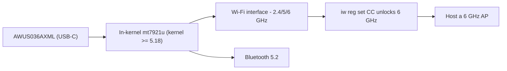

# ALFA AWUS036AXML——Wi-Fi 6E USB-C（6 GHz）

> **一句話定位（Quick Summary）**：**AWUS036AXML** 是 ALFA 產品線中唯一的 **Wi-Fi 6E** 無線網路卡——一支 **MT7921AUN AXE3000 三頻**（2.4/5/**6 GHz**）無線網路卡，配 **USB-C**、雙 5 dBi 天線與**藍牙 5.2**，使用**內建於核心的驅動程式**（自 5.18 起的 `mt7921u`）。已在 ASUS GX10 / Ubuntu 24.04 ARM64 實測：**6 GHz 可用**（AXML 架設了 ch37 / 6135 MHz 的 WPA3-SAE AP，iPhone 15 Pro 以 802.11ax 連入；這張卡未測試作為 6 GHz 用戶端）、藍牙可用、AP 與 WPA3 可用。**封包注入在 stock kernel 6.17 未通過**，所以請不要為了 deauth 或 handshake 擷取而選它。僅限在自有或已授權的網路使用。

## 規格總覽 (Spec overview)

| 項目 | 規格 |
|---|---|
| 晶片 | MediaTek MT7921AUN |
| Wi-Fi 等級 | AXE3000——最高 600 / 1200 / 1200 Mbps（2.4 / 5 / 6 GHz），依 ALFA 規格表 |
| 頻段 | 2.4 + 5 + **6 GHz**（6 GHz 已在 GX10 上驗證） |
| 介面 | **USB-C** |
| 天線 | 2 × 外接 5 dBi，RP-SMA |
| 藍牙 | BT 5.2（實測可用） |
| MIMO | 2×2 |
| Linux 驅動程式 | `mt7921u`——**自 5.18 起內建於核心** |
| 監聽模式 | ✅ 2.4 + 5 GHz，接收較弱（GX10 實測） |
| 封包注入 | ❌ 在 stock kernel 6.17 未通過（kernel 6.16 起的 mac80211 chanctx 回歸；並非晶片先天限制） |

## 實測：ASUS GX10 / Ubuntu 24.04 ARM64

**測試環境**：ASUS Ascent GX10（NVIDIA GB10）、Ubuntu 24.04 LTS ARM64、kernel `6.17.0-1014-nvidia`，測試日期 2026-11-16 至 2026-11-19，測試裝置為 iPhone 7 Plus（WPA3 與 6 GHz 測試使用 iPhone 15 Pro）。

| 項目 | 結果 |
|---|---|
| 晶片 | MediaTek MT7921AUN |
| USB ID | `0e8d:7961` |
| 核心驅動程式 | `mt7921u`（內建於核心） |
| 韌體 | `WIFI_RAM_CODE_MT7961`（linux-firmware） |
| 是否需要 DKMS | 否（kernel ≥ 5.18 不需要） |

| 功能 | 2.4 GHz | 5 GHz |
|---|---|---|
| Monitor | ✅ 弱 | ✅ 弱 |
| Injection | ❌ 失敗（stock kernel 6.17） | ❌ 失敗（stock kernel 6.17） |
| AP 熱點 | ✅ | ✅（80 MHz） |

| 進階功能 | 結果 |
|---|---|
| WPA3-SAE（AP 端） | ✅ iPhone 15 Pro 在 2.4 GHz 連入（`sae_pwe=0`、`MFP: yes`）；6 GHz 也成功（見下列）；5 GHz 與 WPA3 用戶端未測試 |
| 6 GHz | ✅ 以 AXML 作為 AP 實測：ch37 / 6135 MHz 的 WPA3-SAE（H2E、`sae_pwe=1`）AP，iPhone 15 Pro 以 802.11ax（HE-NSS 2）加入並取得 IP。辦公室沒有 6 GHz AP（6 GHz 掃描掃到 0 個 BSS），所以 6 GHz 用戶端模式與 6 GHz 監聽擷取皆未測試 |
| 藍牙 | ✅ 實測：控制器可啟動（HCI 5.2），掃描到 31 個 BLE + 1 個經典藍牙裝置，WiFi 與藍牙可共存 |
| WPA handshake 擷取 | ❌ 無法進行，注入失敗 |
| VIF | ✅ |
| Active monitor | 🟡 `iw` 接受設定，ACK 未驗證 |
| IBSS（Ad-hoc） | N/A |
| Mesh（802.11s） | N/A |
| Wi-Fi Direct（P2P） | 未測試（需第二台設備） |

在你自己的機器上驗證：

```bash
lsusb | grep 0e8d:7961
sudo dmesg | grep mt7921u | tail -2
iw phy $(cat /sys/class/net/$(ls /sys/class/net | grep '^wlx' | head -1)/phy80211/name) info | sed -n '/Supported interface modes/,/Band 1/p'
iw dev
```

完整測試報告：[AWUS036AXML 於 ASUS GX10 / Ubuntu 的實測報告](https://yupitek.com/zh-tw/blog/awus036axml-asus-gx10-ubuntu-test-report/)。

**備註**：
- 注入：`aireplay-ng --test` 與 deauth 回傳 `No Answer` / `No such BSSID available`，因此無法 deauth，也無法擷取 handshake。這並非晶片先天限制：主因是 kernel 6.16 起的 mac80211 chanctx 回歸（見[驅動程式頁面](/alfa-network/drivers/mt7921aun/)）。社群以 git／patched 驅動程式可讓 active monitor 與注入運作，但韌體仍鎖定速率（1/6 Mbps，無法注入 HT/VHT）。我們無法在這裡重測 patched 驅動程式，因為 Secure Boot 拒絕載入未簽署的模組。
- 監聽接收比 MT7612U／MT7610U 的卡弱；後續重測中，在 2.4 GHz ch6 與 5 GHz ch36 各擷取 8 秒，只收到 4 與 8 個訊框，且沒有 beacon。
- `iw` 在監聽模式下回報 TX 功率為 3 dBm；這是回報上的假象。
- AP 測試最好在剛插上卡之後進行；做過監聽／注入測試後，beacon 可能弱到手機看不到 SSID，需要重新插拔這張卡。
- 這個 WiFi + 藍牙複合裝置重新插拔後，WiFi probe 可能卡住；請換一個 USB 連接埠。
- 6 GHz 的結果是「MT7921 = Wi-Fi 6」通則的例外；是否稱為「6E」取決於行銷定義。
- Kali 與 NetHunter：未實機測試。

## 總覽

AXE3000 的 **AXML** 是 ALFA 為 6 GHz 時代準備的代表作。**6 GHz 頻段**目前是最不擁擠的可用頻譜——沒有舊裝置、沒有重疊的實驗室 AP——而這張卡就是你在 Linux 上通往它的方式。兩個細節讓它與眾不同：

1. **它在核心裡。** `mt7921u` 驅動程式自 5.18 起就在主線，所以在目前的 Ubuntu 或 Kali 上，把它插進 **USB-C 連接埠**就能用。沒有 DKMS。
2. **USB-C + 藍牙 5.2。** 現代輕薄筆電有 USB-C，但 Wi-Fi 常常偏弱；一支 AXML 就以正規的無線電與真正的天線，同時取代 Wi-Fi 與藍牙。

天然的搭檔：遠端的 [Wi-Fi 6E 存取點](/alfa-network/products/apa-m25-6e/)，以及用來解鎖你所在地區頻道的 [6 GHz 法規設定](/alfa-network/drivers/mt7921aun/)。

## 安裝與驅動程式

不需要編譯——需要 kernel 5.18+。完整的 6 GHz 設定請見 [MT7921AUN 驅動程式頁面](/alfa-network/drivers/mt7921aun/)。驗證：

```bash
lsusb | grep -i mediatek
iw dev
IF=$(ls /sys/class/net | grep '^wlx' | head -1)
iw phy $(cat /sys/class/net/$IF/phy80211/name) info | grep -E "60[0-9]{2}|61[0-9]{2}" | head
```

**預期輸出**：MT7921U 那一行；一個介面；以及 phy 資訊中的 **6 GHz 頻道項目**（在我們的測試中，法規網域為 TW 時，5955–6415 MHz／頻道 1–93 以 23 dBm 啟用，僅限室內，更高的頻道為停用）。沒有 6 GHz 項目？請設定法規網域：

```bash
sudo iw reg set TW    # your country code
sudo ip link set $IF down && sleep 1 && sudo ip link set $IF up
```



## 進階使用

### 架設 6 GHz WPA3 AP（我們實際測試的做法）

由 AXML 擔任 AP；我們未測試它作為 6 GHz 用戶端。`/tmp/ap6.conf`：

```ini
interface=<your wlx interface>
driver=nl80211
ssid=YUP-6G-TEST
country_code=TW
ieee80211d=1
hw_mode=a
channel=37
op_class=131
ieee80211ax=1
he_su_beamformer=1
he_su_beamformee=1
he_6ghz_reg_pwr_type=0
wpa=2
wpa_key_mgmt=SAE
rsn_pairwise=CCMP
ieee80211w=2
sae_pwe=1
sae_password=<your passphrase>
```

```bash
sudo nmcli dev set $IF managed no
sudo hostapd -t /tmp/ap6.conf
iw dev $IF info | grep channel   # confirm you are on 6 GHz
```

**預期輸出**：`AP-ENABLED` 與 `channel 37 (6135 MHz)`。在我們的測試中，iPhone 15 Pro 成功加入（`AP-STA-CONNECTED`、4-way handshake 完成、取得 DHCP 租約），關聯頻率為 6135 MHz，證明連線確實在 6 GHz 頻段。請注意，6 GHz 需要 `sae_pwe=1`（H2E），不同於 2.4 GHz 為了舊款 iPhone 而使用的 `sae_pwe=0`。

### 監聽模式（在所測試的 kernel 上僅能接收）

```bash
sudo nmcli dev set $IF managed no
sudo ip link set dev $IF down
sudo iw dev $IF set type monitor
sudo ip link set dev $IF up
sudo iw dev $IF set channel 36
sudo timeout 8 tcpdump -l -i $IF -nn -e -c 200
```

**預期輸出**：2.4 與 5 GHz 收到部分 beacon，訊框數比 ACM 少很多（某次重測中幾乎收不到）。注入在 stock kernel 6.17 上失敗。6 GHz 的監聽擷取未測試。

### 以三頻面板天線擴大距離

AXML 原廠的偶極天線已經夠用，但[三頻面板天線](/alfa-network/products/apa-m25-6e/)的用途是延伸 6 GHz 頻段的距離（我們未測試任何天線升級）。

## 相容性

| 平臺 | 支援 | 注意事項 |
|---|---|---|
| Ubuntu 24.04 ARM64（GX10，kernel 6.17） | ✅ 已實測（AP、WPA3 AP、6 GHz AP、藍牙、監聽接收） | 無法注入；用戶端模式未測試 |
| Ubuntu / Kali（其他版本） | ✅ 內建於核心（kernel 5.18+） | 我們未測試 |
| NetHunter / Android | 未測試 | 手機上需要 5.18+ 的 kernel |
| Windows | 我們未測試 | ALFA 官方驅動程式 |
| Jetson（JetPack 6） | 我們未測試 | 見 [Jetson 指南](/alfa-network/hardware/jetson/) |

## 疑難排解

| 症狀 | 原因 | 修復 |
|---|---|---|
| 完全偵測不到 | Kernel < 5.18，或 USB-C 傳輸線只能充電 | 升級 kernel；使用支援資料傳輸的線材 |
| 缺少 6 GHz 頻道 | 未設定法規網域 | `sudo iw reg set <CC>`；重啟介面 |
| 重新插拔後沒有 `wlx` 介面 | 複合裝置的 WiFi probe 卡住 | 換一個 USB 連接埠 |
| 手機看不到 AP 的 SSID（beacon 太弱） | 做過監聽／注入測試後卡的狀態變差，或 `iw` 顯示 TX 功率為 3 dBm | 拔下再插回，然後先啟動 AP |
| 注入／deauth 什麼都找不到 | stock kernel 6.17 上的 mac80211 chanctx 回歸（並非晶片先天限制） | 注入請改用其他卡 |
| 沒有藍牙 | 未載入 `btusb` | `sudo modprobe btusb` |

## 相關資源

- [MT7921AUN 驅動程式頁面](/alfa-network/drivers/mt7921aun/)
- [AWUS036AXM](/alfa-network/products/awus036axm/)——同晶片家族（AXM 上未測試 6 GHz）
- [APA-M25-6E](/alfa-network/products/apa-m25-6e/)——這張卡搭配的三頻面板天線
- [Jetson 指南](/alfa-network/hardware/jetson/)——6 GHz 串流使用情境（我們未測試）
- [無線網路卡比較](/alfa-network/wifi-adapter-comparison/)
