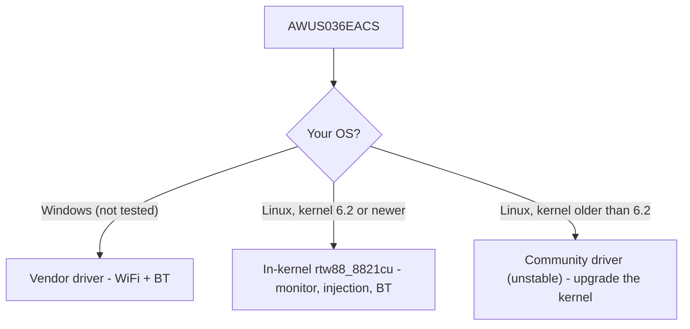

# ALFA AWUS036EACS——Nano WiFi + 藍牙組合

> **一句話定位（Quick Summary）**：**AWUS036EACS** 是 ALFA 的 **nano WiFi + 藍牙組合**——一支 **RTL8821CU AC600** 雙頻 dongle，整合 **BT 4.2**。在 **kernel 6.2 或更新版本**由內建的 `rtw88_8821cu` 驅動程式支援；在我們的 ASUS GX10 / Ubuntu 24.04 ARM64 測試中，監聽模式、雙頻 100% 的封包注入、AP、WPA3 AP（2.4 GHz，僅 AP 端）、端到端 handshake 擷取與藍牙皆可用。Windows 上隨插即用是原廠的說法，我們未測試。僅限在自有或已授權的網路使用。

## 規格總覽 (Spec overview)

| 項目 | 規格 |
|---|---|
| 晶片 | Realtek RTL8821CU |
| Wi-Fi 等級 | AC600（150 + 433 Mbps） |
| 介面 | USB 2.0 |
| 頻段 | WiFi：2.4 + 5 GHz ｜ BT：2.4 GHz |
| 藍牙 | BT 4.2（Linux 上實測可用） |
| 天線 | 內建 2 dBi（無外接 RP-SMA） |
| 安全性 | 依原廠規格為 WEP / WPA / WPA2 / WPA3-SAE（Linux 上實測 WPA2 與 WPA3-SAE 的 AP；WEP/WPA 未測試） |
| Linux 驅動程式 | `rtw88_8821cu`——**kernel ≥ 6.2 內建**（見 [RTL8821CU 驅動程式頁面](/alfa-network/drivers/rtl8821cu/)） |
| 監聽模式 | ✅ 2.4 + 5 GHz（GX10 實測） |
| 封包注入 | ✅ 2.4 與 5 GHz 皆 100%（GX10 實測） |

## 實測：ASUS GX10 / Ubuntu 24.04 ARM64

**測試環境**：ASUS Ascent GX10（NVIDIA GB10）、Ubuntu 24.04 LTS ARM64、kernel `6.17.0-1014-nvidia`，測試日期 2026-11-16 至 2026-11-19，測試裝置為 iPhone 7 Plus（WPA3 另用 iPhone 15 Pro）。

| 項目 | 結果 |
|---|---|
| 晶片 | Realtek RTL8821CU（WiFi + 藍牙複合裝置） |
| USB ID | `0bda:c820` |
| 核心驅動程式 | `rtw88_8821cu`（內建於核心） |
| 韌體 | WiFi 24.11.0（H2C version 12，取自 `dmesg`）；藍牙 `rtl_bt/rtl8821c_fw.bin` |
| 是否需要 DKMS | 否（kernel ≥ 6.2 不需要） |

| 功能 | 2.4 GHz | 5 GHz |
|---|---|---|
| Monitor | ✅ | ✅ |
| Injection | ✅ 100% | ✅ 100% |
| AP 熱點 | ✅ | ✅（802.11a、20 MHz 實測；VHT80 未測） |
| WPA3-SAE（AP 端） | ✅ | 未測試 |

| 進階功能 | 結果 |
|---|---|
| WPA handshake 擷取 | ✅ 端到端（deauth 收到 79 個 ACK，已轉出 `.22000`） |
| VIF | 🟡 被動 monitor VIF 可與 station 在同一頻道並存（software monitor）；驅動程式未宣告介面組合 |
| Active monitor | ❌ `Operation not supported (-95)` |
| IBSS（Ad-hoc） | ❌ `iw` 有列出但加入失敗 |
| Mesh（802.11s） | ❌ `-95` |
| Wi-Fi Direct（P2P） | ❌ `-95` |
| 藍牙 | ✅ 可用：韌體可載入、控制器可啟動，BR/EDR 與 LE 掃描皆掃到裝置；WiFi 與藍牙可共存（WiFi 連線時 BR/EDR 掃描正常；同時段的 LE 掃描掃到 0 台） |

在你自己的機器上驗證：

```bash
lsusb | grep -i 0bda:c820
sudo dmesg | grep -i 8821cu
iw phy $(cat /sys/class/net/$(ls /sys/class/net | grep '^wlx' | head -1)/phy80211/name) info | sed -n '/Supported interface modes/,/Band 1/p'
iw dev
bluetoothctl list
```

完整測試報告：[AWUS036EACS 於 ASUS GX10 / Ubuntu 的實測報告](https://yupitek.com/zh-tw/blog/awus036eacs-asus-gx10-ubuntu-test-report/)。

**備註**：
- 複合裝置：重新插拔後，WiFi 功能的 probe 可能卡住，不會出現 `wlx` 介面。請換一個 USB 連接埠。
- 反覆切換模式後，WiFi 這一側可能停擺（RX 收不到封包，`ip link set up` 回 `Operation already in progress`）。請拔下再插回（最好換一個連接埠），並在插上後第一件事就執行下一項測試。
- 請勿執行 `airmon-ng check kill`；`hcxdumptool` 8.x 在 5 GHz 無法啟動（arm 失敗；後續重測時 2.4 GHz 可以啟動）——請改用 `airodump-ng` + `aireplay-ng`。
- 5 GHz 注入前請先執行 `sudo iw reg set US`，測完再還原你原本的區域設定。
- 6 GHz：不適用。Kali 與 NetHunter：未實機測試。

## 總覽

EACS 是為想要**在一支小巧不起眼的隨身碟裡同時擁有 WiFi + 藍牙**的買家設計的：桌機、嵌入式工業電腦或小型 ARM 主機都適用。AC600 的速度加上 2 dBi 內建天線，讓它成為「夠用的上網 + 藍牙鍵盤／滑鼠」升級；天線短，所以最好靠近 AP 使用。

早期社群的說法是 RTL8821CU 沒有可用的 Linux 驅動程式。這個說法已經過時：主線的 `rtw88_8821cu` 驅動程式（kernel ≥ 6.2）可正常運作，在我們的測試中，雙頻注入皆達 100%，與 AWUS036ACH 並列，領先我們測過的其他 ac 等級無線網路卡。只有比 6.2 更舊的 kernel 才需要依賴不穩定的社群驅動程式。

## 安裝與驅動程式

### Linux，kernel 6.2 或更新版本

不需要安裝任何東西——內建的 `rtw88_8821cu` 會自動綁定，藍牙部分由 `btusb` 處理。請見 [RTL8821CU 驅動程式頁面](/alfa-network/drivers/rtl8821cu/)。

### Linux，較舊的 kernel（僅限 < 6.2）

存在一個社群驅動程式（`brektrou/rtl8821CU`），可能可以在舊 kernel 上編譯，但請預期不穩定。建議升級 kernel；驅動程式頁面有詳細說明。

### Windows

在 Windows（我們未測試）上，驅動程式預期會自動安裝：

1. 將無線網路卡插入 USB 連接埠。
2. Windows 自動安裝 RTL8821CU 驅動程式。WiFi 與藍牙都會出現在裝置管理員中。

```powershell
Get-PnpDevice -PresentOnly | Where-Object { $_.Class -eq "Net" }
```

**預期輸出**（我們未驗證）：列出一張 `802.11ac NIC` 網路介面卡與一個藍牙無線電。



## 相容性

| 平臺 | 支援 | 注意事項 |
|---|---|---|
| Ubuntu 24.04 ARM64（GX10，kernel 6.17） | ✅ 已實測 | 內建於核心，WiFi + 藍牙 |
| Linux kernel ≥ 6.2 | ✅ | 內建 `rtw88_8821cu` |
| Linux kernel < 6.2 | 🔧 | 僅有社群驅動程式，可能不穩定 |
| Kali Linux | ✅（我們未實機測試） | kernel ≥ 6.2 時內建於核心 |
| Windows | 我們未測試 | 原廠驅動程式；預期 WiFi + 藍牙可用 |
| NetHunter / Android | ❓ | 未測試 |
| Raspberry Pi | ❓ | 我們未測試（kernel ≥ 6.2 時內建於核心） |
| macOS | 我們未測試 | 支援有限；Apple Silicon 不支援 |

## 疑難排解

| 症狀 | 原因 | 修復 |
|---|---|---|
| `lsusb` 顯示 `0bda:c820` 但沒有 `wlx` 介面 | 複合裝置的 WiFi probe 在重新插拔後卡住 | 換一個 USB 連接埠；拔下再插回 |
| 多次切換模式後，掃描或擷取收到 0 個封包 | 複合裝置的 WiFi RX 停擺 | 拔下再插回（換一個連接埠）；插上後第一件事就做下一項測試 |
| 找不到藍牙裝置（Windows；我們未測試） | 驅動程式／服務衝突 | 檢查裝置管理員；從 ALFA 支援網站重新安裝驅動程式 |
| Linux kernel < 6.2：沒有穩定的驅動程式 | 只有社群驅動程式 | 升級到 kernel ≥ 6.2 |
| 距離短 | 內建 2 dBi 天線 | 設計如此；請靠近 AP 使用 |

## 相關資源

- [RTL8821CU 驅動程式頁面](/alfa-network/drivers/rtl8821cu/)
- [AWUS036ACM](/alfa-network/products/awus036acm/)——有外接天線的 MediaTek 替代款
- [AWUS036ACS](/alfa-network/products/awus036acs/)——口袋型監聽模式替代款
- [無線網路卡比較](/alfa-network/wifi-adapter-comparison/)
- [相容性矩陣](/alfa-network/linux-compatibility-matrix/)
