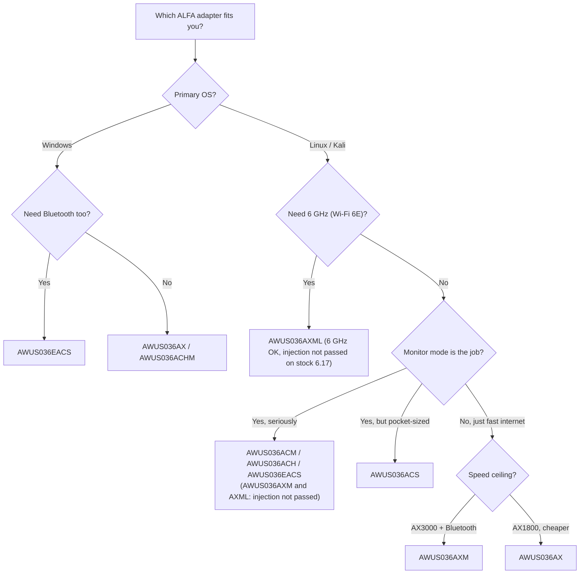

# ALFA Wi-Fi 無線網路卡比較

> **結論先行（Bottom line）**：如果你是使用 Kali Linux 做課程作業或實驗室練習的大學生，買 **AWUS036ACM**——它的 MediaTek MT7612U 晶片內建於 Linux 核心，監聽模式（monitor mode）與封包注入皆實測可用，而且比旗艦機型便宜。若要最高注入成功率，**AWUS036ACH / AWUS036EACS / AWUS036ACS**（EACS kernel ≥ 6.2、ACH / ACS kernel ≥ 6.13 內建驅動程式）兩頻注入皆達 96–100%。**AWUS036AXML**（USB-C）是唯一實測 6 GHz 可運作的型號，但 **AXML / AXM 的封包注入在 stock kernel 6.17 未通過**，不建議用於注入／滲透測試。需要小巧 WiFi + 藍牙組合，**AWUS036EACS** 在 Linux（kernel ≥ 6.2）由內建驅動程式支援（Windows 未實測）。

實測平台：ASUS GX10（NVIDIA GB10）、Ubuntu 24.04 LTS ARM64、kernel 6.17.0-1014-nvidia，測試日期 2026-11-16～11-19。

*💡 點擊上方圖片可開啟高解析度放大燈箱，清晰檢視完整型號與晶片規格。*
## 完整規格比較表

九款無線網路卡，一張表。「監聽模式」代表把介面切換成 RFMON，這樣你可以擷取某個頻道上的每個封包——這是 Wireshark、Aircrack-ng、Wifite 與類似工具的基本需求。

| 型號 | 晶片 | Wi-Fi 等級 | 介面 | 頻段 | 最高速度 | 監聽模式（Linux） | 天線 |
|---|---|---|---|---|---|---|---|
| [AWUS036ACH](/alfa-network/products/awus036ach/) | RTL8812AU | AC1200 | USB 3.0 | 2.4 + 5 GHz | 300 + 867 Mbps | ✅ 實測：注入 2.4G 100%、5G 100%（kernel ≥ 6.13 內建 `rtw88_8812au`） | 2 × 外接 5 dBi，RP-SMA |
| [AWUS036ACHM](/alfa-network/products/awus036achm/) | MT7610U | AC600 | USB 2.0 | 2.4 + 5 GHz | 150 + 433 Mbps | ✅ 實測：注入 2.4G 96–100%、5G 僅廣播（內建 `mt76x0u`） | 1 × 可拆式 5 dBi，RP-SMA（單天線） |
| [AWUS036ACM](/alfa-network/products/awus036acm/) | MT7612U | AC1200 | USB 3.0 | 2.4 + 5 GHz | 300 + 867 Mbps | ✅ 實測：注入 2.4G 63–83%、5G 76%（內建 `mt76x2u`） | 2 × 外接 5 dBi，RP-SMA |
| [AWUS036ACS](/alfa-network/products/awus036acs/) | RTL8811AU | AC600 | USB 2.0 | 2.4 + 5 GHz | 150 + 433 Mbps | ✅ 實測：注入 2.4G 100%、5G 96%（kernel ≥ 6.13 內建 `rtw88_8821au`） | 1 × 外接 2 dBi，RP-SMA（55 mm 機身） |
| [AWUS036AX](/alfa-network/products/awus036ax/) | RTL8832BU | AX1800 | USB 3.2 | 2.4 + 5 GHz | 574 + 1201 Mbps | ✅ 實測：monitor 強、注入 2.4G 96%、5G 可（kernel ≥ 6.17 內建 `rtw89_8852bu`） | 2 × 外接 6 dBi，RP-SMA |
| [AWUS036AXER](/alfa-network/products/awus036axer/) | RTL8832BU | AX1800 | USB 3.2 | 2.4 + 5 GHz | 574 + 1201 Mbps | ✅ 實測：monitor 強、注入 2.4G 73%、5G 可（kernel ≥ 6.17 內建 `rtw89_8852bu`） | 內建（10.5 g nano 機身） |
| [AWUS036AXM](/alfa-network/products/awus036axm/) | MT7921AU | AX3000 級 | USB 3.2 | 2.4 + 5 GHz 已實測；6 GHz 推測可用、未測試 | 最高 600 + 1200 + 1200 Mbps | ⚠️ monitor 可用（接收較弱）；注入未通過（stock kernel 6.17，內建 `mt7921u`） | 2 × 外接 5 dBi，RP-SMA + BT 5.2 |
| [AWUS036AXML](/alfa-network/products/awus036axml/) | MT7921AUN | AXE3000 | USB-C | 2.4 + 5 + 6 GHz（6 GHz 實測可運作） | 最高 600 + 1200 + 1200 Mbps | ⚠️ monitor 可用（接收較弱）；注入未通過（stock kernel 6.17，內建 `mt7921u`） | 2 × 外接 5 dBi，RP-SMA + BT 5.2 |
「+」分隔兩個頻段：**2.4 GHz + 5 GHz**（AXE 機型則為 + 6 GHz）。「300 + 867」的無線網路卡是 **AC1200** 等級：300 Mbps 是 2.4 GHz 上限（2 個空間串流 × 150 Mbps），867 Mbps 是 5 GHz 上限（2 × 433 Mbps）。實際吞吐量通常是連結速率的 50–70%——物理、牆壁與 USB 匯流排開銷吃掉了其餘部分。

## 哪一款適合你？

### 如果你要 Kali / 監聽模式 / 封包注入 → AWUS036ACM

MT7612U 晶片**自 Linux 4.19 起內建於核心**，這代表：在 Ubuntu 24.04（實測）上插上，`ip link` 就已經顯示網路介面。監聽模式透過標準 `iw` 指令運作，封包注入實測 2.4 GHz 63–83%、5 GHz 76%。若你要更高的注入成功率，**AWUS036ACH / AWUS036EACS**（兩頻 100%）、**AWUS036ACS**（100% / 96%）在 kernel 夠新時（ACH / ACS ≥ 6.13、EACS ≥ 6.2）同樣由內建驅動程式支援，不需 DKMS。它還提供 19–23 dBm TX 功率（約 100–200 mW，依 ALFA 規格表）搭配兩支外接天線——對實驗室練習來說是真正有用的範圍。完整工作流程在 [Kali 設定指南](/alfa-network/linux-setup-kali/)。

### 如果你要 Wi-Fi 6E（6 GHz）→ AWUS036AXML

AXML 提供 **6 GHz 頻段**（AXE3000），實測可運作：自架 6 GHz WPA3-SAE AP（ch37 / 6135 MHz），iPhone 15 Pro 以 802.11ax 連上。AXM 為同晶片系列（MT7921AU，同為 `mt7921u`），6 GHz 推測可用但**未實測**。它使用 MediaTek **MT7921AUN**，其 `mt7921u` 驅動程式自核心 5.18 起進入主線——所以同樣沒有 DKMS 的麻煩。注意：AXML / AXM 的**封包注入在 stock kernel 6.17 未通過**（主因是 kernel 6.16 起的 mac80211 chanctx 回歸，非晶片先天限制；社群修補版驅動可讓注入運作，但韌體仍把速率鎖在 1/6 Mbps），monitor 接收也較弱，**不建議用於注入／滲透測試用途**。它也是 Wi-Fi 6E 組合中的 USB-C 機型（AXM 為 USB-A），這使它成為現代超輕薄筆電或平板電腦的完美夥伴。請見 [Wi-Fi 6E 設定說明](/alfa-network/linux-setup-ubuntu/)。

### 如果你要純使用者端無線網路卡（快速、穩定、不做滲透測試）→ AWUS036AXM 或 AWUS036AX

AXM 是兩者中較快等級的（AX3000，依 ALFA 規格 5 GHz 上最高 1200 Mbps），並依規格表提供**藍牙 5.2**——一個 dongle 搞定 WiFi + BT（AXM 的藍牙未實測）。AX 提供 Wi-Fi 6 + WPA3，外觀更經典 ALFA，價格略低。AX 在 kernel ≥ 6.17 由內建 `rtw89_8852bu` 驅動程式支援，實測 monitor 與注入皆可用（注入 2.4G 96%）；AXM 的 monitor 接收較弱、注入未通過，不建議用於嗅探或注入。

ACS（55 mm 機身）與 AXER（10.5 g、內建天線）放進揹包就消失。ACS 是平價監聽模式夥伴（實測注入 2.4G 100%、5G 96%）；AXER 是日常使用的 Wi-Fi 6 nano（實測 monitor 接收強、注入 2.4G 73%）。

### 如果你需要小巧的 WiFi + 藍芽組合 → AWUS036EACS

EACS 在 kernel ≥ 6.2 由內建的 `rtw88_8821cu` 驅動程式支援（舊文件稱「Linux 不推薦」已與實測不符）：ASUS GX10 / Ubuntu 24.04 實測 monitor、注入（2.4G / 5G 皆 100%）、AP、WPA3-SAE 與藍芽皆可用。只有 kernel < 6.2 的舊系統才需要社群 DKMS 驅動程式。整合式 2 dBi 天線讓擷取距離有限；依規格表為 WiFi AC600 + BT 4.2 二合一（Windows 未實測）。

## 如果你無法決定——買 ACM

AWUS036ACM 是社群共識的選擇：內建於核心的驅動程式、經實測的監聽模式 + 注入、雙頻、高功率，而且完全在學生預算內。你會在[疑難排解](/alfa-network/troubleshooting/) 與[驅動程式](/alfa-network/drivers/mt7612u/) 頁面中看到它被當成「無聊但可靠的選項」——而在這個世界裡，無聊代表*它就是能用*。

下一步：在[相容性矩陣](/alfa-network/linux-compatibility-matrix/)中確認你的作業系統，或直接深入 [Ubuntu](/alfa-network/linux-setup-ubuntu/) / [Kali](/alfa-network/linux-setup-kali/) 設定指南。