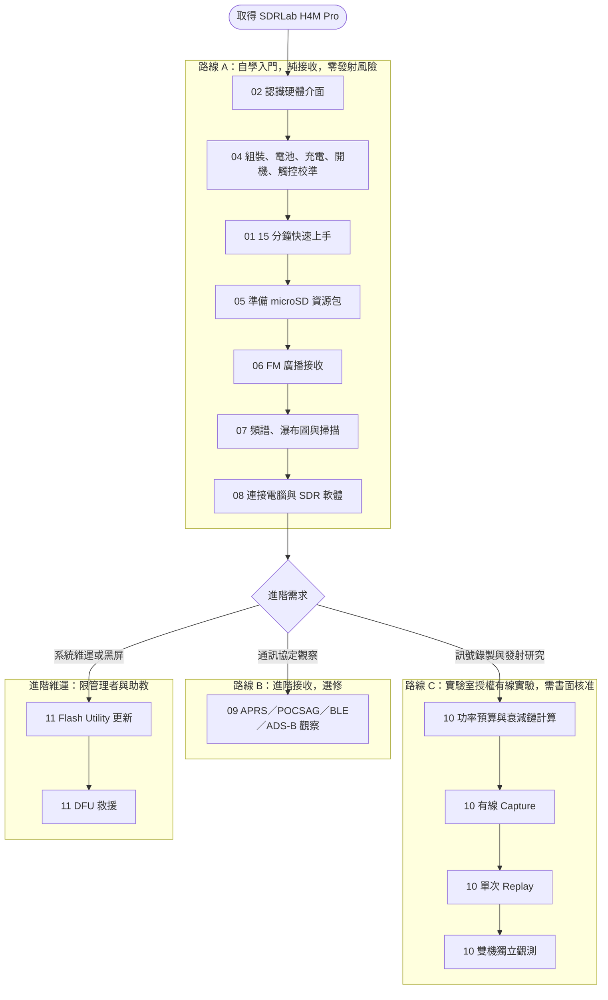

# SDRLab H4M Pro 操作手冊（研究生與實驗室適用）

> **適用裝置**：SDRLab H4M Pro（HackRF Pro r1.2.1 射頻主機板與 Mayhem Signature-Edition PortaPack H4M Pro 面板組合；資料來源為[供應商官方產品頁](https://opensourcesdrlab.com/products/hackrf-pro-h4m-pro?VariantsId=10426)）。  
> **適用對象**：大專院校理工科研究生、實驗室專案研究人員（初次接觸軟體定義無線電 SDR）。  
> **參考韌體**：首批出貨為供應商的 `Pro_v2.4.0`（依 Mayhem v2.4.0 修改）；更新範例使用 v2.4.0.3（硬體目標 `hpro`）。  
> **手冊版本**：03  
> **官方手冊對照**：已對照供應商官方《HackRF Pro + PortaPack H4M Pro User Manual》（2026-08-11 發佈）。  
> **更新日期**：2026-10-02  
> **發佈平台**：doc.yupitek.com（繁體中文正式版）  

:::warning 型號區隔重要提醒
SDRLab H4M Pro 與 H4M 在射頻主機板、電源（**18650 電池** vs 內建軟包）、時鐘（Pro 內建 TCXO）與介面配置上都不同。**請勿交叉套用 H4M 的韌體（`firmware_hackrf.bin`）、`hackrf` SD 資源包、刷寫指令或電氣數值**，以免造成裝置故障。本手冊只適用 H4M Pro；如果你的裝置是 H4M，請閱讀 H4M 手冊。
:::

:::info 商標與產品說明
本產品並非 Great Scott Gadgets 製造。「HackRF」是 Great Scott Gadgets 的商標；依其授權條件，可為了命名或描述 HackRF 的複製品或衍生作品而使用，並須標示出處。本手冊所述 H4M Pro 的產品資訊，以供應商官方產品頁與官方使用手冊為準。
:::

---

## 目錄

- [00 先讀我：安全 5 原則與學習路線圖](#00-先讀我安全-5-原則與學習路線圖)
- [01 15 分鐘快速上手（第一次成功：收聽 FM 廣播）](#01-15-分鐘快速上手第一次成功收聽-fm-廣播)
- [02 認識 H4M Pro 硬體與控制介面](#02-認識-h4m-pro-硬體與控制介面)
- [03 採購與必備器材清單](#03-採購與必備器材清單)
- [04 組裝、電池、充電、第一次開機與觸控校準](#04-組裝電池充電第一次開機與觸控校準)
- [05 準備 microSD 卡與部署資源包](#05-準備-microsd-卡與部署資源包)
- [06 第一次接收：公開 FM 廣播（詳細教學）](#06-第一次接收公開-fm-廣播詳細教學)
- [07 看懂頻譜、瀑布圖、增益控制與掃描](#07-看懂頻譜瀑布圖增益控制與掃描)
- [08 連接電腦操作（SDR 外接模式）](#08-連接電腦操作sdr-外接模式)
- [09 【選修】進階接收：APRS、POCSAG、BLE 與 ADS-B 觀察](#09-選修進階接收aprspocsagble-與-ads-b-觀察)
- [10 【實驗室授權】有線 Capture、單次 Replay 與 TX 實驗](#10-實驗室授權有線-capture單次-replay-與-tx-實驗)
- [11 【進階】韌體更新與 DFU 救援指南](#11-進階韌體更新與-dfu-救援指南)
- [12 排錯與常見問題（FAQ）](#12-排錯與常見問題faq)
- [13 核心術語對照與概念速查](#13-核心術語對照與概念速查)
- [14 學習驗收與實驗記錄表](#14-學習驗收與實驗記錄表)
- [附錄 A：接收頻段與電台查詢指引](#附錄-a接收頻段與電台查詢指引)
- [附錄 B：完整硬體配件規格與採購建議](#附錄-b完整硬體配件規格與採購建議)
- [附錄 C：射頻功率預算與衰減鏈計算工作表](#附錄-c射頻功率預算與衰減鏈計算工作表)
- [附錄 D：官方資源與延伸閱讀清單](#附錄-d官方資源與延伸閱讀清單)

---

## 00 先讀我：安全 5 原則與學習路線圖

軟體定義無線電（SDR, Software-Defined Radio）是極為強大的研究與教學工具。在開始任何操作之前，請全體讀者務必恪守以下 5 項核心原則：


:::warning 開始之前，請記住安全 5 原則
1. **先練習「純接收」**：本手冊前半部只專注於訊號的接收、頻譜觀察與資料解調，不涉及任何發射操作。
2. **發射（TX）與重放（Replay）必須取得實驗室書面授權**：嚴禁以天線進行空中輻射發射練習。所有發射實驗必須在完全受控的有線同軸鏈路中進行，並經指導教授或實驗室管理者書面審核。
3. **天線只用於接收**：裝上天線時，切勿啟動任何發射或重放功能。
4. **Bias-Tee 與 RF Amp 預設保持 OFF**：初學接收與一般實驗不需要開啟同軸供電（Bias-Tee）或內部射頻前置放大器（RF Amp），避免燒毀輸入端。
5. **有疑問立即停機諮詢**：所在地法規（如台灣 NCC《電信管理法》）及學校實驗室規範具有最高法律效力；遇到異常發熱、訊號過載或不明操作時，請立即斷電並向指導教授或實驗室管理者請益。
:::

### 核心限制與法律規範

1. **接收邊界**：接收並解調合法公開的廣播訊號（如商用 FM 廣播）屬於合法學習範疇。然而，未經授權攔截、記錄、公開或解密非公開通訊（如警消、軍用、航空、他人私人通訊）受刑法及電信法規嚴格規範與處罰。
2. **發射許可**：業餘無線電頻段發射需要執照與合規電台；ISM 頻段亦有嚴格的功率與場強限制。有線實驗即使不產生空中輻射，亦必須遵守設備電氣安全界限。GSG 對 HackRF Pro 原設計提供的規格，**不能直接視為 H4M Pro 這個衍生板的接收輸入上限**；也**絕對不要套用 HackRF One 的 −5 dBm 數值**。實際額定請以供應商資料確認；規格不明時，請停止操作並詢問指導教授或實驗室管理者。

### 學習路線圖



### 核心物理量快速導讀：dB 與 dBm

在射頻領域中，我們會頻繁遇到 **dB** 與 **dBm**：
- **dB（分貝，Decibel）**：代表兩個功率的**相對比值**，計算公式為 `dB = 10 * log10(P1 / P2)`。
  - +3 dB 代表功率增為 2 倍；-3 dB 代表功率減半。
  - +10 dB 代表功率為 10 倍；+30 dB 代表功率為 1,000 倍。
  - 衰減器標示 30 dB，表示通過的訊號功率會被衰減為原來的 $1/1000$。
- **dBm（毫瓦分貝）**：代表相對於 **1 mW（毫瓦）** 的**絕對功率值**，計算公式為 `P(dBm) = 10 * log10(P(mW) / 1 mW)`。
  - 0 dBm = 1 mW。
  - +10 dBm = 10 mW；+20 dBm = 100 mW。
  - -10 dBm = 0.1 mW；-30 dBm = 0.001 mW（換算示例）。
- **運算規則**：發射功率（dBm）減去衰減量與線損（dB）等於接收端輸入功率（dBm）：
  ```text
  P_RX = P_TX - 衰減量 - 線損
  ```

---

## 01 15 分鐘快速上手（第一次成功：收聽 FM 廣播）


本節旨在讓你在 15 分鐘內體驗到軟體定義無線電的魅力，建立信心後再深入各項原理。

| 步驟 | 核心動作 | 預期成果 |
|:---:|---|---|
| **Step 0** | 依第 04 章組裝、安裝 18650 電池、確認充電並完成觸控校準（只需做一次） | Battery 狀態正常，觸控準確 |
| **Step 1** | 將你的接收天線鎖到 `ANT` 端子（盒內是否附天線依訂單而定，見第 02 章） | 天線固定良好，手指轉緊即可 |
| **Step 2** | 確認 microSD 卡已插入機身卡槽（若尚未準備可先跳過，仍可開機測試） | 卡片卡扣就位 |
| **Step 3** | 將 `POWER` 開關撥至 ON（位置以機身絲印為準） | 螢幕亮起，顯示 Mayhem 主選單 |
| **Step 4** | 透過旋鈕與方向鍵進入 **Receive** → **Audio** | 進入音訊接收介面 |
| **Step 5** | 將 `mode` 切換為 **WFM**，輸入你所在地電台的 FM 頻率（查詢方式見附錄 A），慢慢調大 `volume` | 揚聲器傳出清晰廣播聲，畫面上出現顯著訊號峰 |

### 快速上手操作步驟

```text
主選單 (Main Menu)
  └─ Receive
       └─ Audio
            ├─ mode: WFM
            ├─ frequency: 你所在地電台的頻率（請見附錄 A）
            ├─ Amp: OFF
            ├─ LNA 16 / VGA 20: 官方手冊的 FM 起始值，聽不到再逐步調整
            └─ volume: 依聽感調整
```

1. **接妥天線**：將天線接頭對準機身 `ANT` SMA 母頭，順時針用手指旋緊。若使用伸縮天線，可拉長到約 75 cm（約為 100 MHz 的 1/4 波長）。
2. **開機進入介面**：撥動電源開關開機。在主畫面中，按方向鍵選擇 **Receive**，按中央確認鍵進入；接著選 **Audio** 並按中央鍵確認。
3. **設定調變模式**：使用方向鍵將游標移至 **mode** 欄位，轉動旋鈕切換為 **WFM**（寬頻調頻廣播）。
4. **設定頻率**：移至 **frequency** 欄位，輸入你所在地電台的頻率。請先到該電台的官方網站查詢；每個地區的頻率不同，不要直接抄別人的數字。
5. **安全調整音量**：確認畫面上的 `Amp` 保持為 **OFF**。慢慢旋轉調整 **volume**，即刻可聽見熟悉的電台廣播聲音！
6. **安全退出**：按實體 **Back** 鍵（或選取畫面上的返回項目）退出至主選單。

恭喜！你已經成功完成了第一次 SDR 射頻接收！接下來請跟隨手冊完整建立系統環境。

---

## 02 認識 H4M Pro 硬體與控制介面


### 兩層架構解析


SDRLab H4M Pro 採用模組化疊層架構：
1. **底層：射頻主機板（HackRF Pro r1.2.1 衍生板）**：
   - 負責射頻調諧、混頻、I/Q 取樣與數位訊號轉換。
   - 官方產品頁列出的規格見下表。
   - 增益、接收輸入上限等電氣特性，請以原廠資料為準，**不要沿用 HackRF One 的數值**。
   - 核心收發架構為半雙工（同時間只能接收或發射）。
2. **頂層：PortaPack H4M Pro 面板**：
   - 搭載觸控螢幕、控制輪、按鍵、揚聲器與 microSD 卡槽。
   - 電源為**可更換的 18650 電池**（電池艙在機身背面；**商品通常不含電池**）。
   - 執行開源 **Mayhem** 韌體，使 H4M Pro 成為無需外接電腦即可獨立運作的掌上型頻譜與無線電終端。

#### H4M Pro 官方規格摘要

| 項目 | H4M Pro（依官方產品頁） | 對照：HackRF One（H4M 使用） |
|---|---|---|
| 射頻主機板 | HackRF Pro r1.2.1 | HackRF One 相容板 |
| 工作頻率範圍 | 100 kHz ～ 6 GHz | 1 MHz ～ 6 GHz |
| 內建時鐘 | 25 MHz、0.5 ppm 高穩定度 TCXO | 無內建 TCXO |
| 主機板 USB | USB-C（USB 2.0） | Micro-B（USB 2.0） |
| 射頻防護 | 加強的內部射頻遮蔽；天線埠加強突波保護 | 基本遮蔽 |
| 電源 | 可更換的 18650 電池（由原本的 104050 軟包電池改版） | 內建軟包電池 |
| 面板改版 | 喇叭與 microSD 卡槽重新配置；前面板 PCB 加入防偽圖樣 | — |

官方使用手冊另列出面板與介面規格如下：

| 項目 | 規格（官方使用手冊） |
|---|---|
| 顯示 | 3.2 吋彩色**電阻式**觸控螢幕 |
| 實體控制 | 5 向旋鈕（旋轉、上下左右四方向、中央按壓） |
| 音訊 | 內建麥克風、內建喇叭、3.5 mm 耳機孔 |
| 電源管理 | 18650 電池管理晶片，USB 充電 |
| 建議電池 | 3.7 V 標稱／4.2 V 最大充電、2500 mAh、9.25 Wh |
| 儲存 | microSD 卡槽，FAT32 或 exFAT |
| 擴充 | GPIO 擴充埠 |
| 天線埠 | SMA；Bias-Tee 3.3 V 直流供電可在韌體中切換 |
| 射頻與取樣 | MAX2831 收發晶片；MAX5865 ADC/DAC（8-bit 正交）；取樣率最高 20 Msps、8-bit I/Q |
| 雙工 | 半雙工（同一時間只能接收或發射，不能同時） |
| 參考時鐘 | 內建 25 MHz、0.5 ppm TCXO；支援外部時鐘輸入／輸出 |
| 預載韌體 | `Pro_v2.4.0`（依 Mayhem v2.4.0 修改） |

**增益、輸入上限等電氣額定仍須依原廠資料確認，不能由這些表格推論。** 關於正品辨識，官方表示前面板有防偽圖樣，並會另外提供說明影片，請以官方說明為準。


### 盒內配件清點

請依你的**訂單與出貨清單**逐項清點。下列是常見項目，**不一定每份訂單都有**，不要因為商品照片有就認為是標準配件：
- [ ] HackRF Pro r1.2.1 射頻主機板
- [ ] PortaPack H4M Pro 面板（Mayhem Signature Edition）
- [ ] USB 資料連接線（接頭型式依批次而定）
- [ ] 接收天線（SMA 公頭；官方手冊列有 ANT500 伸縮天線，或依目標頻段選用專用天線；是否隨附依訂單而定）
- [ ] 其他選購天線（例如特定頻段的膠棒天線）

供應商商品頁標示**不隨附 18650 電池**，請另行準備（見第 03 章）。如果有缺件、外觀損傷或連接埠變形，請先拍照留存，再聯絡供應商。Yupitek 不附 microSD 卡，也不預載資源，請自備。依官方手冊，HackRF Pro 主機板與 PortaPack H4M Pro 面板是成套供應，使用前要先依第 04 章的 4.1 組裝。

### 實體介面與端子定義

:::tip 接頭辨識準則
接線時請**一律以機身金屬殼或外殼絲印文字為準**，切勿單憑手冊或網路照片的方向猜測！
:::

| 絲印名稱 | 物理介面 | 核心用途 | 初學階段連接建議 |
|---|---|---|---|
| **`ANT`** | SMA 母頭（外螺內孔） | 射頻輸入／輸出端子；Bias-Tee 3.3 V 直流供電可在韌體中切換 | **可以連接**（僅限純接收天線）；Bias-Tee 保持 OFF |
| **`CLK IN`** | SMA 母頭 | 外部參考時鐘輸入（官方規格列為支援；電氣額定請查原廠資料） | **先不要連接**（規格未確認前保持空置） |
| **`CLK OUT`** | SMA 母頭 | 參考時鐘輸出（官方規格列為支援；電氣額定請查原廠資料） | **先不要連接**（規格未確認前保持空置） |
| **`POWER`** | 撥動開關 | 電源開關。依供應商手冊，**開關在 ON 時才會充電** | 位置與方向以機身絲印為準 |
| **USB 埠（2 個）** | USB 端子（HackRF Pro 主機板為 USB-C） | 不同的 USB 埠可能分別負責**資料傳輸**與**充電**，不要只因接頭相同就推定用途 | 以機身絲印與供應商手冊確認用途；**不要同時試插兩個埠** |
| **電池艙** | 背面艙蓋 | 安裝 18650 電池 | 只依第 04 章步驟操作 |
| **microSD** | TF 彈壓式卡槽 | 儲存韌體擴充應用（APPS）、設定與錄音（位置與 H4M 不同，以實機為準） | 關機狀態下插拔專用記憶卡 |
| **GPIO** | 排針端子 | 外部除錯與硬體擴充介面（接腳定義請以原廠資料為準） | **嚴禁連接**（保持懸空，防止短路） |

### 控制元件統一命名與操作指引

為確保操作步驟清晰無誤，本手冊全文統一使用以下控制元件名稱：

| 控制元件名稱 | 對應硬體 | 核心操作功能 |
|---|---|---|
| **旋鈕（Dial）** | 5 向旋鈕的旋轉動作 | 改變當前選取欄位的數值（如調整頻率數字、音量大小、增益等級） |
| **方向鍵（D-pad）** | 5 向旋鈕的上下左右四個方向 | 在螢幕各欄位與功能表之間移動選取游標（焦點） |
| **中央確認鍵（Select）** | 5 向旋鈕的中央按壓 | 確認選取、進入子選單或觸發動作 |
| **返回鍵（Back）** | 機身上標示 Back 的實體按鍵，或畫面上的返回項目 | 退出當前 App、返回上一層選單 |
| **觸控螢幕（Touchscreen）** | 3.2 吋電阻式觸控螢幕 | 輕觸直接選取目標。電阻式螢幕**需要先完成觸控校準**（見 4.5）；輸入頻率數字時，旋鈕比點選更容易。若觸控沒有反應，請改用旋鈕與方向鍵，並避免大力按壓螢幕，同時記下你的版本資訊以便向供應商求助 |

### 接收天線安裝指南


1. **檢查接頭形式**：H4M Pro 機身的 `ANT` 接頭為標準 SMA 母頭（外螺紋，中心為金屬插孔）。隨附天線接頭應為標準 SMA 公頭（內螺紋，中心有金屬針）。請目視確認中心針筆直無偏折。
2. **安裝動作**：將天線垂直對準 `ANT` 端子，輕推就位後，用手指旋轉外金屬螺套直到鎖緊。
3. **安全警語**：切勿使用板手或鉗子暴力鎖死，也不要在天線未固定時旋轉整台主機，以免造成 SMA 端子內部排針扭斷或焊點破裂。初次接收時，Bias-Tee 與 Amp 都保持 OFF。大型戶外天線另有雷擊與強訊號風險，請不要在初學階段使用。

---

## 03 採購與必備器材清單

### 1. 純接收自備清單（每位讀者必備）


- **microSD 卡**：


  - 規格：建議 **16 GB 至 32 GB**，Class 10 / A1 等級，向可靠通路購買真品。這些標章只是入門的保守選擇，不保證高取樣率錄製時完全不丟樣。
  - 格式：官方手冊指出 FAT32 或 exFAT 都可使用；本手冊的格式化範例以 FAT32 為主。
  - 原因：低品質或老化的卡，是錄製 IQ 時丟樣（會悄悄損毀錄製檔）與刷寫失敗（可能造成無法開機）的主要原因；容量越大也越容易買到擴容偽卡。
  - 購買後請保留發票與卡片型號，格式化前先測試完整容量與可寫性（測試可能清除全部資料，請使用可信來源的測試軟體，並確認選對磁碟）。


- **18650 鋰電池（另購；商品通常不含）**：


  - 請依**官方網站**公布的建議參數，選用**單顆**電池（[官方產品頁](https://opensourcesdrlab.com/products/hackrf-pro-h4m-pro?VariantsId=10426)、[官方 H4M Pro 使用手冊](https://blog.opensourcesdrlab.com/archives/HackRF-Pro-PortaPack-H4M-Pro-User-Manual)）。
  - **官方建議的 18650 電池參數**：

    | 項目 | 建議參數 |
    |---|---|
    | 類型 | 3.7 V 可充電鋰離子電池 |
    | 標稱容量 | 2500 mAh |
    | 標稱能量 | 9.25 Wh |
    | 標稱電壓 | 3.7 V |
    | 最大充電電壓 | 4.2 V |

  - 本手冊**不指定電池型號與購買來源**：這款產品銷往多個國家，各地可買到的型號與適用法規不同。請向可靠的通路購買，並核對電池標籤與上表參數相符。官方產品頁另有測試時使用的電池照片，可供辨識外形。
  - 確認電池外觀完好、沒有破皮或鼓脹，並核對製造商標示的保護要求與尺寸。
  - 嚴禁反接、短路、混用不明電池。
- **microSD 讀卡機**：
  - 用於將 Mayhem SD 資源包解壓縮寫入記憶卡根目錄。
- **可信電腦與作業系統**：
  - Windows 10/11、macOS (Intel/Apple Silicon) 或 Linux (Ubuntu/Debian)。
- **被動接收天線**：
  - 隨附伸縮天線（適合 70 MHz – 1 GHz）或特定頻段膠棒天線（如 433 MHz / 915 MHz）。

### 2. 實驗室有線安全套件清單（進行第 10 章實驗時由實驗室統一提供）


:::danger 有線實驗防護原則
進行任何射頻發射（TX）或重放（Replay）實驗時，**嚴禁將兩台 SDR 的 `ANT` 端口以同軸線直接互連**！若無足夠衰減，發射功率將直接燒毀接收端低雜訊放大器（LNA）。
:::

- **50 Ω 射頻同軸電纜**：優質雙層遮蔽 RG-316 或 RG-142，SMA 公對公接頭。
- **固定射頻衰減器組（Attenuators）**：
  - 阻抗：50 Ω。
  - 耐受功率與衰減量：**必須依第 10.3 節的功率預算計算後選用**，首級衰減器要能承受發射端的最大功率。
  - 附錄 B 的規格只是常見配置舉例，**不能直接當作安全依據**；30 dB 也不是通用的安全值。
- **隔直器（DC Block）**：
  - 串聯於射頻鏈路中，物理阻絕任何直流偏置電壓，保護敏感前端晶片。
- **50 Ω 射頻假負載（Dummy Load）**：
  - 用於終端阻抗匹配吸收功率，非直接保護接收端。
- **第二台獨立接收量測設備**：
  - 頻譜分析儀、功率計，或另一台受完整衰減保護的 SDR 裝置。

### 3. 官方軟體與資源下載管道


請務必從官方開源儲存庫下載，切勿使用來路不明的網盤或二次打包映像檔：
- **供應商 Mayhem 發行頁**：[GitHub OpenSourceSDRLab/mayhem-firmware Releases](https://github.com/OpenSourceSDRLab/mayhem-firmware/releases)
- **Mayhem 官方發行頁**：[GitHub portapack-mayhem/mayhem-firmware Releases](https://github.com/portapack-mayhem/mayhem-firmware/releases)

**官方說明（產品頁）**：首批出貨的韌體是依 Mayhem v2.4.0 修改的版本，名稱為 `Pro_v2.4.0`，開機後**螢幕左下角**顯示的版本號就是 `Pro_v2.4.0`。如果要複製 SD 卡內容，可暫時使用供應商 [v2.4.0 發行頁](https://github.com/OpenSourceSDRLab/mayhem-firmware/releases/tag/v2.4.0)的壓縮檔，使用後 APPS 圖示就不會再反灰，可以正常使用。你也可以自行更新到官方 Mayhem 韌體；官方表示開發團隊近期已針對 HackRF Pro 與 H4M Pro 做了適配，可考慮 nightly 版本。

請依你的情況選擇：

| 你的情況 | 做法 |
|---|---|
| 首批出貨，開機左下角顯示 `Pro_v2.4.0` | 到供應商 v2.4.0 發行頁，在 **Assets** 下載 SD 資源壓縮檔，解壓縮到卡根目錄（第 05 章） |
| 版本不是 `Pro_v2.4.0` | 先記錄你的完整版本字串，向供應商確認相配的資源，不要直接覆蓋 |
| 決定更新韌體（見第 11 章） | SD 資源包與韌體必須是**同一版本、同一硬體目標**。範例：v2.4.0.3 的 `COPY_TO_SDCARD_hpro_mayhem_v2.4.0.3.zip`（空間有限可選同版本的 `-no-world-map` 版，兩者只選一個）與 `FIRMWARE_mayhem_v2.4.0.3.zip` |

- 韌體 ZIP 內含多個硬體目標，H4M Pro 必須使用 `firmware_hpro.bin`，**不要使用** `firmware_hackrf.bin`。
- **`hackrf` 與 `hpro` 資源不能混用，也不能只看版本號相同**：下載前務必確認檔名中的目標是 `hpro`。

#### 下載檔案 SHA-256 檢查碼計算指南

下載完成後，請在終端機中計算雜湊值，並與官方發行頁（GitHub Releases）上的 SHA-256 比對，確保檔案完整、來源正確。如果還不熟悉終端機，請先看第 08 章的「第一次使用終端機」：
- **Windows（PowerShell 或 CMD）**：
  ```cmd
  certutil -hashfile <資源包檔名>.zip SHA256
  ```
- **macOS（Terminal）**：
  ```sh
  shasum -a 256 <資源包檔名>.zip
  ```
- **Linux（Bash）**：
  ```sh
  sha256sum <資源包檔名>.zip
  ```

---

## 04 組裝、電池、充電、第一次開機與觸控校準

### 4.1 組裝 HackRF Pro 與 PortaPack H4M Pro


依官方手冊，主機板與面板是成套供應，第一次使用前需要先組裝。

1. **關機並移除所有線材**：電源開關在 OFF，拔除 USB 線與任何射頻（RF）線材。
2. **對準排針**：把 PortaPack H4M Pro 對準 HackRF Pro 的擴充排針。
3. **平行均勻按壓**：兩塊板從頭到尾保持平行，均勻往下壓。**不要從一端搖晃面板**，否則會折彎排針。
4. **確認到位**：正確就位時，兩塊板貼合，連接器沿線**沒有可見的縫隙**。

**如果不對**：板子無法貼合，或有一端翹起，請停止，不要加大力道，先檢查排針是否歪斜，並聯絡供應商。

### 4.2 安裝 18650 電池

H4M Pro 使用可更換的 18650 電池，**第一次開機前必須先安裝**。這一步的風險最高，請逐步確認。

:::danger 18650 鋰電池安全
- 只使用單顆、外觀完好、符合官方網站建議參數的 18650 電池（見第 03 章）。
- **正負極方向必須與電池艙內的標記一致**。無法確認方向時，不要安裝，請聯絡供應商。
- 嚴禁反接、短路、混用不明電池。依官方手冊，極性接反會燒毀電源管理晶片。
- 發現發熱、異味或鼓脹，立即斷電並遠離可燃物。
:::

1. **完全關機**：將電源開關撥到 OFF，拔除 USB 線與所有射頻（RF）線材。
2. **檢查電池**：確認電池外皮沒有破損，兩端接點乾淨。
3. **開啟電池艙**：在機身背面開啟電池艙蓋。
4. **對照極性**：電池艙內壓鑄有正負極標記。把電池兩端與標記對照，確認方向。**不要依商品照片推測方向**；官方手冊同樣要求依電池座上壓鑄的正負極標記放入；若標記不清楚或與你的電池不一致，停止並向供應商確認。
5. **放入電池**：方向、尺寸與電壓都確認無誤後，輕放入電池。不要強行壓入尺寸不合的電池。
6. **蓋好艙蓋**，再進行下一節的充電與開機。

**你應該看到**：電池穩固放入，艙蓋可正常蓋上，沒有異味或發熱。

### 4.3 充電、holding 與溫度


依供應商的 H4M Pro 手冊，**電源開關在 ON 時才會充電**；開關在 OFF 時，畫面可能停在 `holding`，表示沒有充電。官方手冊指出，這是最常被回報成「電池壞掉」的狀況，實際上並非故障。

1. 確認電池已依 4.2 正確安裝，並確認機身標示為**充電用途**的 USB 埠。
2. 接上符合供應商規定的可靠 USB 電源與可傳輸電力的線材。**不要同時試插兩個 USB 埠。**
3. 把電源開關撥到 **ON**。
4. 點選標題列右上方的電池圖示（或在選單中開啟 **Battery**），查看 `charge` 欄位是 `charging` 還是 `holding`，並留意電壓。百分比只是估計值，不是實測容量。
5. 如果顯示 `holding`，依序確認電源開關、線材、USB 埠、電源供應器與電池接點。一次只換一項，**不要直接判定電池故障**。
6. 充電期間若外殼異常發熱、有異味或電池膨脹，立即拔掉 USB 並遠離可燃物，通知實驗室管理者。
7. 充電完成後拔掉 USB。

不同批次的行為若與供應商手冊不同，請停止並儲存畫面向供應商求證。

### 4.4 首次開機自檢（Self-Check）

1. **環境準備**：將 H4M Pro 放置於絕緣、穩固的工作桌面上，先不要連接任何 RF、CLK 或 GPIO 線材。
2. **開機動作**：將電源開關推向 ON 位置。
3. **開機畫面查驗**：
   - 螢幕亮起並載入 Mayhem 啟動畫面。
   - 主畫面上方會顯示時間、microSD 卡狀態圖示、電池電壓與狀態。
   - 主畫面中央為功能選單（例如 **Receive**、**Transmit**、**Capture**、**Replay** 等，實際項目依版本而異）。
   - 如果還沒有放入 microSD 卡，部分圖示會呈灰色，這是正常現象，等第 05 章部署資源後再處理，不要由單一灰色圖示判定硬體故障。
4. **檢查韌體版本字串**：


   - 開機後，**螢幕左下角**會顯示版本號（供應商首批出貨為 `Pro_v2.4.0`）。也可在主畫面或 **Settings** 中找到 **About**（版本資訊）；不同版本的位置可能略有不同。
   - 記錄完整版本字串（例如帶有 `Pro_` 或 `n_` 等字首的版本、版本號與提交碼），並拍照留存。
   - 這個版本字串決定你在第 05 章該下載哪一組資源包。
5. **關機動作**：操作完畢後，先透過返回鍵退回主選單，再將電源開關推向 OFF。

#### 開機驗收標準（官方手冊：四項必須同時成立）

1. 左下角顯示完整的韌體版本，**沒有紅色的 FLASH ERR**。
2. 右上角的 SD 圖示是**綠色**，表示卡片已被辨識。
3. 主選單所有應用圖示都是亮的，點選能正常開啟。
4. 右下角時鐘顯示即時的 UTC 時間。

如果出現下列異常，請依表處理：

| 症狀 | 原因與處置 |
|---|---|
| 左下角出現紅色 FLASH ERR | 韌體校驗不符，請重新刷寫韌體（見第 11 章，限管理者） |
| 應用圖示反灰 | SD 資源與韌體版本不符，請重新部署完整的 SD 資源包（第 05 章） |
| SD 圖示不是綠色 | 卡片沒有被辨識，請重新格式化為 FAT32 或 exFAT，或更換卡片 |
| 時鐘停止，或每次重新開機日期就加一天 | 內部鈕扣電池耗盡，或沒有插入 SD 卡 |


### 4.5 觸控校準

H4M Pro 的觸控螢幕是**電阻式**。沒有校準時，後面的操作都不可靠，所以請在第一次開機後先完成校準。

1. 進入 **Main menu → Settings → Calibration**。
2. 依畫面提示，依序點選每個十字目標。**每個點都要按住至少 1 秒再放開**；放開太早，是校準資料不準的常見原因。
3. 校準完成後重新開機，確認觸控位置準確。

**如果不對**：重新開機後觸控仍然偏移，官方手冊指出是機內的鈕扣電池耗盡。更換電池後，校準資料才會永久儲存；否則每次關機後校準都會消失。更換請交由供應商或有經驗的人員處理。

### 4.6 標題列、主選單與實體控制

#### 標題列圖示

標題列右側由左至右依序是：螢幕截圖、休眠、靜音模式（stealth）、頻率轉換器、Bias-Tee 直流供電、外部時鐘輸出、靜音、螢幕亮度、電池百分比、SD 卡狀態。

:::danger Bias-Tee 警告
Bias-Tee 開啟時圖示會變黃，此時天線埠會輸出 **3.3 V 直流電**。只有在接上主動式天線或外接 LNA 時才可以開啟。**接被動式天線時絕對不要開啟**：這是標題列中唯一可能損壞硬體的開關。
:::

#### 主選單的八個模組

| 模組 | 功能 |
|---|---|
| 1 Receive | 接收類應用：音訊解調、寬頻掃描 |
| 2 Transmit | 發射類應用：IQ 重放、自訂發射（**初學階段不要使用**） |
| 3 Recon | 自動全頻段掃描與頻率擷取 |
| 4 Capture | 原始 IQ 訊號錄製 |
| 5 Replay | 播放與發射已儲存的 IQ 檔 |
| 6 Looking Glass | 超寬頻即時頻譜掃描 |
| 7 Utilities | 工具箱：韌體更新、截圖、檔案 |
| 8 Settings | 全域參數設定 |

實際項目依版本而異。

#### 資訊列

資訊列左側顯示目前的 Mayhem 韌體版本；韌體損毀時會顯示紅色 FLASH ERR。右側顯示即時 UTC 日期時間。鈕扣電池耗盡時，時鐘會停止；沒有插入 SD 卡時，每次重新開機日期會加一天。

#### 實體控制

5 向旋鈕在電阻式觸控不好點選時最好用：**旋轉**可以增減數值，**按上下左右**可以在欄位間移動，**按中央**確認。調整頻率數字時，用旋鈕比點選容易得多。

### 4.7 電池容量設定（選用）

官方手冊的做法：

1. 開機後，點選標題列右上方的電池圖示，進入電池設定。
2. 把預設的 **1500 mAh** 改成實際容量並儲存。官方建議的電池容量是 **2500 mAh**；若你的電池標籤上的容量不同，請以標籤為準。
3. 之後標題列會較準確地顯示剩餘百分比、即時電壓與預估續航。

容量值只是剩餘電量估算用的參考值：**保持 1500 mAh 並不會損壞任何東西**，只是百分比與預估續航會不準。容量設定也**不會增加電池的實際容量**。如果你的版本沒有這個設定，可以略過。

---

## 05 準備 microSD 卡與部署資源包


microSD 卡是 H4M Pro 執行外部 App（如 Audio 接收、Capture 錄音、頻譜分析）的必要儲存媒介。若未插卡或檔案結構不正確，主選單的許多圖示將顯示為灰色無法點擊，或出現 `ExtAppErr` 錯誤。

### 5.1 各作業系統格式化 FAT32 指南

官方手冊指出 FAT32 或 exFAT 都可使用；以下範例以 FAT32 為主。

請務必將 microSD 卡格式化為 **FAT32** 檔案系統（Master Boot Record 分割區表）：

<details>
<summary>點擊展開：Windows 格式化步驟</summary>

1. 將卡插入讀卡機並連接電腦。
2. 開啟「檔案總管」，在該磁碟機代號上按滑鼠右鍵，點選「格式化」。
3. 檔案系統選擇 **FAT32**，配置單元大小選擇「預設配置大小」。
4. 勾選「快速格式化」，點擊「開始」。
*(若卡片大於 32 GB 且系統選單沒有 FAT32，請先查閱 [Mayhem 官方格式化說明](https://github.com/portapack-mayhem/mayhem-firmware/wiki/How-to-Format-SDCard)，再使用可信來源的工具。)*
</details>

<details>
<summary>點擊展開：macOS 格式化步驟</summary>

1. 開啟「磁碟工具程式（Disk Utility）」。
2. 於左側選取外接記憶卡裝置，點擊上方「清除（Erase）」。
3. 名稱輸入 `H4MPRO`，格式選擇 **MS-DOS (FAT)**，架構選擇 **主開機紀錄 (MBR)**。
4. 點擊「清除」完成格式化。
*(或在 Terminal 執行：`diskutil eraseDisk FAT32 H4MPRO MBRFormat /dev/diskN`，請確認 diskN 編號)*。
</details>

<details>
<summary>點擊展開：Linux 格式化步驟</summary>

:::danger 先確認磁碟代號
格式化會清除整張卡的資料。請用容量與裝置名**雙重確認**是 microSD 卡，選錯會清除其他磁碟。
:::

1. 透過 `lsblk` 確認記憶卡分割區代號（例如 `/dev/sdb1`）。
2. 確認無誤後執行指令：
   ```bash
   sudo mkfs.vfat -F 32 /dev/sdb1
   ```
</details>

### 5.2 解壓縮與目錄結構確認

1. 下載第 03 章依你的情況選定的 SD 資源包（檔名含 `hpro` 或來自供應商 v2.4.0 發行頁）。
2. 解壓縮 ZIP 檔案，**將壓縮檔內的所有資料夾與檔案直接複製到記憶卡的最頂層（根目錄）**。
3. 檢查記憶卡根目錄，確保結構如下，**千萬不要包覆一層包含 ZIP 檔名的多餘母資料夾**：

```text
microSD 卡根目錄 (/)
├── APPS/             <-- 外部擴充程式 (.ppd 應用，若遺失主選單會反灰)
├── SETTINGS/         <-- 系統偏好設定儲存目錄
├── FREQMAN/          <-- 頻率管理器清單檔案目錄 (.TXT)
├── CAPTURES/         <-- 射頻錄音與 IQ 資料記錄目錄 (.C16 / .TXT)
└── LOOKINGGLASS/     <-- 寬頻掃描預設頻段目錄
```

實際資料夾依資源包版本而異，以你下載的資源包內容為準。官方手冊提醒：**每次更新韌體後，SD 資源包都必須重新部署**；兩者版本不相配時，主選單的 App 圖示會反灰。更新時不要把舊的 `APPS` 整個覆蓋新資源包；電腦與 H4M Pro 也不要同時寫入同一張卡。

4. **安全退出並插卡**：
   - 在電腦作業系統中執行「安全移除硬體 / 推出磁碟」。
   - **務必在 H4M Pro 完全關機狀態下**，將金屬接點朝向正確方向（依機身插槽圖示），輕推插入卡槽直到聽到清脆卡扣聲。
   - 開機後，如果螢幕上方出現記憶卡圖示，且主選單圖示正常顯示，通常表示資源包已部署成功。最後仍要以第 06 章的實際接收來確認。

---

## 06 第一次接收：公開 FM 廣播（詳細教學）

**目標**：透過 H4M Pro 接收並解調所在地公開商用寬頻 FM 廣播電台。  
**預估耗時**：約 10 分鐘  
**所需器材**：已就緒的 H4M Pro、伸縮天線（已接於 `ANT`）、耳機（可選）。  

### 操作步驟（一步一動）

1. **進入音訊接收模組**：
   - 開機進入主選單，使用方向鍵移至 **Receive**，按中央確認鍵進入。
   - 移至 **Audio**，按中央確認鍵進入音訊接收畫面。
2. **選擇解調模式（Mode）**：
   - 將游標移至 **mode** 欄位。
   - 轉動旋鈕切換至 **WFM**（Wideband FM，寬頻調頻）。
    - *(說明：一般 FM 音樂電台使用 WFM；NFM 為對講機使用的窄頻調頻，在此會嚴重失真。官方手冊的 FM 範例：頻寬 200 kHz。)*
3. **輸入中心頻率（Frequency）**：
   - 將游標移至 **frequency** 欄位。
   - 按下中央確認鍵選取特定位數，轉動旋鈕輸入你所在地的電台頻率（格式例如 `100.700 MHz`，**這只是格式範例，不是通用頻率**，請參照附錄 A 查詢）。
4. **確認高頻放大器關閉（Amp OFF）**：
   - 目視確認畫面上的 **Amp** 顯示為 **OFF**。
5. **初始化增益（Gain）**：
   - 官方手冊的 FM 起始值是 **LNA 16、VGA 20**（AMP 保持 0）。聽不到或訊號太弱時再逐步調整，每次只調一項。
6. **調大音量（Volume）**：
   - 移至 **volume** 欄位（畫面右側的音量滑桿），順時針旋轉旋鈕慢慢調大，直到內建喇叭或 3.5 mm 耳機傳出聲音。
7. **微調靜噪門檻（Squelch）**：
   - 若無聲音，確認 **squelch**（SQ）數值是否過高；嘗試將它調至最低（0 或 OFF），使背景白雜訊出現，確認喇叭運作正常。官方手冊指出，過高的 SQ 預設值可能擋掉所有音訊輸出，這是「看得到載波卻沒聲音」最常見的原因。
8. **微調天線與頻率**：
   - 適度微調天線長度與擺放角度，觀察螢幕上頻譜峰值變高、雜音消失、人聲與音樂清晰。
9. **正常退出**：
   - 收聽完成後，按下實體 **Back** 鍵安全退出至選單。

:::tip 你應該看到與聽到的結果
螢幕正中央會出現一個顯著且穩定的訊號峰，瀑布圖有明顯亮帶持續下移，耳機或揚聲器傳出清晰的廣播內容。
:::

### 故障排除與中斷條件

- **有訊號峰但只有沙沙雜音**：檢查 `mode` 是否設為 **WFM**；若設為 NFM 則無法正確解調立體聲廣播。
- **完全沒有聲音**：確認音量不是 0，並檢查是否插著耳機（**插上耳機時，內建喇叭會停用**）。
- **完全無聲音且無訊號峰**：檢查天線是否確實鎖在 `ANT` 端子、頻率數值是否輸入錯誤（注意 MHz 與 kHz 單位）。
- 💡 **這個測試的用途**：FM 廣播是確認整條接收鏈（天線、射頻前端、解調、音訊輸出）是否正常最快的方法。之後的實驗聽不到聲音時，回來做這個測試，可以判斷問題在音訊路徑還是在接收本身。
- ⛔ **請立刻停止**：若機器突然急劇發熱、螢幕異常反覆重啟，請立即關閉電源開關。

---

## 07 看懂頻譜、瀑布圖、增益控制與掃描

### 7.1 頻譜圖（Spectrum）與瀑布圖（Waterfall）原理


進入頻譜或音訊頁面時，畫面通常分為上下兩半部：

```text
+-------------------------------------------------------+
|  頻譜圖 (Spectrum)                                    |
|         ^ 幅度 (Amplitude / dBFS)                     |
|         |           /\ (強訊號峰)                     |
|         |          /  \                               |
|         |  /\_    /    \    _/\ (噪底 Noise Floor)    |
|         +---\----/------\--/--------------------> 頻率|
+-------------------------------------------------------+
|  瀑布圖 (Waterfall)                                   |
|  時間 (t) 向下滾動                                    |
|  t0  [      ..  ======  ..    ] (顏色深淺代表相對強度)|
|  t1  [      ..  ======  ..    ]                       |
|  t2  [      ..  ======  ..    ]                       |
+-------------------------------------------------------+
```

- **上半部：頻譜圖（橫軸頻率，縱軸訊號強度）**：即時呈現當前通過接收機濾波器的所有頻率分量強度。
- **下半部：瀑布圖（橫軸頻率，垂直方向為時間軸）**：新資料從最上方加入並向下滾動。顏色的亮暗代表訊號強弱（例如藍色代表弱雜訊，黃紅白色代表強發射訊號），非常適合用來捕捉間歇性發射或突發封包。

### 7.2 增益控制鏈（Gain Staging）與過載排查


SDRLab H4M Pro 具備多級增益。**H4M Pro 與 HackRF One 的增益校準不同，不要套用 HackRF One 的數值**；各級的可調範圍與步進以你的畫面顯示為準：
1. **RF Amp（射頻前置放大器）**：**初學階段強烈建議一律 OFF**。當天線接收到強訊號時，開啟 Amp 會讓接收前端飽和。
2. **LNA Gain（低雜訊放大器增益）**：主要用來提高前端微弱訊號的訊噪比（SNR）。
3. **VGA Gain（基頻可變增益放大器）**：放大降頻後的基頻訊號，供 ADC 取樣。

調整原則：先把增益降到低檔，再逐步調高；每次只調一項，並記下變化。

官方手冊對三個增益的說明：**LNA 與 VGA 提高靈敏度，是平常要調的兩個**；調太高會讓前端飽和，調太低則訊號被淹沒。**AMP 是前端射頻放大器**：訊號強或距離近時保持 0，只有訊號確實又弱又遠時才開。實際步驟是：AMP 設 0 → 提高 LNA 直到看見訊號 → 微調 VGA 取得對比。如果畫面飽和，先降 LNA，再動別的。

#### 訊號狀態判定與調整指引（依瀑布圖顏色）


官方手冊的瀑布圖顏色判讀如下；實際顏色可能因版本與配色而異。

| 瀑布圖外觀 | 意義 | 處置 |
|---|---|---|
| 整片綠色、沒有結構 | 前端飽和，增益太高 | 先降 LNA，再降 VGA；AMP 設 0；離訊號源遠一點 |
| 整片深藍、完全沒有線 | 增益太低，或頻率不對 | 提高 LNA／VGA；確認頻率與天線 |
| 深色背景加上清楚的亮線 | 正常 | 繼續 |

更細的現象對照：

| 螢幕觀察現象 | 潛在成因分析 | 正確處置步驟 |
|---|---|---|
| **訊號峰明顯，噪底平坦低沉** | 增益設定適當，天線匹配良好 | 維持當前參數，進行穩定觀測。 |
| **整個頻譜噪底全部上浮，冒出無數假峰（Spurs）** | 前端過載（Overload / Saturation） | **立刻降低 LNA 與 VGA 增益**，確保 Amp 為 OFF。 |
| **頻譜平坦，看不到目標訊號峰** | 頻率偏離、天線長度不配或訊號過弱 | 重新確認目標頻率，適當拉長天線，再以小步調升 LNA。 |
| **有顯著峰值，但解調聲音破碎失真** | 訊號過強導致基頻截波，或解調頻寬設太窄 | 調降 VGA 增益，並檢查解調頻寬設定。 |

#### 中心頻率與 DC 尖峰

畫面正中央若永遠有一條垂直線，那是 HackRF 的 **DC 尖峰與本地振盪器洩漏**，屬於零中頻架構的特性，**不是訊號**。目標訊號靠近中心時會被它蓋住，所以標準做法是把調諧中心頻率**偏移目標 50–100 kHz**，再讓解調頻寬涵蓋目標。

#### 解調頻寬

頻寬必須大到涵蓋訊號加上發射端的頻率誤差。**選太窄是比較常見的錯誤**：低成本的 315 MHz 遙控器可能漂移數十 kHz，8.5 kHz 的濾波器會丟掉它，16 kHz 則可以抓住。選太寬會損失靈敏度、讓鄰近訊號進來，但很少直接讓實驗失敗。

#### 常見頻段起始參數（官方手冊）

:::caution 頻率與法規因地區而異
下表只是接收參數的參考，各地區對這些頻段的接收與使用規定不同，請先確認當地規定。
:::

| 頻段 | 掃描範圍（MHz） | 步進 | 解調／頻寬 | 靜噪 | LNA／VGA／AMP |
|---|---|---|---|---|---|
| 中波 AM | 0.525–1.605 | 9 kHz | AM/DSB 9k | −65 | 28/28/0 |
| 短波 49 m | 5.900–6.200 | 5 kHz | AM/DSB 9k | −65 | 32/30/0 |
| FM 廣播 | 87.0–108.0 | 100 kHz | WFM/200k | −50 | 16/20/0 |
| 航空通訊 | 118.0–137.0 | 25 kHz | AM/DSB 9k | −60 | 24/25/0 |
| UHF 對講機 | 400.0–470.0 | 12.5 kHz | NFM/11k | −60 | 24/25/0 |
| 315 MHz 遙控 | 314.0–316.0 | 25 kHz | NFM/16k | −60 | 32/30/0 |
| 433 MHz ISM | 433.0–434.8 | 25 kHz | NFM/16k | −60 | 32/30/0 |

這些是一般環境下可用的起點：LNA 與 VGA 請依當地訊號環境調整，解調模式、頻寬與步進則照表使用。

### 7.3 頻率掃描工具：Recon 與 Scanner

1. **Recon（範圍頻段偵察）**：
   - 適用情境：搜尋某個頻率區間（例如 $144.000 MHz ~ 146.000 MHz$ 業餘段）內有哪些使用中的頻道。
   - 核心參數（欄位名稱依版本而異）：
     - 範圍的下限與上限：搜尋的起始與終止頻率。
     - 步進（Step）：步進間隔（例如語音頻道設為 $12.5 kHz$ 或 `25 kHz`）。
     - 靜噪（Squelch）：靜噪門檻，當訊號強度超越門檻時才會停止並播放該頻道。
   - **官方手冊的 Recon 操作要點**：
     1. 在 **CONFIG** 頁勾選 auto start scan，載入頻率範圍檔後儲存；選擇 **SEARCH** 手動範圍掃描模式。
     2. 填入目標的 START 與 END 頻率後，**一定要按 SEARCH 才會套用**，並確認第三行的 R 值已更新。只填範圍而沒按 SEARCH，會繼續使用舊範圍，這是 Recon 看起來「什麼都掃不到」最常見的原因。
     3. 每個頻段用固定的靜噪參考：FM 廣播 −50 dB、對講機 −60 dB。接收功率超過門檻時，裝置會自動鎖定並記錄該頻率。
   - ⚠️ CONFIG 頁中**黃色標記的選項是發射開關**。只做接收或掃描時，不要啟用。
2. **Scanner（指定頻率清單巡查）**：
   - 適用情境：讀取 microSD 卡內的自訂頻率庫進行輪流巡更監聽。
   - 頻率檔案路徑：放在記憶卡 `FREQMAN/` 目錄下之 `.TXT` 檔。

#### 最小自訂 FREQMAN 頻率清單範例

若欲建立自己的頻率監聽庫，**建議先複製 `FREQMAN/` 裡資源包內附的既有檔案，照它的格式修改**。以下是格式示意，檔名與數值都請換成你所在地合法可接收的頻率：

```text
f=<頻率，單位 Hz>,d=<名稱>,m=WFM
f=<頻率，單位 Hz>,d=<名稱>,m=NFM
```
- 每行以逗號分隔：`f=` 代表頻率（以 Hz 為單位）、`d=` 代表名稱標籤、`m=` 代表預設解調模式。支援的欄位依版本而異，請以內附檔案為準。
- 先測試一個已知的電台頻率，確認清單可用，再逐步擴充。

---

## 08 連接電腦操作（SDR 外接模式）

當你需要更強大的運算能力、錄製高頻寬訊號，或搭配 GNU Radio 進行演算法開發時，可以將 H4M Pro 連接電腦，切換至 **HackRF 模式**。

### 四種運作模式解析


| 模式名稱 | 主機角色 | 螢幕狀態 | 適用場景 |
|---|---|---|---|
| **Standalone Mayhem** | 掌上獨立運作 | 顯示 Mayhem 彩色選單與 App | 現場移動監測、快速檢視、隨身收聽 |
| **HackRF USB Peripheral** | 電腦的外接 SDR 射頻介面卡 | 面板停止 App 運作，轉由電腦控制 | 搭配 SDRangel、SDR++、GQRX、GNU Radio、URH 等桌面軟體 |
| **DFU Recovery** | 晶片底層引導救援 | 螢幕可能全暗；不能只憑螢幕或燈號判斷 | 韌體損毀修復（見第 11 章，限管理者） |
| **SD over USB** | 讀卡機模式（若你的版本支援） | 依版本而異 | 免拆卡透過 USB 存取 microSD 檔案 |

### 進入 HackRF 模式步驟

1. 退出 H4M Pro 當前正在執行的所有 App，回到主選單。
2. 在選單中找到並點擊 **HackRF**（部分版本顯示為 **HackRF Mode**）。
3. 使用優質 USB 資料線，連接到機身標示為**資料傳輸**用途的 USB 埠（H4M Pro 的兩個 USB 埠用途不同，請依絲印確認），另一端接電腦。

---

### 各作業系統安裝與驅動驗證

<details>
<summary>點擊展開：Windows</summary>

1. **先安裝 USB 驅動**：依官方手冊，執行供應商「配套資源包」中的 `dpinst.exe`，安裝 HackRF Pro 的 USB 驅動。
2. 將 H4M Pro 以資料用 USB 埠連接電腦。接上資料線後，開啟「裝置管理員」，確認出現新的 **COM 埠**。
3. 安裝開源 SDR 環境 [radioconda](https://github.com/ryanvolz/radioconda/releases)，或依 [GSG 官方安裝文件](https://hackrf.readthedocs.io/en/latest/installing_hackrf_software.html)安裝 HackRF 工具。
4. 讓 H4M Pro 進入 HackRF 模式，開啟命令提示字元（CMD），輸入：
   ```cmd
   hackrf_info
   ```
5. 如果裝置沒有被辨識，請先確認 USB 線可傳輸資料，以及 H4M Pro 已進入 HackRF 模式。DFU、serial 與射頻（radio）介面的驅動各不相同，不要把驅動強裝到不屬於它的介面上。

</details>

<details>
<summary>點擊展開：macOS</summary>

1. 開啟 Terminal，透過 Homebrew 安裝：
   ```bash
   brew install hackrf
   ```
2. 將 H4M Pro 連接電腦並切入 HackRF 模式，於 Terminal 執行：
   ```bash
   system_profiler SPUSBDataType | grep -A 5 -i "HackRF"
   hackrf_info
   ```

</details>

<details>
<summary>點擊展開：Linux（Ubuntu／Debian）</summary>

1. 開啟終端機，安裝官方套件：
   ```bash
   sudo apt update
   sudo apt install hackrf
   ```
2. 執行檢測：
   ```bash
   hackrf_info
   ```
3. 如果出現 `Permission denied`，表示一般使用者沒有存取 USB 裝置的權限。請確認套件已安裝 udev 規則，重新載入規則並重新插拔裝置，必要時重新登入：
   ```bash
   sudo udevadm control --reload-rules && sudo udevadm trigger
   ```

</details>

### 第一次使用終端機

- **Windows**：按 `Win` 鍵，輸入 `cmd`，開啟「命令提示字元」。
- **macOS**：按 `Command + 空白鍵`，輸入 `Terminal`，按 Enter。
- **Linux**：按 `Ctrl + Alt + T`，或從應用程式選單開啟「終端機」。
- 貼上指令後按 Enter 執行。指令中的檔名、磁碟代號請換成你自己的。


#### `hackrf_info` 輸出範例

連接成功時，命令列會回傳類似以下的資訊。**這只是格式範例**，內容請以你的實際輸出為準；若顯示的板型與 HackRF Pro 不符，請停止並向供應商確認：

```text
Found HackRF
Index: 0
Serial number: <你的序號>
Board ID Number: <板型編號與名稱，應與 HackRF Pro 對應>
Firmware Version: <版本>
```
若輸出 `No HackRF boards found`，請重新檢查 USB 線是否具備資料傳輸功能（非純充電線），並確認裝置已確實進入 HackRF 模式。H4M Pro 使用 HackRF Pro 主機板，若工具版本過舊，可能無法正確辨識板型；請先依 [GSG 官方安裝文件](https://hackrf.readthedocs.io/en/latest/installing_hackrf_software.html)更新工具，不要急著刷寫韌體。

### 電腦端接收軟體實作（以開源 SDR++ 為例）

1. **下載與安裝**：前往 [SDR++ 官方網站](https://www.sdrpp.org/) 下載對應作業系統版本。
2. **來源選取（Source）**：在 Source 下拉選單中選取 **HackRF**，點擊 Refresh 後按下 **Play** 啟動串流。（SDR++ 只是範例，GQRX、SDR# 等相容軟體也可使用。）
3. **電台收聽**：
   - 於頻率欄位輸入與第 06 章相同的 FM 廣播頻率。
   - Radio 解調面板中切換至 **WFM**。
   - 調整電腦喇叭音量，即可在電腦端享受超高解析度瀑布圖與純淨的廣播音訊。

---

## 09 【選修】進階接收：APRS、POCSAG、BLE 與 ADS-B 觀察

在深入通訊協定分析時，SDR 可以作為優秀的基頻封包觀察器。

:::warning 協定觀察之隱私與授權界限
本節僅限用於接收公開廣播資訊（如 APRS 氣象封包）或實驗室自有發射裝置的封包除錯。嚴禁針對私人傳呼（POCSAG）或他人藍牙裝置進行惡意攔截或隱私資訊蒐集。
:::

### 1. APRS 業餘無線電封包接收

- **協定說明**：APRS（Automatic Packet Reporting System）廣泛應用於業餘無線電，以 AFSK 1200 bps 調變傳送電台位置、氣象與遙測資料。
- **操作流程**：
  1. 於主選單進入 **Receive** → **APRS**。
  2. 設定當地業餘無線電 APRS 頻率（例如台灣常見為 `144.640 MHz`，美國為 `144.390 MHz`；實際頻率請以當地主管機關與業餘無線電社團的最新公告為準）。
  3. 當周遭有業餘電台發射時，螢幕將解析出發射台呼號（Callsign）、經緯度座標與即時訊息文字。

### 2. POCSAG 實驗尋呼訊號觀察

- **協定說明**：POCSAG 是傳統尋呼機（Pager）採用的 FSK 協定。
- **操作限制**：僅限使用實驗室自備之低功率尋呼機測試訊號源進行驗證。
- **操作流程**：進入 **Receive** → **POCSAG**，設定測試頻率與鮑率（如 512 / 1200 bps），比對自行發送的無敏感內容測試字串。
- **官方手冊的提示**：POCSAG 不需要特定頻率，只要收發兩端設成相同頻率即可。訊息類型是決定結果的關鍵設定：發射端要設為 **Alphanumeric**，預設內容 `PORTAPACK` 才會被解碼成可讀文字；其他類型會顯示數字或空白，即使連線本身已經正常。看到封包到達卻看不到文字時，先檢查訊息類型。

### 3. BLE 廣播封包觀察

- **協定說明**：BLE（Bluetooth Low Energy）在 2.4 GHz 頻段的三個主要廣播頻道（37、38、39 頻道，分別對應 2402、2426、2480 MHz）發送 Advertisement 封包。
- **操作流程**：進入 **Receive** → **BLE RX**，可觀察周遭自有 iBeacon 或物聯網感測器發射之 MAC 位址與廣播資料強度。
- **官方手冊的接收設定**：模式選 **Auto**（會在三個廣播頻道間跳頻）；**Sort** 設為 **Hits**，讓最常出現的裝置排在清單最上面；增益設為 24；每次測試前按 **clear** 清掉上一輪的殘留項目。

### 4. ADS-B 航機訊號接收（只接收）

- **協定說明**：ADS-B 是 1090 MHz 的航空監視訊號，航機會持續廣播自己的位置與識別資料。

:::danger 只接收，不發射
1090 MHz 是航空監視頻率。向真實空域發射偽造的航機軌跡是違法的，也會造成飛航安全危害。官方手冊與本手冊都把 ADS-B 當作**純接收實驗**，不進行任何 ADS-B 發射。
:::

- **操作流程**：
  1. 進入 **Receive** → **ADS-B**。
  2. 官方手冊建議把 LNA 與 VGA 都設為 **32** 作為起始參考，然後稍待一會；範圍內的航機通常在幾秒內出現在清單中。
  3. 清單會顯示每架航機的 ICAO 位址、航班號、經緯度、高度與速度；選取一筆可以查看詳細資料。
- **天線擺放**：1090 MHz 的接收很吃天線位置。**視野開闊、遠離建築與金屬**，對解碼到的航機數量的影響，比任何增益調整都大。

---

## 10 【實驗室授權】有線 Capture、單次 Replay 與 TX 實驗


:::danger 絕對安全禁令：本章所有實驗必須符合以下前提
1. **書面審核**：必須取得指導教授或實驗室管理者簽核之實驗計畫書（載明頻率、功率預算、時長與目的）。
2. **全封閉有線鏈路**：**嚴禁連接天線**！必須使用 50 Ω 遮蔽同軸電纜、串聯足額固定衰減器與隔直器（DC Block）。
3. **單次發射原則**：**Loop 循環發射必須目視確認為 OFF**。發射時間以秒為單位，完成後立即停機。
4. **雙機角色分立**：半雙工裝置不能見證自己的發射。觀察發射必須使用第二台獨立且具備衰減保護的接收機。
:::

### 10.1 IQ 訊號本質、複數取樣率與 C16 格式規格


SDR 錄製的並非音訊檔，而是直接記錄高頻降頻後的**同相（I, In-phase）**與**正交（Q, Quadrature）**基頻向量樣本：
- **C16 檔案格式**：
  - 樣本容器結構：以 16-bit 帶符號整數（Signed 16-bit Little-Endian, `int16_t`）交錯儲存：`[I0, Q0, I1, Q1, I2, Q2, ...]`。
  - 每個複數樣本佔用大小：2 bytes (I) + 2 bytes (Q) = 4 bytes。


- **伴隨中繼資料（Metadata TXT）**：
  - 每個 `.C16` 檔案在錄製時會自動生成同名的 `.TXT` 檔（例如 `capture_01.C16` 伴隨 `capture_01.TXT`），記錄中心頻率與精確取樣率。

#### 取樣率與資料儲存速率對照表

```text
每秒資料量 (Bytes/s) = 取樣率 (Samples/s) * 4 Bytes
```

| 取樣率（Sample Rate） | 觀測頻寬上限 | 每秒資料寫入量 | 5 秒錄製資料量 | 記憶卡負載評估 |
|:---:|:---:|:---:|:---:|---|
| **250 kHz** | ~200 kHz | 1,000,000 Bytes (~1 MB/s) | 5,000,000 Bytes (~5 MB) | 🟢 極低，任何合格卡均可 |
| **500 kHz** | ~400 kHz | 2,000,000 Bytes (~2 MB/s) | 10,000,000 Bytes (~10 MB) | 🟢 推薦入門實驗取樣率 |
| **1.0 MHz** | ~800 kHz | 4,000,000 Bytes (~4 MB/s) | 20,000,000 Bytes (~20 MB) | 🟡 需確保 microSD 為 A1 級 |
| **2.0 MHz** | ~1.6 MHz | 8,000,000 Bytes (~8 MB/s) | 40,000,000 Bytes (~40 MB) | 🟠 寫入延遲高時可能丟樣 |

*(提醒：硬體規格宣稱的 20 Msps 是電腦端 USB 傳輸的數值，不要直接套用到 microSD 卡錄製，否則可能嚴重丟樣。表中的觀測頻寬只是約略值，實際可用頻寬依濾波與設定而異。)*

---

### 10.2 研究生專用：Python C16 IQ 檔案讀取與分析腳本

完成 Capture 錄製後，你可以將檔案取出並在電腦中透過 Python 進行 FFT 訊號分析：

```python
import numpy as np
import matplotlib.pyplot as plt

def read_c16_iq(filename, num_samples=100000):
    """讀取 Mayhem C16 格式複數 IQ 樣本"""
    # 讀取交錯之 int16 陣列
    raw_data = np.fromfile(filename, dtype=np.int16, count=num_samples * 2)
    # 將 I 與 Q 重新組合為複數陣列：I 為實部，Q 為虛部
    i_samples = raw_data[0::2].astype(np.float32)
    q_samples = raw_data[1::2].astype(np.float32)
    complex_iq = i_samples + 1j * q_samples
    return complex_iq

# 範例執行
if __name__ == "__main__":
    c16_file = "CAPTURES/test_signal.C16"
    sample_rate = 500e3  # 500 kHz
    iq = read_c16_iq(c16_file, num_samples=50000)
    
    # 繪製前 500 點時域 I/Q 波形
    plt.figure(figsize=(10, 4))
    plt.plot(np.real(iq[:500]), label="I (In-phase)", color="blue")
    plt.plot(np.imag(iq[:500]), label="Q (Quadrature)", color="orange")
    plt.title("Mayhem C16 IQ Time-Domain Waveform")
    plt.xlabel("Sample Index")
    plt.ylabel("Sample Amplitude")
    plt.legend()
    plt.grid(True)
    plt.show()
```

---

### 10.3 射頻功率預算與衰減鏈計算


在發射端（TX）與接收端（RX）連接前，必須進行嚴謹的鏈路功率計算：

```text
P_RX,worst = P_TX,max - A_min - L_min
```

- `P_TX,max`：發射端之最大可能輸出功率（單位：dBm）。
- `A_min`：衰減器之最小標稱衰減量（單位：dB）。
- `L_min`：同軸電纜與接頭之最小線損（保守估算可設為 0 dB 或 1 dB）。
- `P_RX,allowed`：接收端設備允許之最大輸入功率。**必須依原廠資料確認**，且要記錄資料來源、容差與簽核人。**不要套用 HackRF One 的 −5 dBm 數值**，GSG 對 HackRF Pro 原設計的規格也不能直接視為這個衍生板的上限。
- `M`：預留之安全餘量（Safety Margin，必須 `≥ 10 dB`）。

#### 算例示範（示意算例，數字依實測器材為準）

```text
[發射端 H4M Pro TX] ---> [30 dB 衰減器] ---> [20 dB 衰減器] ---> [DC Block] ---> [接收端 H4M Pro RX]
  P_TX = +10 dBm        (耐受 5W)          (耐受 2W)       (隔離直流)      P_RX_allowed = X dBm（依原廠資料）
```

- 假設已知發射端在特定頻段之最大輸出 `P_TX,max = +10 dBm`（約 10 mW）。
- 鏈路串聯兩顆衰減器：`30 dB + 20 dB = 50 dB` 總衰減（`A_min = 50 dB`）。
- 保守估算線損 `L_min = 0 dB`。
- 計算接收端最壞情況輸入功率：
  ```text
  P_RX,worst = +10 dBm - 50 dB - 0 dB = -40 dBm
  ```
- 計算安全餘量：
  ```text
  M = P_RX,allowed - P_RX,worst = X - (-40 dBm)
  ```
- **判讀**：餘量 `M` 必須 `≥ 10 dB`。**`X` 要填入你依原廠資料確認的接收輸入上限**；算例中的 `+10 dBm` 與衰減量都只是教學示意，實驗時請改填實際器材數值，並取得書面核准後才能通電。

---

### 10.4 有線 Capture 錄製操作流程


1. **接線檢查**：訊號源保持關閉，將訊號源透過衰減鏈連接至 H4M Pro `ANT` 端子，串入 DC Block。
2. **進入 Capture**：進入主選單 **Capture**。
3. **設定取樣率與頻率**：
   - 頻率設定為實驗核准頻率。
   - `Sample Rate` 設定為 **500 kHz**。
   - 確認格式為 **C16**。
4. **確認剩餘空間與 Amp**：確認 microSD 卡空間充裕，Amp 保持 **OFF**。官方手冊另外提醒：取樣率 500 kHz 的重放相容性最好；避免選用黃色標示的高速檔位，會造成丟樣。
5. **開始錄製**：按下螢幕上的 **Record** 鈕，秒數開始累加。
6. **提供測試訊號**：開啟受測訊號源，發射 3~5 秒之已知測試封包。
7. **停止錄製**：關閉訊號源，並立即按下 H4M Pro 的 **Stop** 按鈕。
8. **檢查完整性**：查看螢幕上的 `Dropped / Loss` 數值。**必須為 0**；若有丟樣則該檔案不可用於後續重放。

---

### 10.5 嚴格單次 Replay 重放操作流程


:::caution 官方範例與本章的差別
官方手冊的範例是以空中方式重放（TX gain 設為 16）。**本章的實驗一律是核准的有線鏈路，不得直接套用該增益值**，請依 10.3 節核准的功率預算設定。
:::

1. **角色確認**：裝置 A 作為發射端，裝置 B（或頻譜儀）作為接收端。兩機均關機，完成 50 dB 衰減保護鏈連接。
2. **進入 Replay**：開機後進入 **Replay** 應用。
3. **選取檔案**：從列表選取剛剛錄製的單一 `.C16` 檔案。頻率與取樣率會自動從同名 `.TXT` 載入，**務必核對與錄製時一致**。
4. ⚠️ **關鍵安全檢查：Loop 必須確認為 OFF**：
   - 目視確認螢幕上的 **Loop** 開關為 **OFF**。
   - *(說明：若 Loop 為 ON，發射將無限循環持續，造成射頻過熱與干擾風險！)*
5. **增益設定**：確認 Amp 為 **OFF**，TX Gain 設定在指導教授核准之低檔位。
6. **接收端就緒**：接收端開啟頻譜分析儀或 Audio 接收 App，準備捕捉訊號。
7. **單次發射**：按一下 **Play**。觀察進度條跑完 1 次後立即自動停止發射。
8. **停機復原**：按下實體返回鍵退出 Replay，關閉主機電源，拆卸同軸電纜並妥善歸還實驗器材。


#### 重放失敗時的排查順序（官方手冊整理，依常見程度）

1. 缺少 `.TXT` 中繼資料，造成取樣率與頻率和錄製時不一致。
2. 錄製檔含有丟樣，波形已損毀；請重錄並確保丟樣為 0%。
3. 頻譜掃描時中心頻率讀得不精確；請用較窄的範圍重新量測。
4. 發射增益太低，或天線缺少／頻段不對（本章為有線鏈路，請改查衰減與接線）。
5. 錄製只擷取到傳輸的一部分；同一次錄製中多按幾次，確保至少有一份完整訊號。

另外，**把檔案複製到電腦存檔時，`.C16` 與 `.TXT` 一定要一起複製**，否則 Replay 無法自動帶入正確的發射參數。

---

## 11 【進階】韌體更新與 DFU 救援指南


:::info 維運建議
**若機器目前運作正常，且能正常接收廣播，請勿隨意更新韌體！** 遇到問題時，請先檢查 microSD 卡（品質、格式、根目錄與版本是否相配），不要先跳到刷寫韌體。
:::

本章屬於進階維運內容，請在指導教授、實驗室管理者或助教的協助下操作。

### 11.1 使用內建 Flash Utility 更新韌體


:::info 官方說明
官方產品頁表示，開發團隊近期已針對 HackRF Pro 與 H4M Pro 做了適配工作，並建議可考慮 nightly 版本。是否更新、更新到哪個版本，請先確認相容性與救援路徑，再由指導教授、實驗室管理者或助教協助。
:::

若官方發布了重大的穩定性修補程式，且當前韌體提供 **Utilities** → **Flash Utility**：
0. 更新前先備份你的 `SETTINGS`、頻率清單與錄製檔，並確認電源穩定（電池電量充足）。
1. 到供應商 Releases 查看 `.ppfw.tar` 是否**明確標示支援 `hpro` 目標**，且與 SD 資源相配。
2. 將符合條件的檔案複製到 microSD 卡根目錄，將卡插回，開機進入 **Utilities** → **Flash Utility**。
3. 選取檔案，**先核對畫面顯示的硬體目標是 `hpro`**，再依畫面提示確認。
4. 刷寫過程中**切勿觸碰電源開關或拔除記憶卡**。完成後記錄新的完整版本與錯誤訊息，並檢查 APPS 與 FM 接收是否正常。

:::danger 不能只憑檔名判定
供應商 v2.4.0.3 發行版中，`.ppfw.tar` 的檔名為 `portapack-mayhem_OCI.ppfw.tar`，**沒有明示 `hpro` 目標**。**不能只憑 `OCI` 字串就判定可用於 H4M Pro 並直接刷寫。** 請先向供應商確認這個檔案是否支援 H4M Pro。
:::

官方手冊對兩種檔案的說明：`.ppfw.tar` 一次更新主韌體與所有外部應用，是日常升級的首選；`.bin` 只更新主韌體，用於救援或只需要替換核心韌體時。若只更新 `.bin`，仍必須讓卡上的 APPS 與韌體版本保持配對。找不到檔案或系統判定不相容時，請停止，改用其他已確認適用的方式。

**成功判斷**：寫入時螢幕會持續閃爍，出現寫入成功提示後機器自動重新啟動。重新開機後，主選單的外部應用圖示是亮的、可以點選，就表示韌體與 SD 卡檔案版本相配。**寫入期間不要關機、不要拔卡**；中斷寫入正是 11.3 要處理的情況。

**版本選擇**：官方手冊指出 v2.4.0.2 針對 ADS-B 接收品質做了改善。nightly 版本帶有最新功能，也帶有最新的錯誤；日常依賴的裝置請使用穩定版，並在 SD 卡上保留一份已知良好的韌體檔，這樣更新失敗時，可以直接用 11.1 的方式回復，不需要電腦。

### 11.2 WebUSB 瀏覽器更新（hackrf.app）

官方手冊的做法，適合快速切換穩定版、nightly 或自訂韌體：

1. **驅動**：Windows 先執行「配套資源包」中的 `dpinst.exe` 安裝 USB 驅動。接上資料線後，在裝置管理員確認出現新的 COM 埠。
2. **連線**：用 Chrome 或 Edge 開啟 [https://hackrf.app](https://hackrf.app)，把 H4M Pro 以 USB 連接電腦並進入 **HackRF 模式**，在瀏覽器提示中允許 WebUSB 存取。頁面會顯示 **Device Connected**。
3. **更新**：進入 **Manage Firmware**，選擇 stable、nightly 或本機自訂檔案，按下 upload。傳輸期間指示燈會閃爍，停止後裝置會自動重新啟動。
4. **注意**：選韌體前，先確認頁面顯示的是正確的裝置，並核對硬體目標（target）是否為 `hpro`。若無法確認，請停止；**不要用預設選項去猜板型**。
5. 網站更新可能只更新 flash 或外部 APPS，不等於替換記憶卡上的全部資源，因此仍須完成第 05 章。

### 11.3 DFU 模式底層修復（黑屏救援）


若因中途斷電導致開機黑屏、螢幕無反應，**請先與有經驗的人員確認本機的按鍵位置、驅動與救援安排**，再進行下列步驟。這是風險最高的操作：它會擦除並重寫全部內容。

1. **進入 DFU 模式（官方手冊）**：
   - 按住 HackRF Pro 的 **DFU** 鍵，把 USB 線接到電腦，再放開 DFU 鍵。
   - DFU 模式下，HackRF Pro 的**所有指示燈會全暗**。這和 HackRF One 不同，是正確的現象，**不是故障**。
   - 另有說明提到同時按住 `DFU` 與 `RESET`，再先放開 `RESET`、後放開 `DFU` 的做法。兩種做法的差異請向供應商確認；無論用哪一種，都以電腦是否辨識到 DFU 裝置為準。
2. **電腦識別確認**：
   - 燈全暗不代表已成功列舉。請在 Linux 執行 `lsusb`，或在 Windows 裝置管理員查看，**必須看到 DFU 模式的裝置**才繼續。
3. **執行官方恢復工具**：
   - Windows：先執行 `dpinst.exe` 安裝對應的 USB 驅動。解壓縮**完整**韌體 ZIP，確認 `firmware/firmware_hpro.bin` 與 `firmware/hackrf_hpro_usb.dfu` 都存在（**不要只取 `mayhem_flasher.bat`**）。
   - 執行 `mayhem_flasher.bat`。官方手冊的做法是：輸入 **3**，選擇 [HackRF Pro / PortaPack]；再輸入 **2**，選擇 [Flash DFU then full Mayhem 一鍵恢復]。等終端機印出 `Firmware flashed successfully`。
   - **選項的順序可能因腳本版本而異**。請以畫面上的選項文字逐項核對，不要只按數字。任何會「還原 stock 韌體」的選項都不要選，那會讓 PortaPack 功能無法繼續使用。
   - Linux / macOS：先用 `hackrf_info` 確認工具版本與板型，核對 `firmware_hpro.bin` 的來源與雜湊值，再由有經驗的人員依官方文件使用 `hackrf_spiflash -w firmware_hpro.bin`。若工具版本、板型或供電條件不明，請停在只讀辨識階段，不要刷寫。
4. **恢復判斷（官方手冊）**：MCU、FPGA 與 RF 三個指示燈都亮起，裝置自動重新啟動進入 Mayhem，且開機畫面左下角不再出現紅色的 FLASH ERR。
5. **失敗時**：儲存完整記錄檔與版本資訊，不要連續嘗試其他型號或來源不明的檔案，並聯絡供應商。

---

## 12 排錯與常見問題（FAQ）

### 故障排除決策矩陣


| 遇到症狀 | 第一步：你可以先自己檢查 | 第二步：深入排查處置 | 什麼時候找指導教授／助教 |
|---|---|---|---|
| **完全無法開機** | 1. 檢查電源開關是否在 **ON**。<br />2. 確認 18650 電池已依極性標記正確安裝，且電池有電。<br />3. 接上可靠的 USB 電源，查看 Battery 是 `charging` 還是 `holding`。 | 充電一段時間後再次嘗試開機。若仍無反應，檢視機身有無異常熱度。 | 電池異常膨脹、發燙，或長時間充電依然無任何燈號反應。 |
| **接上 USB 卻不充電，顯示 `holding`** | 1. 確認電源開關在 **ON**。<br />2. 確認接的是充電用途的 USB 埠，且一次只接一個埠。 | 更換 USB 線與電源供應器，再檢查電池接點與極性。**不要直接判定電池故障。** | 更換後仍不充電，或外殼發熱、有異味、電池膨脹。 |
| **開機後功能圖示全部反灰，或點擊出現 `ExtAppErr`** | 1. 確認 microSD 卡是否確實推入到底卡扣鎖定。<br />2. 關機拔卡，透過電腦讀卡機檢查卡片內容。 | 檢查 `APPS` 資料夾是否直接位於記憶卡根目錄，避免雙層目錄嵌套。重新解壓縮官方資源包。 | 重新更換多張已格式化 FAT32 記憶卡後依然提示無法讀卡。 |
| **收音機聽不到任何廣播聲音** | 1. 檢查天線是否鎖緊於 `ANT`（非 CLK 埠）。<br />2. 確認 `mode` 設為 **WFM**。<br />3. 調大音量，將 `squelch` 降為 0。 | 查看頻譜上有無凸起的訊號峰。若有峰無聲，調降 VGA 增益，避免前端飽和。 | 嘗試多個合法廣播頻率與不同天線，頻譜依然呈現完全水平死線。 |
| **瀑布圖整片通紅，全螢幕佈滿假峰** | 1. 目視檢查 **Amp** 是否為 **OFF**。<br />2. 將 **LNA Gain** 與 **VGA Gain** 調至最低檔位。 | 逐步調升增益，直到訊號峰浮現且噪底保持深藍色。 | 位於強大發射站旁導致接收機嚴重混疊，需申請外接帶通濾波器。 |
| **Capture 錄製時 `Dropped / Loss` 頻繁增加** | 1. 檢查取樣率是否設得過高（降低至 500 kHz 或 250 kHz 測試）。<br />2. 檢查記憶卡剩餘容量是否已滿。 | 備份記憶卡檔案後，重新進行 FAT32 完整格式化，排除檔案系統碎片化。 | 使用已驗證之高速 A1 記憶卡且在低速率下依然持續丟樣。 |
| **電腦 `hackrf_info` 找不到裝置** | 1. 確認 H4M Pro 螢幕已退出 App 並點進 **HackRF** 模式。<br />2. 更換確認具備資料傳輸功能的 USB 傳輸線。 | Windows 下查看裝置管理員是否出現 HackRF 相關裝置（不要對 DFU 或 serial 介面強裝驅動）；Linux 下確認已安裝 udev 規則並重新插拔。 | 電腦各連接埠均完全無法列舉任何 USB 裝置。 |
| **左下角出現紅色 `FLASH ERR`** | 1. 記錄畫面上的完整版本資訊。<br />2. 不要自行連續嘗試刷寫。 | 韌體校驗不符，需要重新刷寫韌體（第 11 章）。 | 重新刷寫後依然出現。 |
| **時鐘停止，或每次開機日期加一天** | 確認 microSD 卡已插入。 | 內部鈕扣電池耗盡；更換後時鐘與觸控校準才能儲存。 | 需要更換鈕扣電池時。 |
| **SD 圖示不是綠色** | 關機後重新插拔 microSD 卡。 | 重新格式化為 FAT32 或 exFAT，或更換卡片。 | 換多張卡後依然不被辨識。 |
| **觸控位置偏移** | 重新進入 **Settings → Calibration** 校準，每點按住 1 秒以上。 | 重新開機後仍偏移，表示鈕扣電池耗盡。 | 需要更換鈕扣電池時。 |
| **看得到載波，卻完全沒有聲音** | 把 **squelch（SQ）** 降到 0；確認音量不是 0；確認沒有插耳機（插上耳機時喇叭會停用）。 | 切到 WFM，調到一個本地電台，確認音訊路徑本身正常。 | 以上都正常卻依然無聲。 |
| **畫面中央永遠有一條垂直線** | 這是 DC 尖峰，不是訊號。 | 把中心頻率偏移目標 50–100 kHz。 | — |

### 常見問答集（FAQ）


**Q1：為什麼我的 H4M Pro 沒辦法同時發射又同時接收訊號？**  
A：HackRF 核心架構為**半雙工（Half-Duplex）**設計，內部僅有一套射頻收發通道在天線開關間切換。因此在物理上同一時間只能處於接收態或發射態。要驗證發射訊號，必須使用第二台獨立設備接收。

**Q2：螢幕上的訊號峰越高，代表實際發射功率越強嗎？**  
A：**不一定**。未經實驗室標準訊號產生器校準的 SDR 頻譜，其垂直刻度僅代表 ADC 的數位相對強度（dBFS），而非絕對功率值（dBm）。此外，天線阻抗匹配與不同頻段的電路增益平坦度均會影響視覺峰值。

**Q3：錄下來的 `.C16` 檔案可以直接用電腦音樂播放器聽嗎？**  
A：**不能**。`.C16` 儲存的是射頻複數基頻向量（I 與 Q 取樣點），而非解調後的聲學類比波形。必須透過 Mayhem 的 Replay 播放，或在電腦中以 Python、GNU Radio 執行相應的數學解調運算後才能轉為聲音。

---

## 13 核心術語對照與概念速查

### 三語專業術語對照表

| 繁體中文（台灣標準） | 簡體中文 | English | 核心概念說明 |
|---|---|---|---|
| **軟體定義無線電** | 软件定义无线电 | **Software-Defined Radio (SDR)** | 原本由固定硬體電路執行的濾波、混頻與解調工作，改由軟體演算法處理。 |
| **取樣率** | 采样率 | **Sample Rate** | 類比數位轉換器（ADC）每秒鐘對射頻訊號進行取樣的樣本次數。 |
| **丟樣** | 丢样 | **Dropped Samples / Loss** | 因記憶卡寫入延遲或系統匯流排負載過大，導致取樣點於記錄中斷裂遺失。 |
| **同相／正交** | 同相／正交 | **In-phase / Quadrature (I/Q)** | 以垂直正交的兩個分量表示複數基頻訊號的振幅與相位資訊。 |
| **寬頻調頻** | 宽带调频 | **Wideband FM (WFM)** | 商用廣播使用的高音質大頻寬調頻調變方式（頻寬約 150~200 kHz）。 |
| **窄頻調頻** | 窄带调频 | **Narrowband FM (NFM)** | 傳統無線對講機使用的小頻寬通訊調變方式（頻寬約 10~25 kHz）。 |
| **靜噪** | 静噪 | **Squelch** | 設定訊號門檻，當空間雜訊低於門檻時自動將音訊切斷靜音。 |
| **步進** | 步进 | **Frequency Step** | 調整頻率時每一次跳動的最小間隔單位（如 1 kHz, 12.5 kHz）。 |
| **半雙工** | 半双工 | **Half-Duplex** | 單一裝置同時間內只能單向接收或發射，無法同時雙向通訊。 |
| **同軸供電** | 同轴供电 | **Bias-Tee** | 透過高頻射頻同軸線纜同時饋送直流電源給天線端的主動低雜訊放大器。 |
| **隔直器** | 隔直器 | **DC Block** | 串聯於射頻接頭間，利用電容物理特性阻絕直流電流，僅允許高頻交流訊號通過。 |
| **固定衰減器** | 固定衰减器 | **Attenuator** | 精密耗散射頻功率的被動電阻網路，用以保護後端接收前端不致過載損毀。 |
| **假負載** | 假负载 | **Dummy Load** | 吸收全部發射功率並轉為熱能的 50 歐姆端接負載，避免射頻能量空載反射。 |
| **瀑布圖** | 瀑布图 | **Waterfall** | 將頻譜強度以時間序列連續向下滾動展現的時間-頻率能量圖。 |
| **解調** | 解调 | **Demodulation** | 從接收到的高頻調變載波中還原出原始基頻訊號（聲音或數位封包）。 |
| **更新韌體** | 刷写固件 | **Firmware Flash** | 將底層微控制器作業系統程式碼燒錄寫入晶片之非揮發性快閃記憶體中。 |
| **救援模式** | 恢复模式 | **DFU (Device Firmware Upgrade)** | 晶片硬體唯讀記憶體中固化的極限通訊模式，供死機時恢復底層程式碼。 |

---

## 14 學習驗收與實驗記錄表

### 學習自我驗收自檢問題


在申請進入實驗室有線發射（第 10 章）之前，研究生應能夠向指導教授清楚說明以下觀念：
1. **microSD 卡上的 APPS 與主機板刷寫韌體有何本質區別？**  
   *(提示：韌體是驅動晶片的核心作業系統；APPS 是存放於記憶卡上動態載入的應用擴充模組)*。
2. **為什麼 H4M Pro 的 ADC 是 8-bit，錄製出來的樣本檔卻稱為 C16？**  
   *(提示：官方規格列為 8-bit I/Q；C16 是磁碟上的儲存容器格式，I 與 Q 各以帶符號 16-bit 整數存放)*。
3. **進行有線 Replay 前，為什麼必須在視覺上反覆確認 Loop 為 OFF？**  
   *(提示：避免未受控的無線電封包無限循環發射，造成設備過熱損壞與非預期射頻干擾)*。
4. **為什麼 30 dB 衰減器不能當作所有發射的通用保險？**  
   *(提示：安全與否取決於發射端最大功率是否超過衰減器耗散上限，以及衰減後是否低於接收端經確認的輸入上限)*。
5. **為什麼不能要求單台 H4M Pro 見證自己在發射時的波形？**  
   *(提示：射頻主機板為半雙工硬體架構，發射時接收通道關閉)*。

---

### 標準實驗記錄表模板

本表格供讀者每次進行射頻量測與授權實驗時影印或轉為 Markdown 填寫存檔：

```text
================================================================================
SDRLab H4M Pro 射頻實驗安全稽核與操作記錄表
================================================================================
【實驗基本資訊】
實驗日期：____年__月__日    實驗地點：__________________ 實驗室
操作人員：________________  指導教授／核准負責人：________________
裝置序號：________________  韌體版本（Firmware Tag）：____________
microSD 規格：____ GB (FAT32)    SHA-256 驗證：[ ] 通過 / [ ] 未核對

【射頻操作參數】
實驗目標頻率（Center Frequency）：_____________ MHz
預計取樣頻寬（Sample Rate）：________ kHz (C16)
調變模式（Mode）：[ ] WFM  [ ] NFM  [ ] RAW/IQ  [ ] 其他:______
硬體設定狀態：Bias-Tee: [X] OFF    RF Amp: [X] OFF    LNA: ___ dB    VGA: ___ dB

【有線鏈路安全預算（發射/重放實驗必填）】
發射端最大可能功率 (P_TX,max)：________ dBm
預計串聯衰減器量 (A_min)：      ________ dB (衰減器型號/耐瓦數: _________)
預計同軸電纜線損 (L_min)：      ________ dB
最壞接收端輸入 (P_RX,worst = P_TX - A - L)：________ dBm
接收端輸入上限 P_RX,allowed（原廠資料依據：________）：______ dBm
安全條件比對：P_RX,worst ≤ P_RX,allowed - M？ [ ] 符合 (餘量 Margin: _____ dB)
隔直器（DC Block）已串接：[ ] 是，已確認
發射循環開關（Loop）：    [X] 目視確認已關閉 (OFF)

【觀測與驗證成果】
錄製檔名：________________.C16 (伴隨 .TXT 中繼檔：[ ] 有)
檔案大小：________________ Bytes (換算時長：約 _____ 秒)
丟樣狀態（Loss/Dropped）：[ ] 0 (零丟樣) / [ ] 有丟樣 (數值: _____)
獨立觀測端（儀器或 RX-B）記錄現象：
________________________________________________________________________________
操作異常紀錄與中斷處置：
________________________________________________________________________________
指導教授／實驗室管理者簽核：____________________  日期：____年__月__日
================================================================================
```

---

## 附錄 A：接收頻段與電台查詢指引


:::caution 頻率與法規因地區而異
下表是一般性的頻率範圍，各國與地區的可用性、功率與執照規定不同。**ISM 欄的頻段不代表在你所在地一定可免執照使用**，請以所在地主管機關（台灣為 NCC）的最新公告為準。
:::

| 業務類別 | 常用頻率區間 | 調變與特性 | 查詢方式與法令依據 |
|---|---|---|---|
| **商業調頻廣播（FM）** | $88.0 MHz ~ 108.0 MHz$ | WFM（寬頻立體聲調頻，頻道間隔 100/200 kHz） | 查詢當地廣播電台官方網站公告，或參閱主管機關頻率指配表。 |
| **業餘無線電（VHF）** | $144.0 MHz ~ 146.0 MHz$ | NFM / AFSK（對講語音、APRS 封包 144.640 MHz） | 中華民國業餘無線電促進會（CTARL）頻道表。 |
| **業餘無線電（UHF）** | $430.0 MHz ~ 432.0 MHz$ | NFM / 數位語音 | 遵守業餘人員等級與電台操作執照規範。 |
| **ISM 免執照低功率頻段** | $433.05 ~ 434.79 MHz$<br />`920 ~ 928 MHz`<br />$2400 ~ 2483.5 MHz$ | FSK, LoRa, BLE, Wi-Fi 等微功率遙測 | 僅限合法低功率物聯網設備接收觀察；嚴禁外加天線進行未授權發射。 |
| **航空通訊（AM 語音）** | $118.0 MHz ~ 136.975 MHz$ | AM（調幅航空語音） | **絕對禁止任何發射**；純接收亦受電信法規嚴格通訊保密規範約束。 |

---

## 附錄 B：完整硬體配件規格與採購建議

:::caution 以下是常見配置舉例
衰減器的衰減量與耐受功率，必須依第 10.3 節與附錄 C 的功率預算計算後選用，不能直接套用下列數字。
:::

1. **射頻連接線材（Coaxial Cables）**：
   - 建議選擇 **RG-316/U** 鐵氟龍高溫雙層遮蔽同軸線，或 **RG-142** 高隔離同軸線，長度建議 50 cm 至 100 cm。
   - 接頭兩端必須為標準 SMA 公頭（內螺紋帶針），阻抗嚴格要求為 **50 Ω**。
2. **固定射頻衰減器（Fixed Attenuators）**：
   - 推薦配置：20 dB (2W) 兩顆、30 dB (5W) 一顆。
   - 頻寬要求：DC 至 3 GHz 或 DC 至 6 GHz。
   - 材質：全黃銅鍍金或不鏽鋼外殼，散熱片構造。
3. **隔直器（DC Block）**：
   - 內隔直（Inner DC Block）：工作頻率 `10 MHz ~ 6 GHz`，耐壓 ≥ 50 V。
4. **50 Ω 射頻負載（Termination Load）**：
   - SMA 公頭標準假負載，耐受功率 1 W ~ 2 W，VSWR ≤ 1.15。

---

## 附錄 C：射頻功率預算與衰減鏈計算工作表

在進行進階實驗時，請套用此試算表完成計算：

```text
[步驟 1] 確認發射端可能出現之最大功率：
         P_TX,max = ______ dBm

[步驟 2] 計算有線保護鏈路之最小衰減值：
         第 1 級衰減器 A1 = ______ dB (額定耐溫與功率: ___ W)
         第 2 級衰減器 A2 = ______ dB (額定耐溫與功率: ___ W)
         同軸電纜與接頭線損 L = ______ dB
         總衰減量 A_total = A1 + A2 + L = ______ dB

[步驟 3] 計算接收前端最壞情況之輸入功率：
         P_RX,worst = P_TX,max - A_total = ______ dBm

[步驟 4] 驗證硬體安全保護餘量（Margin）：
         P_RX,allowed（依原廠資料確認，不可套用 HackRF One 的 -5 dBm）= ______ dBm
         Margin M = P_RX,allowed - P_RX,worst = (______) - (______) = ______ dB
         審核結果：Margin 是否 ≥ 10 dB？ [ ] 是 (核准操作) / [ ] 否 (增加衰減器)
```

---

## 附錄 D：官方資源與延伸閱讀清單

- **H4M Pro 供應商產品頁**：[https://opensourcesdrlab.com/products/hackrf-pro-h4m-pro?VariantsId=10426](https://opensourcesdrlab.com/products/hackrf-pro-h4m-pro?VariantsId=10426)
- **H4M Pro 官方使用手冊**：[https://blog.opensourcesdrlab.com/archives/HackRF-Pro-PortaPack-H4M-Pro-User-Manual](https://blog.opensourcesdrlab.com/archives/HackRF-Pro-PortaPack-H4M-Pro-User-Manual)
- **H4M Pro 官方技術部落格**：[https://blog.opensourcesdrlab.com/archives/hackrf-pro-h4m-pro](https://blog.opensourcesdrlab.com/archives/hackrf-pro-h4m-pro)
- **供應商 Mayhem 發行頁**：[https://github.com/OpenSourceSDRLab/mayhem-firmware/releases](https://github.com/OpenSourceSDRLab/mayhem-firmware/releases)
- **供應商 GitHub 討論區**：[https://github.com/orgs/OpenSourceSDRLab/discussions/5](https://github.com/orgs/OpenSourceSDRLab/discussions/5)
- **供應商 Reddit 社群**：[https://www.reddit.com/r/OpenSourceSDRLab/](https://www.reddit.com/r/OpenSourceSDRLab/)
- **供應商技術支援信箱**：support@opensourcesdrlab.com
- **供應商 YouTube 頻道（影片教學）**：[https://www.youtube.com/@OpenSourceSDRLab](https://www.youtube.com/@OpenSourceSDRLab)
- **PortaPack-Mayhem 官方儲存庫**：[https://github.com/portapack-mayhem/mayhem-firmware](https://github.com/portapack-mayhem/mayhem-firmware)
- **Mayhem 官方使用百科（Wiki）**：[https://github.com/portapack-mayhem/mayhem-firmware/wiki](https://github.com/portapack-mayhem/mayhem-firmware/wiki)
- **Great Scott Gadgets (HackRF 官方文件)**：[https://hackrf.readthedocs.io/](https://hackrf.readthedocs.io/)
- **SDR++ 跨平台開源軟體**：[https://www.sdrpp.org/](https://www.sdrpp.org/)
- **GNU Radio 開源軟體無線電工具**：[https://www.gnuradio.org/](https://www.gnuradio.org/)
- **台灣國家通訊傳播委員會（NCC）法規查詢**：[https://ncclaw.ncc.gov.tw/](https://ncclaw.ncc.gov.tw/)
- **Yupitek 官方技術文件庫**：[https://doc.yupitek.com](https://doc.yupitek.com)
